# PureDevs Customer History for WooCommerce 3.1.2 — Feature Reference for the Content Team

**Who this is for.** The content and video team. It is the single source of truth for *what the
plugin does and where each thing lives in wp-admin* at version **3.1.2**. Use it to plan demo
videos, screen recordings, listing copy and documentation. Every statement is verified against the
shipped 3.1.2 code (the "Source" line under each entry points at the file and lines that render it).

**What this document is not.** It contains no taglines, hooks, video titles, FAQ copy, competitor
angles or content ideas. Ideas are produced separately, from the features documented here.

| | |
|---|---|
| **Product** | PureDevs Customer History for WooCommerce |
| **Version documented** | **3.1.2** (Release 1.5, "See the Whole Customer") |
| **Model** | Freemius freemium, product **7511**: a free plugin on WordPress.org plus an optional **Pro** licence that switches the premium features on in place. One plugin, one install, no second download. |
| **Requirements** | WordPress 6.0+, WooCommerce 7.0+ (header declares "tested up to 11.0"), PHP 7.4+. HPOS (High-Performance Order Storage) compatible. |
| **Public references** | Live demo `https://ch.puredevs.com/wp-admin` (user `demo`, password `demo1234`, read-only) · existing walkthrough video `https://www.youtube.com/watch?v=anFJa63GnfI`. Both are listed in `readme.txt`. Treat them as references, not as sources: the demo may lag the version documented here. |
| **Pricing** | Placeholder only; see §E. Never quote a price that is not configured in the Freemius dashboard. |
| **Prepared** | 2026-09-19, from the `release` branch at 3.1.2 (commit `9899dd1`). |

## How to use this document

1. **Start with §3 (Admin map)** to learn the menu, the tab bar and every URL slug.
2. **Part A** walks the admin exactly as a user meets it: page by page, and inside each page widget by
   widget, top to bottom. Every widget, card, table, filter and setting field has its own numbered
   entry (for example `DASH-14`, `PROF-07`, `STAT-08`). Use the ID when you brief a shot or a scene.
3. **Part B** covers what has no single screen: what is tracked on the storefront, the email digest,
   the Free limits, the exact definitions behind every score and segment, the nightly schedule,
   privacy and compatibility.
4. **§C** lists what changed between 3.0.0 and 3.1.2, mapped to entry IDs.
5. **§D is mandatory reading before any copy or script is written.** It is the do-not-claim list.
6. **§F** indexes every screenshot and explains how to re-shoot on another store.

### The entry template

Every entry in Part A uses the same shape so it can be scanned quickly:

```
### DASH-07 · "Most viewed products" — FREE
| Where      | Dashboard, last widget of the free grid                                     |
| Screenshot | DASH-07.png · ① heading ② table/chart toggle ③ View All ④ collapse ⑤ table |
What it shows.        Columns, chart type, row count, where links go.
How it's computed.    Data source, order statuses counted, time window, live vs nightly, caching.
Interactions.         Each control, keyed to the callout numbers on the screenshot.
Empty state.          The exact string shown when there is no data (or "none").
Demo prerequisites.   What the demo store must contain so the widget looks good on camera.
Accuracy notes.       ⛔ things you must not claim about it · ⚑ content rule flags.
Source.               file:line that renders it.
```

### Legend

| Mark | Meaning |
|---|---|
| **FREE** | Available in the free build on WordPress.org. |
| **PRO** | Requires an active Pro licence or trial. On Free the feature is absent or shown as a locked preview (see A18). |
| **FREE + PRO** | Present on Free; Pro adds to it (the entry says what). |
| ⛔ **Do not claim** | A limit on what may be said. The full list is in §D. |
| ⚑ **Content rule** | The feature is on the never-pitch list in `docs/content/PureDevs_Proof_Marketing_Ad_Strategy_v1.md` §4.5 (RFM segments, churn scores, health scores, behavioral tags). Document and film it if needed, but do not lead a piece with it without a decision from the owner. |
| ① ② ③ | Numbered callouts drawn on the screenshot. The entry's text uses the same numbers. |

Screenshots were captured on a local demo store seeded with synthetic data (60 customers, about 400
orders over 14 months). Names, amounts and dates are fictional. Images live in
`docs/marketing/screenshots/`.

---

## §1 · Product facts

**What it is.** A self-hosted customer-intelligence plugin for WooCommerce. It records what shoppers
search for, view, add to cart and buy, joins that to WooCommerce orders and customers, and reports
it inside wp-admin: a customer-first dashboard, a customer list with filters and saved segments,
per-customer profiles with order history, notes and (on Pro) intelligence cards, search and
product-view analytics, a revenue snapshot, and an admin-only email digest. Pro adds the
intelligence layer (RFM segments, health scores, lifecycle stages, behavioral tags, churn
prediction), abandoned-cart observation, a full revenue and product analytics suite, cohort
retention, geographic performance, an activity timeline, manual tags, session tooling and the
removal of the Free limits.

**Where the data lives.** Entirely in the store's own WordPress database. There is no external
service, API, account or key. Nothing is sent anywhere. The bundled charting library (Chart.js
4.4.1) is served from the plugin folder, not a CDN.

**Zero setup.** Tracking starts on activation. There is no wizard. Scores and segments on Pro are
computed by nightly jobs (see B5), so they appear the day after activation, not instantly.

**What the plugin is NOT** (from the project's own rules in `CLAUDE.md`, enforced in code):

- It does NOT send marketing emails to customers.
- It does NOT generate or manage coupons.
- It does NOT modify orders, products, or WooCommerce settings.
- It does NOT run automation workflows or campaigns.
- It does NOT connect to external SaaS services or APIs.
- It does NOT manage loyalty points, referral programs, or tier rewards.
- It does NOT provide product recommendation widgets or interest scoring.
- All "action" features belong in a separate Automation Add-on plugin (a different product; this
  document does not cover it).
- It OBSERVES and REPORTS only. The one outbound action is a manual, one-to-one email the store
  owner composes and sends from a customer's profile (A4), plus admin-only report emails (B2).

---

## §2 · Free vs Pro at a glance (3.1.2)

| Capability | FREE | PRO |
|---|---|---|
| Customers in the list | Most recent **100** | **Unlimited** |
| Analytics read window | Most recent **90 days** (collection is never windowed) | **Full history** |
| Saved custom segments | **1** | **Unlimited** + 5 ready-made intelligence segments |
| Dashboard widgets | **6**: Top Customers, Latest Orders, Top Selling Products by This Month, Top Searches, Latest Searches, Most viewed products | + "Most viewed {taxonomy}" widgets (categories, brands) + 12 more: Revenue Analytics with data-integrity check, Retention, LTV distribution, Abandoned Carts, RFM Segments, Health Distribution, Declining Health, Lifecycle Funnel, At Risk, Behavioral Segments, Churn Risk Overview, RFM matrix |
| Customer list filters | No. of orders, total spent, product purchased | + Role, country, refund rate, RFM segment, health score, health trend, behavior, manual tag, keyword search, rows per page, lifecycle stage / days |
| Customer list columns | User, role, orders, pending, refunded, average, total, actions | + RFM Segment, Health Score, Lifecycle Stage, Behaviors, Refund Rate, Avg Order Gap |
| Customer profile | Order history by status, Financial Summary, Personal Information, **Notes** | + Activity Timeline, RFM, Health, Lifecycle, Behavioral, Churn cards, Manual Tags |
| Order History filters | Date range | + Total amount, payment method, status, keyword search, rows per page |
| Revenue | 5 KPI cards incl. **Repeat Purchase Rate** + net-revenue trend (90 days) | + the Dashboard revenue set (time-series, new/returning/guest, data integrity, retention and expected CLV, LTV distribution), Product Revenue, Frequently Bought Together, Revenue Patterns, Geographic Performance, Cohort Retention |
| Search and discovery | Search Analytics page: top searches, last searches, **Zero-Result Searches**, most viewed products | Statistics suite: Site Pages, Keywords, Zero-Result Searches page, Viewed vs Purchased, Top Selling, category and brand views, Total Spent; Live Sessions / Live Searches / Trash |
| Customer intelligence (RFM, health, lifecycle, behavioral, churn) | Locked previews | ✅ Full, with a Churn Prediction page (at-risk list, alerts, analytics, settings) |
| Abandoned-cart tracking | — | ✅ Observe, detect abandonment and recovery, cart detail (insight only) |
| Aggregate conversion funnel | — | ✅ |
| Guest-to-customer merge | — | ✅ automatic, with a one-time backfill |
| WooCommerce order screen | — | ✅ Customer Intelligence meta box |
| Email digest (admin-only) | Orders + Top customers, **weekly or monthly** | + Search, Most viewed products, Most viewed categories, + a saved-segment CSV attachment |
| Segment CSV export | Standard columns | + Klaviyo and Mailchimp column presets (files only, no API) |
| Manual tags and notes | Notes | Notes + Manual Tags (page, profile panel, filter, segment condition) |
| Session data tools | — | Export / import CSV, delete by date range, delete all, show bot sessions, record admin sessions |
| Self-hosted, HPOS-compatible, no external calls | ✅ | ✅ |

**Correction to earlier material.** `readme.txt` and the 3.0.0 brief describe seven Free dashboard
widgets including "top categories". In 3.1.2 the category/brand widget and the category panel on
Search Analytics only render when Pro is active; Free shows six widgets (see FREE-01). Category and
brand view analytics are Pro.

**The upgrade story in one line (factual):** all data is collected from day one on Free, for every
customer and session; activating Pro unlocks the full view and the intelligence layer in place.
Nothing is migrated or re-tracked.

---

## §3 · Admin map

Everything lives under one top-level menu, **Customer History** (icon: analytics, position 55.5),
capability `manage_woocommerce`. Every plugin page also carries a **top tab bar**.

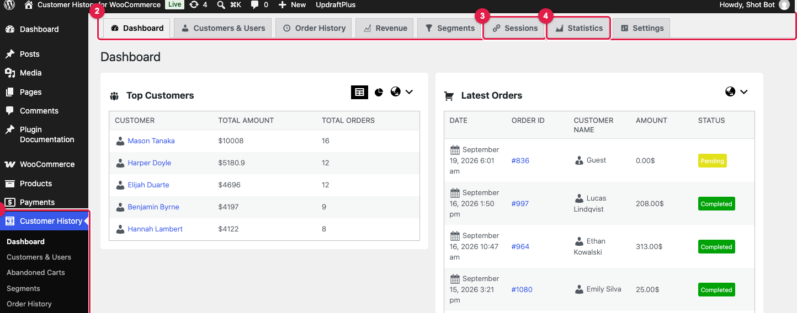

① admin menu ② top tab bar ③ Sessions tab (Pro) ④ Statistics tab (Pro)

### 3.1 Menu items and URL slugs

| Menu label | Tier | Slug (`admin.php?page=`) | Documented in |
|---|---|---|---|
| Dashboard | FREE | `pd-woo-dashboard` | A1 |
| Customers & Users | FREE | `pd-woo-customers` | A2 |
| Abandoned Carts | PRO | `pd-woo-abandoned-carts` | A11 |
| Segments | FREE | `pd-woo-segments` | A7 |
| Order History | FREE | `pd-woo-order-history` | A5 |
| Revenue | FREE | `pd-woo-revenue` | A6 |
| Search Analytics | FREE only (hidden when Pro is active) | `pd-woo-search-analytics` | A8 |
| Cohorts | PRO | `pd-woo-cohorts` | A14 → STAT-08 |
| Churn Prediction | PRO | `pd-woo-churn-prediction` | A12 |
| Sessions | PRO | `pd-woo-sessions` | A9 |
| Statistics | PRO | `pd-woo-stats` | A10 |
| Manual Tags | PRO | `pd-woo-manual-tags` | A13 |
| Settings | FREE | `pd-woo-settings` | A15 |
| Contact Us / Upgrade ➤ | Freemius | `pd-woo-dashboard-contact`, `pd-woo-dashboard-pricing` | A17 |

Pro items are inserted at two seams, one before Segments and one before Settings; the screenshot
above shows the resulting order.

### 3.2 Hidden pages (no menu entry, reached by link)

| Page title | Tier | Slug | Reached from |
|---|---|---|---|
| Customer Details | FREE | `pd-woo-customer&user_id=N` | Customers list "View", Top Customers widget, any linked customer name |
| Send Email to Customer | FREE | `pd-woo-customer-email&user_id=N` | Customers list "Email" button; Churn card "Email this customer" |
| Cart Detail | PRO | `pd-woo-abandoned-carts&cart_id=N` | Abandoned Carts "View Detail" |
| Live Searches / Trash | PRO | `pd-woo-searches`, `pd-woo-trash` | Sessions sub-navigation |
| Statistics reports | PRO | `pd-woo-search-stats`, `pd-woo-zero-result-searches`, `pd-woo-product-view-stats`, `pd-woo-top-selling-stats`, `pd-woo-product-revenue`, `pd-woo-conversion-funnel-stats`, `pd-woo-product-correlations`, `pd-woo-geographic`, `pd-woo-{taxonomy}-stats&pd_taxonomy=…`, `pd-woo-revenue-patterns`, `pd-woo-stats-spent` | Statistics sub-navigation |

### 3.3 Top tab bar

Rendered on every plugin page except the two hidden customer pages. Free: Dashboard · Customers &
Users · Order History · Revenue · Segments · **Search Analytics** · Settings. Pro: the Search
Analytics tab is removed and **Sessions** and **Statistics** are added before Settings.

### 3.4 Sub-navigation

- **Statistics**: Site Pages · Keywords · Zero-Result Searches · Viewed vs Purchased Ratio · Top Selling
  Products by This Month · Product Revenue · Conversion Funnel · Cohort Retention · Frequently Bought
  Together · Geographic Performance · one "{Taxonomy} View" tab per eligible product taxonomy (Brand
  View, Category View on the demo store) · Revenue Patterns · Total Spent.
- **Sessions**: Live Sessions · Live Searches · Trash (count).
- **Churn Prediction**: At-Risk Customers · Alerts (badge with the active count) · Analytics · Settings.

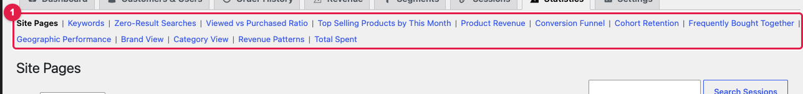

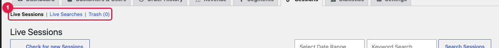

---

# Part A · Screen by screen

Sections follow the menu order a user meets on Pro. Every page section opens with a summary table
(menu, URL, tier, full-page screenshot) and then lists one entry per widget, card, table, filter or
setting field, top to bottom. Pro-only pages are marked PRO in the section title; on Free those menu
items do not exist. A18 describes what a Free user sees instead.

| Section | Page | Tier | Entry IDs |
|---|---|---|---|
| A1 | Dashboard | FREE + PRO | DASH-01 … DASH-21, DASH-B |
| A2 | Customers & Users | FREE + PRO | CUST-01 … CUST-05 |
| A3 | Customer Details (profile) | FREE + PRO | PROF-01 … PROF-11, PROF-L |
| A4 | Send Email to Customer | FREE | MAIL-01 |
| A5 | Order History | FREE + PRO | ORD-01 |
| A6 | Revenue | FREE | REV-01 … REV-03 |
| A7 | Segments | FREE + PRO | SEG-01 … SEG-04 |
| A8 | Search Analytics | FREE only | SA-01 … SA-06 |
| A9 | Sessions | PRO | SESS-01 … SESS-03 |
| A10 | Statistics | PRO | STAT-01 … STAT-13 |
| A11 | Abandoned Carts | PRO | CART-01, CART-02, CART-L |
| A12 | Churn Prediction | PRO | CHURN-01 … CHURN-04 |
| A13 | Manual Tags | PRO | TAGS-01 |
| A14 | Cohorts (menu item) | PRO | → STAT-08 |
| A15 | Settings | FREE + PRO | SET-01 … SET-05 |
| A16 | WooCommerce order screen | PRO | WC-01 |
| A17 | WordPress system surfaces | FREE + PRO | SYS-01 … SYS-04 |
| A18 | The Free-tier experience | FREE | FREE-A … FREE-D |

---
## A1 · Dashboard

| | |
|---|---|
| **Menu** | Customer History → Dashboard (first tab of the top tab bar) |
| **URL** | `admin.php?page=pd-woo-dashboard` |
| **Tier** | FREE page. Free renders **six** widgets plus at most one upsell banner. Pro adds the taxonomy widgets (DASH-05, DASH-08) and twelve full-width widgets below the grid. |
| **Full-page shot** | 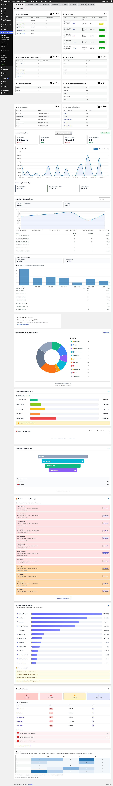 (Pro) · 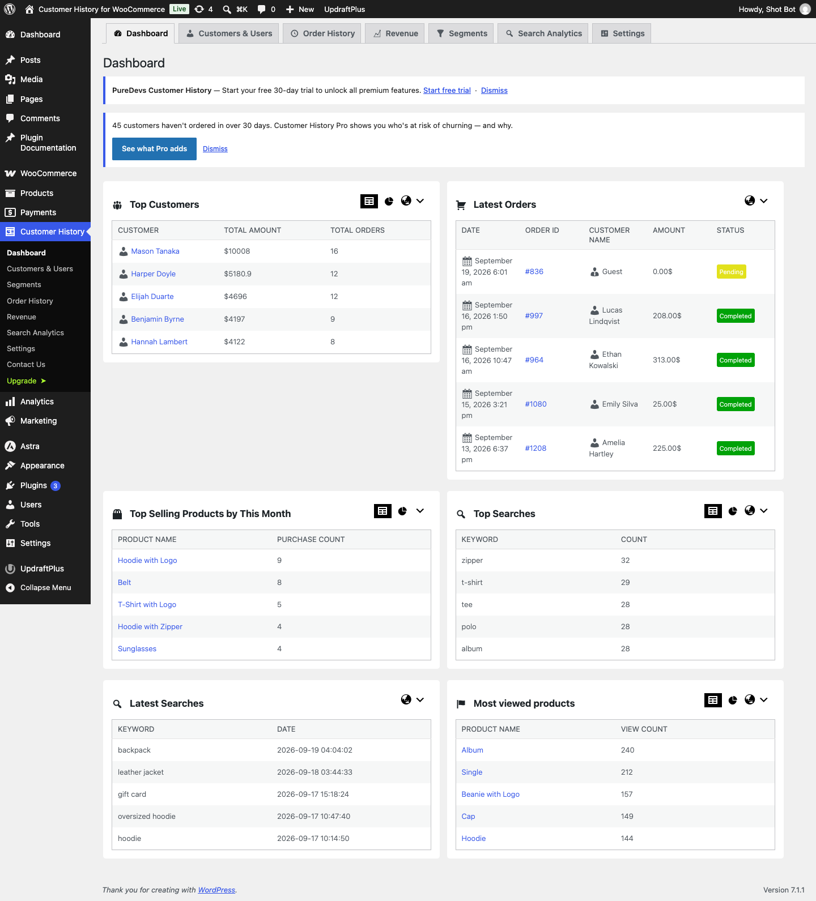 (Free) |
| **Entries** | DASH-01 … DASH-08, DASH-10 … DASH-21, DASH-B |

The page title is "Dashboard". The free widgets sit in a two-column grid (each panel 48 % wide, stacking to one column under 768 px) in a fixed order: Top Customers, Latest Orders, Top Selling Products by This Month, Top Searches, the taxonomy widgets, Latest Searches, Most viewed products. Pro widgets are appended below through the `pdwchs_dashboard_widgets` hook and are full width, in this order: Revenue Analytics, Retention, Lifetime value distribution, Abandoned Carts, Customer Segments (RFM Analysis), Customer Health Distribution, Declining Health Alert, Customer Lifecycle Funnel, At Risk Customers, Behavioral Segments, Churn Risk Overview, RFM matrix. Free widgets are live queries (cached for 30 minutes, limited to the most recent 90 days on Free). Pro intelligence widgets read scores that are recalculated nightly (Part B5). Charts use Chart.js 4.4.1 served from the plugin folder.

**Shared widget header (free widgets).** Every free widget has the same header: an icon and heading on the left, and on the right a control cluster with a **table-view icon** (title "Table View"), a **chart-view icon** (title "Chart View"), a **"View All"** link and a **collapse caret** (title "Click to Expend", a typo in the source). Table is the default view. The chart view is always a doughnut chart, 280 px tall, legend at the bottom, fixed ten-color palette. Latest Orders and Latest Searches have no chart toggle.

**Readme discrepancy.** `readme.txt` and the old 3.0.0 brief count seven free widgets including "top categories". The taxonomy widget renders nothing on Free (see DASH-05), so a Free dashboard shows six.

---

### DASH-01 · "Top Customers" — FREE

| | |
|---|---|
| **Where** | Dashboard, first widget (top-left) |
| **Screenshot** | 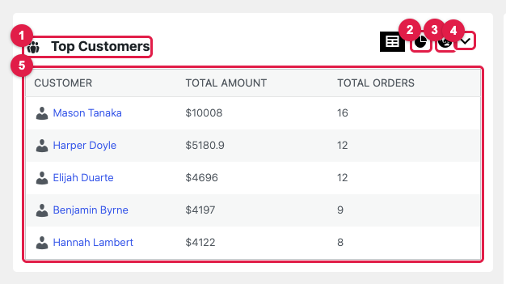 · ① heading ② table / chart toggle ③ View All ④ collapse / expand ⑤ data table. Chart view: 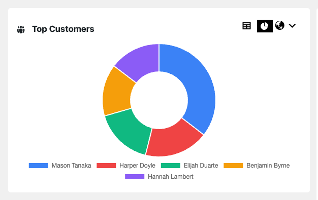 |

**What it shows.** The five highest-spending users. Columns: `Customer` (links to the customer profile, opens in a new tab), `Total Amount`, `Total Orders`.

**How it's computed.** All users with the administrator, customer or subscriber role, sorted by WooCommerce total spent, top 5. Respects the "Hide users with no orders" setting (SET-01). Lifetime figures, not limited by the 90-day window.

**Interactions.** ② switches between the table and a doughnut of spend share. ③ opens Customers & Users (A2). ④ collapses the panel.

**Empty state.** None. With no data the table shows only its header row.

**Demo prerequisites.** At least five registered customers with completed orders and clearly different totals.

**Accuracy notes.** Guests are not included; the ranking covers registered users only.

**Source.** `admin/partials/templates/dashboard/top-customers.php:5-128`

### DASH-02 · "Latest Orders" — FREE

| | |
|---|---|
| **Where** | Dashboard, top-right |
| **Screenshot** | 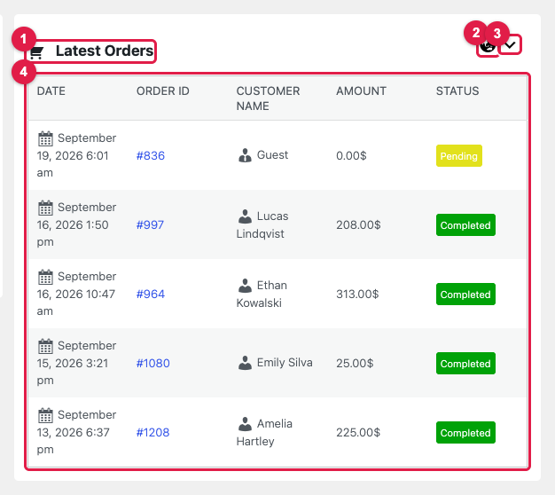 · ① heading ② View All ③ collapse / expand ④ data table |

**What it shows.** The five most recent orders in any status. Columns: `Date`, `Order ID` (links to the WooCommerce order editor), `Customer Name` (guests shown as "Guest"), `Amount`, `Status` (colored pill).

**How it's computed.** `wc_get_orders()`, newest first, limit 5. No status filter, so pending, cancelled and failed orders appear too.

**Interactions.** ② opens Order History (A5). ③ collapses. There is no chart view.

**Empty state.** None (header row only).

**Demo prerequisites.** A few recent orders in mixed statuses, including one guest order, so the status pills and the "Guest" label are visible.

**Accuracy notes.** The plugin has no order screen of its own; every order link goes to WooCommerce's editor.

**Source.** `admin/partials/templates/dashboard/last-orders.php:5-81`

### DASH-03 · "Top Selling Products by This Month" — FREE

| | |
|---|---|
| **Where** | Dashboard, second row, left |
| **Screenshot** | 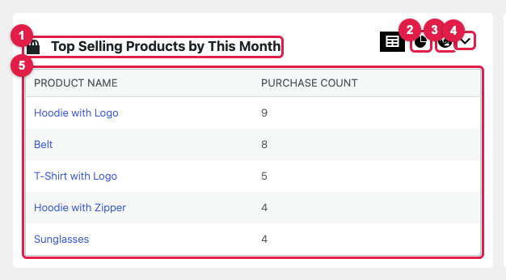 · ① heading ② table / chart toggle ③ View All (Pro only) ④ collapse / expand ⑤ data table. Chart view: 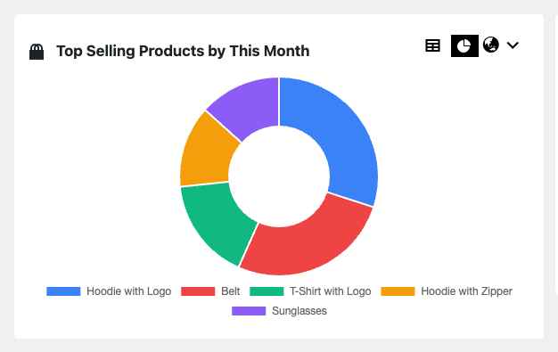 |

**What it shows.** Top five products for the current calendar month. Columns: `Product Name` (links to the product page), `Purchase Count`.

**How it's computed.** Orders created this calendar month in on-hold, processing or completed status, counted by line item, top 5.

**Interactions.** ② doughnut of purchase share. ③ "View All" is rendered only when Pro is active and opens the Statistics report of the same name (STAT-05). ④ collapses.

**Empty state.** None (header row only). Early in a month the widget can be nearly empty.

**Demo prerequisites.** Orders dated in the current month across at least five products. Film later in the month.

**Accuracy notes.** ⛔ The window is fixed to "this month"; there is no date picker. It counts on-hold orders, whereas the revenue cards count completed and processing only, so do not present the two as the same figure.

**Source.** `admin/partials/templates/dashboard/top-selling-products.php:5-21`; query `includes/class-pd-customer-history.php:1064-1092`

### DASH-04 · "Top Searches" — FREE

| | |
|---|---|
| **Where** | Dashboard, second row, right |
| **Screenshot** | 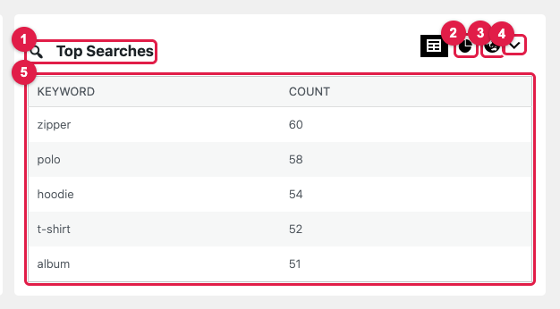 · ① heading ② table / chart toggle ③ View All ④ collapse / expand ⑤ data table. Chart view: 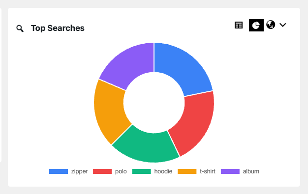 |

**What it shows.** The five most-searched storefront keywords. Columns: `Keyword`, `Count`.

**How it's computed.** `PDWCHS_Search_Stats_Data::get_keyword_counts()` with limit 5, reading `ACTION::search::{term}` rows from the tracking table. Most recent 90 days on Free, full history on Pro.

**Interactions.** ② doughnut. ③ opens Search Analytics on Free (A8) or Live Searches on Pro (SESS-02). ④ collapses.

**Empty state.** None (header row only).

**Demo prerequisites.** Storefront searches made while logged out or as a customer. Admin activity is not tracked by default (Part B1).

**Accuracy notes.** Counts are raw searches, not unique visitors.

**Source.** `admin/partials/templates/dashboard/top-searches.php:5-76`

### DASH-05 · "Most viewed Product categories" — PRO

| | |
|---|---|
| **Where** | Dashboard, third row. One widget per eligible product taxonomy; the heading pattern is "Most viewed {Taxonomy plural}". |
| **Screenshot** | 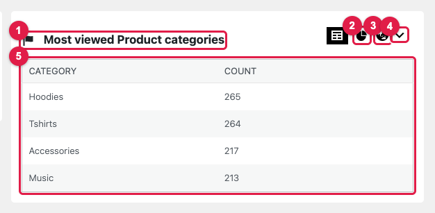 · ① heading ② table / chart toggle ③ View All ④ collapse / expand ⑤ data table. Chart view: 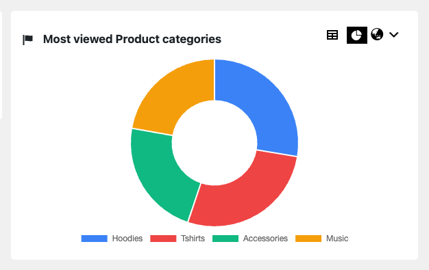 |

**What it shows.** The most viewed terms of a product taxonomy. Columns: `{Taxonomy singular}` (here "Category"), `Count`.

**How it's computed.** Page views of taxonomy archive URLs (for example `product-category/hoodies`) counted per term. The taxonomy list comes from `PDWCHS_Pro_Helpers::pdwchs_get_product_taxonomies()`: public product taxonomies with an admin UI, excluding product type, visibility, tags, shipping classes and all `pa_*` attributes.

**Interactions.** ② doughnut. ③ opens the matching "{Singular} View" Statistics tab (STAT-11). ④ collapses.

**Empty state.** None (header row only).

**Demo prerequisites.** Category archive visits by non-admin visitors.

**Accuracy notes.** ⛔ **Renders nothing on Free.** The template lives in the free build, but the taxonomy list falls back to an empty array when the Pro helper class is absent, so no taxonomy widget appears (confirmed on FREE-01). Category views are still recorded on Free; they are just not reported. Do not list category analytics as a Free feature.

**Source.** `admin/partials/templates/dashboard/top-taxonomy.php:4-58`; taxonomy list `pro/Helpers/Pro-Helpers.php:75-93`

### DASH-06 · "Latest Searches" — FREE

| | |
|---|---|
| **Where** | Dashboard, left of the last free row |
| **Screenshot** | 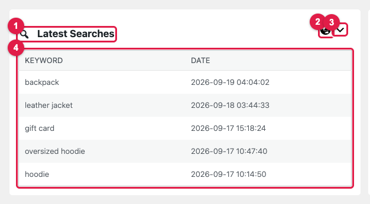 · ① heading ② View All ③ collapse / expand ④ data table |

**What it shows.** The five most recent storefront searches. Columns: `Keyword`, `Date`.

**How it's computed.** `get_last_searches( 5 )` on the tracking table, newest first. 90-day window on Free.

**Interactions.** ② opens Search Analytics (Free) or Live Searches (Pro). ③ collapses. No chart view.

**Empty state.** None (header row only).

**Demo prerequisites.** Recent searches, ideally including one term the catalog does not carry.

**Accuracy notes.** Shows the term and time only, not who searched. Per-customer search history is part of the Pro Activity Timeline (PROF-02).

**Source.** `admin/partials/templates/dashboard/last-searches.php:5-44`

### DASH-07 · "Most viewed products" — FREE

| | |
|---|---|
| **Where** | Dashboard, right of the last free row |
| **Screenshot** | 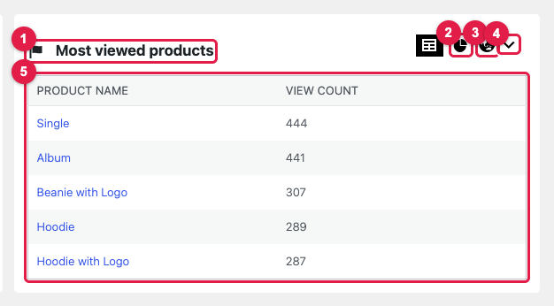 · ① heading ② table / chart toggle ③ View All ④ collapse / expand ⑤ data table. Chart view: 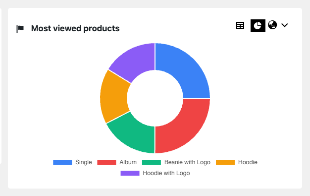 |

**What it shows.** Top five products by page views. Columns: `Product Name` (links to the product page), `View count`.

**How it's computed.** Tracked URLs that start with `product/`, resolved from slug to product, counted, top 5. 90-day window on Free.

**Interactions.** ② doughnut. ③ opens Search Analytics on Free, or the Statistics product-view report on Pro (STAT-04). ④ collapses.

**Empty state.** None (header row only).

**Demo prerequisites.** Product page visits by non-admin visitors spread over several products.

**Accuracy notes.** Views are page loads, not unique visitors. Bots are only filtered on Pro.

**Source.** `admin/partials/templates/dashboard/most-viewed-products.php:21-101`

### DASH-08 · "Most viewed Brands" — PRO

| | |
|---|---|
| **Where** | Dashboard, third row, next to DASH-05. Appears only when the store uses WooCommerce brands (`product_brand`). |
| **Screenshot** | 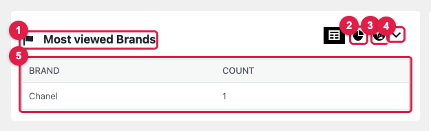 · ① heading ② table / chart toggle ③ View All ④ collapse / expand ⑤ data table. Chart view: 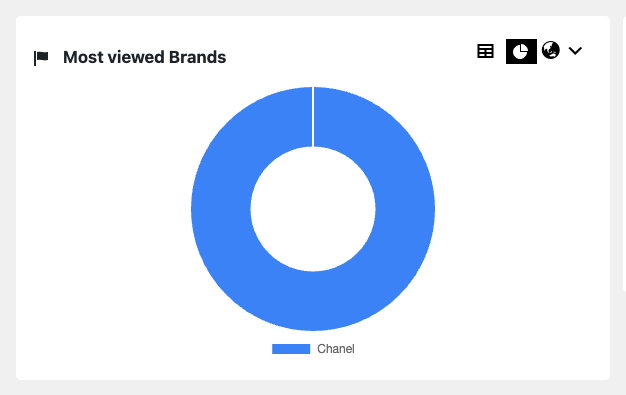 |

**What it shows.** The same widget as DASH-05 for the brand taxonomy. Columns: `Brand`, `Count`.

**How it's computed.** See DASH-05. One widget is produced per eligible taxonomy, so a store with custom product taxonomies gets more of them.

**Interactions.** ③ opens "Brand View" under Statistics (STAT-11).

**Empty state.** None (header row only).

**Demo prerequisites.** Brands assigned to products and visits to brand archive pages. On the demo store this widget has few rows because brand archives received little traffic.

**Accuracy notes.** ⛔ The set of taxonomy widgets varies per store. Do not promise a fixed list.

**Source.** `admin/partials/templates/dashboard/top-taxonomy.php:4-58`

---

### DASH-10 · "Revenue Analytics" — PRO

| | |
|---|---|
| **Where** | First Pro widget, full width, below the free grid |
| **Screenshot** | 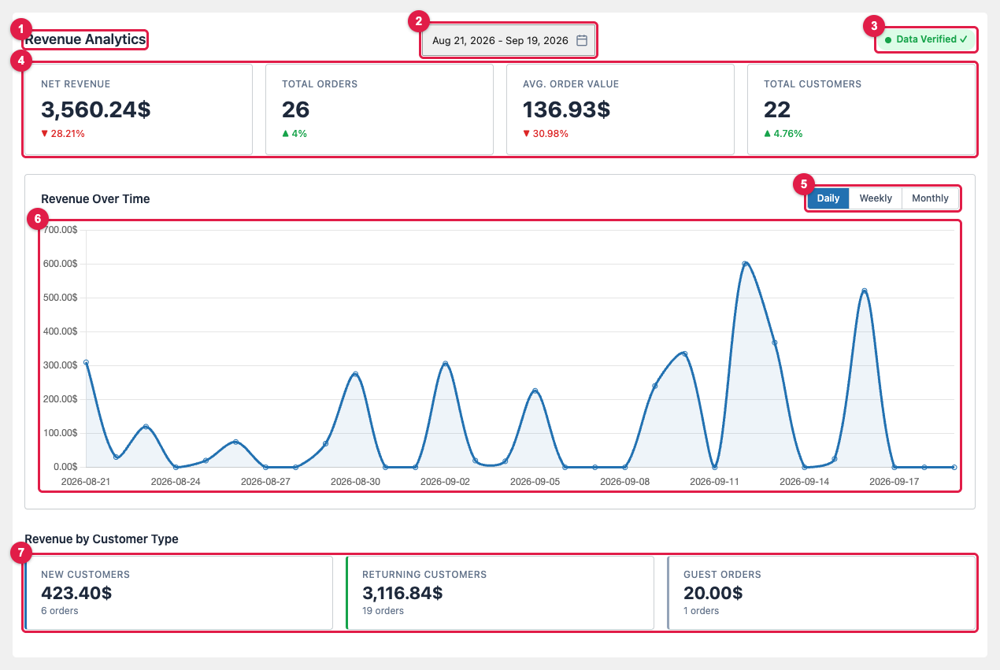 · ① heading ② date-range picker ③ data-integrity badge ④ four KPI cards ⑤ Daily / Weekly / Monthly ⑥ Revenue Over Time chart ⑦ Revenue by Customer Type |

**What it shows.** Four KPI cards, each with a change versus the previous period: `Net Revenue`, `Total Orders`, `Avg. Order Value`, `Total Customers`. A line chart headed "Revenue Over Time". A section headed "Revenue by Customer Type" with three cards: `New Customers`, `Returning Customers`, `Guest Orders`, each with an amount and an order count.

**How it's computed.** Completed and processing orders only. Three AJAX calls (`pdwchs_get_revenue_overview`, `pdwchs_get_revenue_over_time`, `pdwchs_get_new_vs_returning_revenue`), each cached for 30 minutes per date range. No 90-day limit on Pro.

**Interactions.** ② presets: Today, Last 7 Days, Last 30 Days (default), This Month, Last Month. ⑤ regroups the chart by day, week or month. ③ see DASH-10b.

**Empty state.** Loading "Loading revenue data...", failure "Failed to load revenue data. Please try again."

**Demo prerequisites.** Completed orders on most days of the selected range, from new, returning and guest buyers, so all three split cards are non-zero.

**Accuracy notes.** Pending, on-hold, cancelled, refunded and failed orders are excluded from revenue. This is the Pro revenue view; there is no separate "Revenue Analytics" page. The free Revenue page is A6.

**Source.** `pro/Analytics/templates/revenue-dashboard-widget.php:24-163`; `pro/Analytics/Revenue/Revenue-Pro.php:35-39`; presets `pro/admin/js/pdwchs-revenue-dashboard.js:27-48`

### DASH-10b · Revenue data-integrity indicator — PRO

| | |
|---|---|
| **Where** | Badge in the Revenue Analytics header (callout ③ on DASH-10) |
| **Screenshot** | None. The "View Details" button and its panel are only rendered when the badge reads "Data Mismatch ⚠️". The demo store verifies clean and shows "Data Verified ✓". |

**What it shows.** A badge (tooltip "Revenue data integrity check") with three states: "Verifying data…", "Data Verified ✓", "Data Mismatch ⚠️". On a mismatch a "View Details" / "Hide Details" button opens a panel with three tables: **Orders in unusual statuses** (Order, Status, Total, Date), **Partially refunded orders** (Order, Total, Refunded, Date), **Currency mismatch** (Order, Currency, Total, Date).

**How it's computed.** Compares two revenue calculations for the selected range. A difference above **1.0 %** is a mismatch; above **5.0 %** is high severity. Unusual statuses are pending, on-hold, cancelled, refunded and failed. Comparison cached 5 minutes, details 30 minutes.

**Interactions.** The details button exists only in the mismatch state.

**Empty state.** Inside the panel: "No flagged orders for this range."

**Demo prerequisites.** To film the panel the two figures must differ by more than 1 %, which a healthy store does not produce. Plan to show the verified badge instead.

**Accuracy notes.** ⛔ It is a diagnostic on the plugin's own revenue figures. Do not describe it as an accounting audit or a reconciliation with a payment gateway.

**Source.** `pro/Analytics/templates/data-integrity-indicator.php:9-70`; thresholds `pro/Analytics/Revenue/Data-Integrity.php:26-38`; button `pro/admin/js/pdwchs-revenue-dashboard.js:525-538`

### DASH-11 · "Retention · 30-day window" — PRO

| | |
|---|---|
| **Where** | Second Pro widget |
| **Screenshot** | 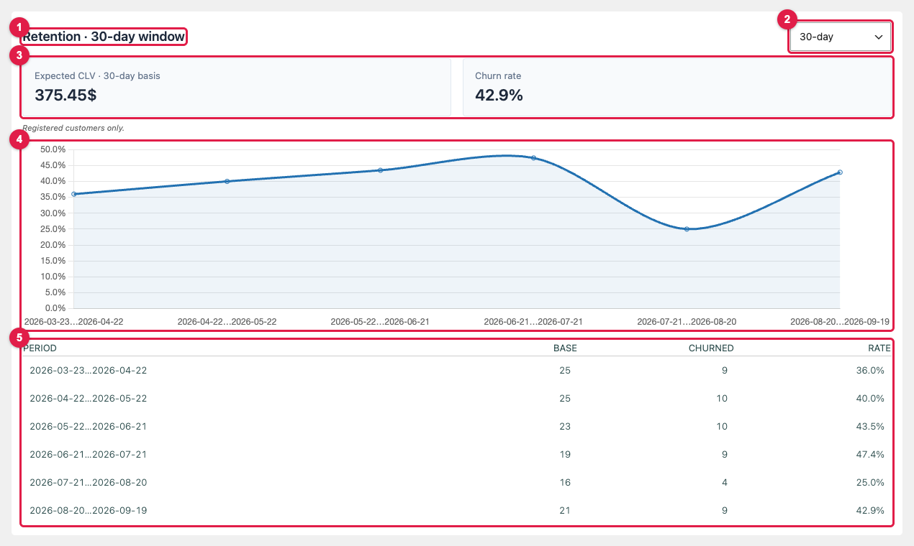 · ① heading shows the selected window ② window preset ③ Expected CLV and churn-rate cards ④ churn rate per period ⑤ Period / Base / Churned / Rate table |

**What it shows.** Heading "Retention · %s window" (default "30-day"). Two cards: "Expected CLV · {window} basis" and "Churn rate"; an undefined value renders as a dash with a hover explanation. The note "Registered customers only." A chart of churn rate per period and a table `Period` · `Base` · `Churned` · `Rate`.

**How it's computed.** For each period of the chosen length, Base is the registered customers with a completed or processing order before the period and Churned is those with no qualifying order inside it. Expected CLV = average monthly value × (1 ÷ churn rate). AJAX `pdwchs_get_retention_metrics`.

**Interactions.** ② options: 15-day, 30-day, 60-day, 90-day, 4-month, 6-month, 12-month, 24-month. The preset is a display option, not a stored setting.

**Empty state.** "No completed or processing orders from registered customers yet, so there is nothing to measure retention against."

**Demo prerequisites.** Registered customers with orders spanning at least 6 to 12 months.

**Accuracy notes.** ⛔ Store-level churn rate and an expected value, not a forecast curve and not a per-customer prediction. Guests are excluded.

**Source.** `pro/Analytics/templates/retention-metrics.php:37-160`; `pro/Analytics/Revenue/Retention-Panel.php:57-95`; `pro/Analytics/Revenue/Retention-Metrics.php:39-83`

### DASH-12 · "Lifetime value distribution" — PRO

| | |
|---|---|
| **Where** | Third Pro widget |
| **Screenshot** | 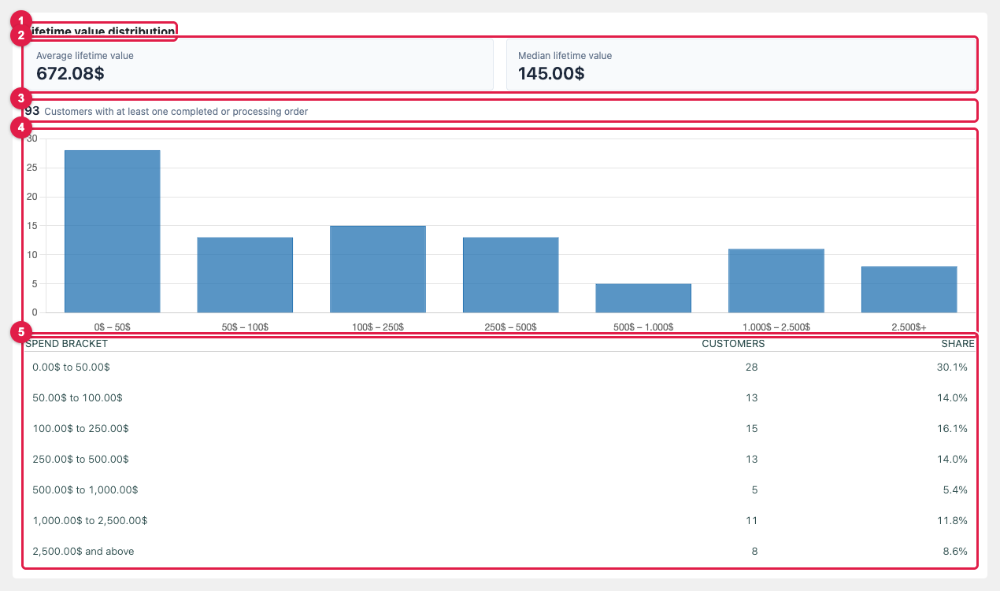 · ① heading ② average and median LTV ③ customers counted ④ histogram by spend bracket ⑤ Bracket / Customers / Share table |

**What it shows.** Cards "Average lifetime value" and "Median lifetime value", a total line "Customers with at least one completed or processing order", a histogram, and a table `Spend bracket` · `Customers` · `Share`.

**How it's computed.** Lifetime spend per customer over completed and processing orders, bucketed into brackets based on 0, 50, 100, 250, 500, 1000, 2500 and scaled by powers of ten to fit the store. Bracket labels read "X to Y" and "X and above".

**Interactions.** None. The table repeats the chart for accessibility.

**Empty state.** "No completed or processing orders yet, so there is no lifetime value to distribute."

**Demo prerequisites.** Customers spread across low, mid and high lifetime spend so several brackets have bars.

**Accuracy notes.** ⛔ A distribution of past spend. No projection or predicted LTV.

**Source.** `pro/Analytics/templates/ltv-distribution.php:29-114`; `pro/Analytics/Revenue/LTV-Panel.php:52, 207-226`; `pro/Analytics/Revenue/LTV-Distribution.php:55`

### DASH-13 · "Abandoned Carts (Last 7 Days)" — PRO

| | |
|---|---|
| **Where** | Fourth Pro widget (half width) |
| **Screenshot** | 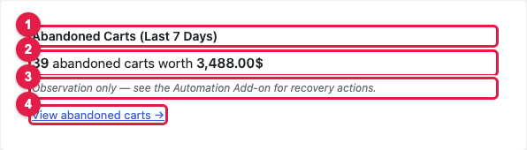 · ① heading ② count and value at risk ③ observation-only note ④ link to the Abandoned Carts page |

**What it shows.** One headline: "{count} abandoned carts worth {value}", the note "Observation only — see the Automation Add-on for recovery actions.", and the link "View abandoned carts →".

**How it's computed.** `PDWCHS_Cart_Widget::pdwchs_get_summary_stats( 7 )`: carts marked abandoned in the last 7 days and their summed totals.

**Interactions.** ④ opens Abandoned Carts filtered to status Abandoned, last 7 days (CART-01).

**Empty state.** The widget is not rendered at all when "Cart tracking" is off (SET-03).

**Demo prerequisites.** Cart tracking on, and several carts left idle past the timeout (default 60 minutes) within the last week.

**Accuracy notes.** ⛔ Observation only. No recovery emails, no coupons. The "Automation Add-on" named in the note is a separate product and not part of this plugin.

**Source.** `pro/Carts/templates/cart-dashboard-widget.php:4-26`; `pro/Carts/Cart-Widget.php:29, 47-84`

### DASH-14 · "Customer Segments (RFM Analysis)" — PRO

| | |
|---|---|
| **Where** | Fifth Pro widget |
| **Screenshot** | 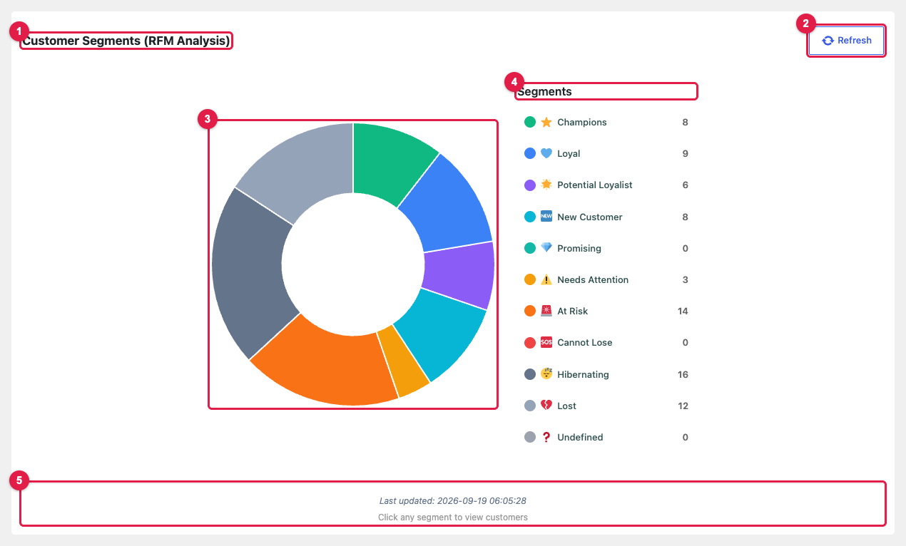 · ① heading ② Refresh ③ doughnut of segment share ④ clickable legend ⑤ last updated stamp |

**What it shows.** A doughnut of customers per RFM segment (tooltip: label, count, percentage), a legend headed "Segments" with color, icon, name and count for all eleven segments, and a footer "Last updated:" plus "Click any segment to view customers".

**How it's computed.** Segment counts from the nightly RFM job (2:00 AM). Definitions in Part B4.1.

**Interactions.** ② refetches. ④ clicking a legend row opens the customer list filtered to that segment.

**Empty state.** Loading "Loading segment data...", failure "Failed to load RFM data. Please try again."

**Demo prerequisites.** The RFM job must have run and customers must span recency and frequency profiles so most segments are non-zero.

**Accuracy notes.** ⚑ Content rule: RFM is on the never-pitch list (`docs/content/PureDevs_Proof_Marketing_Ad_Strategy_v1.md` §4.5). Scores are nightly, not real-time.

**Source.** `pro/Intelligence/templates/rfm-dashboard-widget.php:19-54`; `pro/admin/js/pd-customer-history-rfm.js:115-169`

### DASH-15 · "Customer Health Distribution" — PRO

| | |
|---|---|
| **Where** | Sixth Pro widget |
| **Screenshot** | 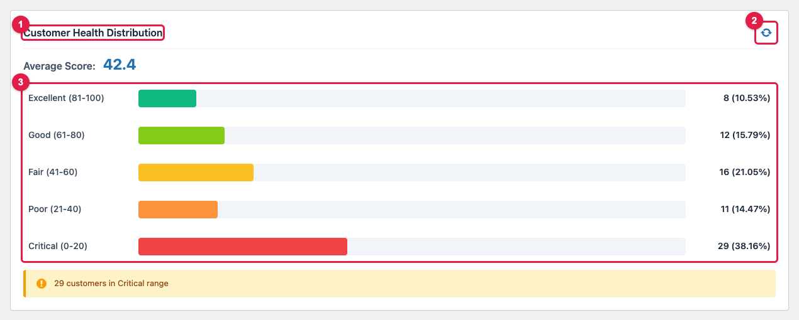 · ① heading ② Refresh ③ one bar per band |

**What it shows.** "Average Score:" and five horizontal bars with count and percentage: Excellent (81-100), Good (61-80), Fair (41-60), Poor (21-40), Critical (0-20). A warning strip "{n} customers in Critical range" when any exist.

**How it's computed.** Health scores from the nightly job (3:00 AM). Formula in Part B4.2.

**Interactions.** ② refetches.

**Empty state.** Loading "Loading health data..."

**Demo prerequisites.** The health job must have run and customers must range from very recent to long inactive.

**Accuracy notes.** ⚑ Content rule: health scores are on the never-pitch list (§4.5). Nightly.

**Source.** `pro/Intelligence/templates/health-dashboard-widget.php:23-51`; bands `pro/Intelligence/Health.php:522-526`; `pro/admin/js/pd-customer-history-health.js:60-72`

### DASH-16 · "Declining Health Alert" — PRO

| | |
|---|---|
| **Where** | Seventh Pro widget, directly under DASH-15 |
| **Screenshot** | 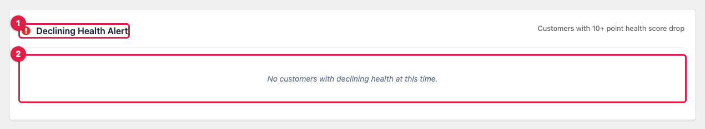 · ① heading ② customers with a 10+ point drop |

**What it shows.** Subtitle "Customers with 10+ point health score drop". A list with name, point drop, "Last order:" in days ago, and a "View Profile" link.

**How it's computed.** Customers whose health score fell by ten or more points between the previous and the latest nightly calculation.

**Interactions.** "View Profile" opens the customer profile (A3).

**Empty state.** "No customers with declining health at this time."

**Demo prerequisites.** Two health calculations at least a day apart with some customers going quiet in between. On a fresh site this list is empty.

**Accuracy notes.** ⚑ Content rule (§4.5). ⛔ It is a list for the admin. Nothing is sent to the customer.

**Source.** `pro/Intelligence/templates/health-dashboard-widget.php:54-73`; strings `pro/Intelligence/Intelligence.php:122-127`

### DASH-17 · "Customer Lifecycle Funnel" — PRO

| | |
|---|---|
| **Where** | Eighth Pro widget |
| **Screenshot** | 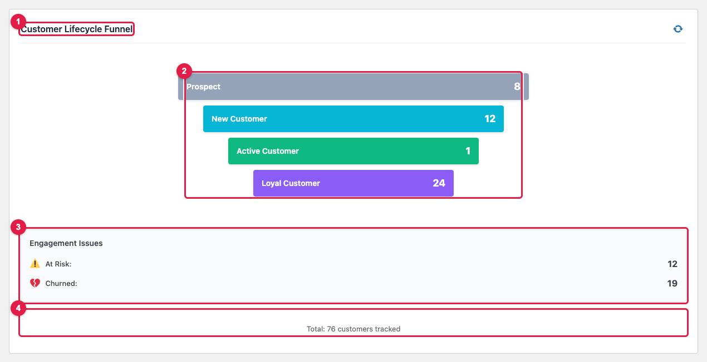 · ① heading ② funnel Prospect → New → Active → Loyal ③ At Risk and Churned counts ④ total customers tracked |

**What it shows.** Tapering bars for Prospect, New Customer, Active Customer, Loyal Customer with name and count. A side box "Engagement Issues" with "At Risk:" and "Churned:". Footer "Total: {n} customers tracked".

**How it's computed.** Lifecycle stages from the nightly job (4:00 AM). Rules in Part B4.3.

**Interactions.** Clicking a stage opens the customer list filtered to that lifecycle stage. The refresh icon refetches.

**Empty state.** Loading "Loading lifecycle funnel..."

**Demo prerequisites.** Registered users with zero, one, two and three or more orders inside 90 days, plus some inactive for 91+ and 181+ days.

**Accuracy notes.** This is a customer lifecycle funnel, not the conversion funnel (STAT-07).

**Source.** `pro/Intelligence/templates/lifecycle-funnel-widget.php:16-50`; `pro/admin/js/pd-customer-history-lifecycle.js:52, 208-209`

### DASH-18 · "At Risk Customers (30+ Days)" — PRO

| | |
|---|---|
| **Where** | Ninth Pro widget |
| **Screenshot** | 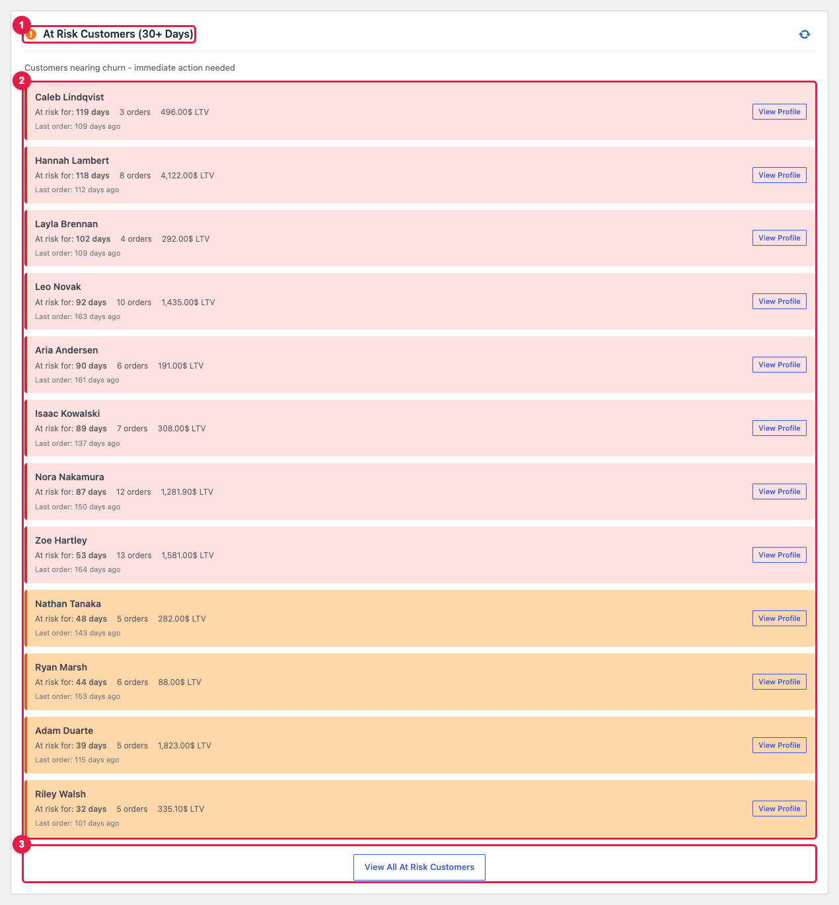 · ① heading ② customers in the At Risk stage for 30+ days ③ View All At Risk Customers |

**What it shows.** Subtitle "Customers nearing churn - immediate action needed", a list of customers, and a footer button "View All At Risk Customers".

**How it's computed.** Customers whose lifecycle stage is "At Risk" **and** whose days in that stage are 30 or more, longest first.

**Interactions.** ③ opens the customer list filtered to lifecycle stage At Risk.

**Empty state.** A "no results" block. Because it needs `lifecycle_days_in_stage >= 30`, the widget stays empty on a store whose lifecycle job first ran less than 30 days ago.

**Demo prerequisites.** Pro active for more than 30 days with customers who entered At Risk at least 30 days ago, or back-dated stage dates on a demo store.

**Accuracy notes.** ⛔ The subtitle says "immediate action needed", but the plugin takes no action. Do not imply automated follow-up.

**Source.** `pro/Intelligence/templates/at-risk-alert-widget.php:18-41`; query `pro/Intelligence/Lifecycle.php:487-492`

### DASH-19 · "Behavioral Segments" — PRO

| | |
|---|---|
| **Where** | Tenth Pro widget |
| **Screenshot** | 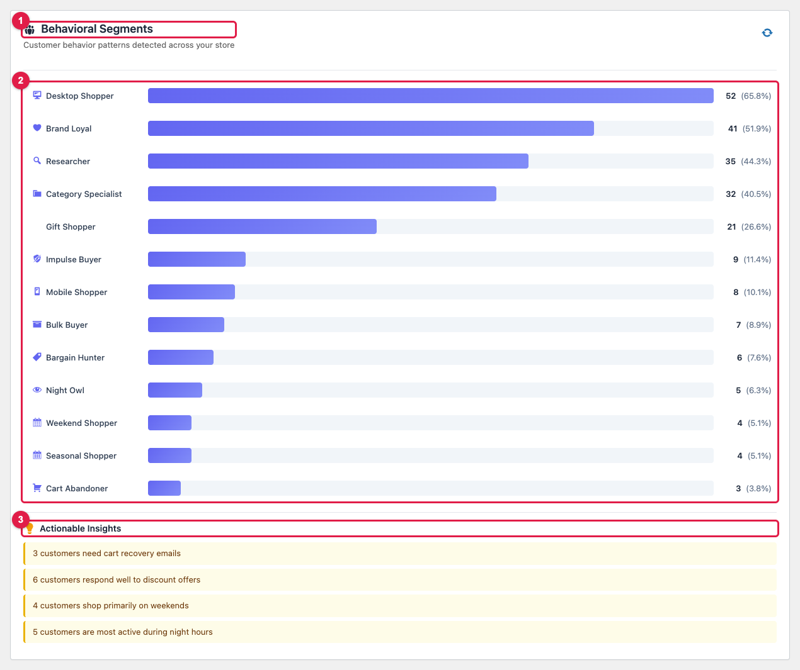 · ① heading ② customers per behavioral tag ③ insights list |

**What it shows.** Subtitle "Customer behavior patterns detected across your store", a bar distribution of customers per behavioral tag, and a list headed "Actionable Insights".

**How it's computed.** Active tags from the nightly behavioral job (5:00 AM) and from the re-analysis queued when an order completes. The 15 detection rules are in Part B4.4. AJAX `pdwchs_behavioral_segments_data`.

**Interactions.** The refresh icon refetches.

**Empty state.** Loading "Loading behavioral data..."

**Demo prerequisites.** Customers with enough orders and sessions to meet the minimum data for several tags (most need 3 to 5 orders).

**Accuracy notes.** ⚑ Content rule: behavioral tags are on the never-pitch list (§4.5). ⛔ The insights are text for the admin, not automated actions.

**Source.** `pro/Intelligence/templates/behavioral-dashboard-widget.php:28-50`; `pro/Intelligence/Intelligence.php:206`

### DASH-20 · "Churn Risk Overview" — PRO

| | |
|---|---|
| **Where** | Eleventh Pro widget |
| **Screenshot** | 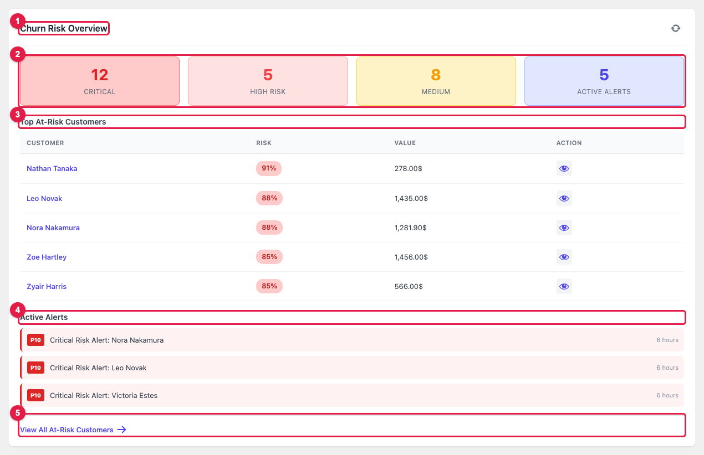 · ① heading ② Critical / High Risk / Medium / Active Alerts ③ top 5 by risk score ④ latest alerts with priority ⑤ link to the Churn Prediction page |

**What it shows.** Four stat boxes: `Critical`, `High Risk`, `Medium`, `Active Alerts`. A table "Top At-Risk Customers" with columns `Customer`, `Risk` (colored score badge), `Value`, `Action` (View Profile icon), top 5. A list "Active Alerts" with the top 3 as a priority badge, alert title and relative time. Footer link "View All At-Risk Customers".

**How it's computed.** Churn scores from the nightly job (2:00 AM) and alerts from the hourly alert job. Definitions in Part B4.5.

**Interactions.** ⑤ opens Churn Prediction (A12). The refresh icon refetches.

**Empty state.** "No high-risk customers detected. Your customers are healthy!"

**Demo prerequisites.** The churn job must have run, and some customers need two or more orders and long gaps since the last one.

**Accuracy notes.** ⚑ Content rule: churn scores are on the never-pitch list (§4.5). ⛔ Prediction and admin alerting only. The coupon and win-back email actions were removed in 3.0.2.

**Source.** `pro/Intelligence/templates/churn-dashboard-widget.php:48-138`

### DASH-21 · "RFM matrix" — PRO

| | |
|---|---|
| **Where** | Last Pro widget |
| **Screenshot** | 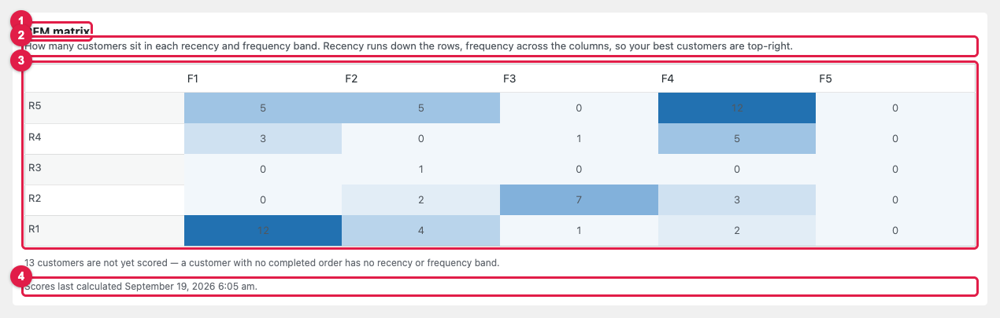 · ① heading ② how to read the grid ③ recency rows × frequency columns ④ scores last calculated |

**What it shows.** Intro text: "How many customers sit in each recency and frequency band. Recency runs down the rows, frequency across the columns, so your best customers are top-right." A 5 × 5 grid, rows R5 to R1 and columns F1 to F5, with a customer count in every cell (zeros included) and ten shading levels. Cell tooltip "{recency band} · {frequency band} — N customers". A footnote on unscored customers and a stamp "Scores last calculated %s."

**How it's computed.** Server-rendered from stored RFM scores, cached for 30 minutes. No JavaScript.

**Interactions.** Hover tooltips only.

**Empty state.** "RFM scores have not been calculated yet. Scores are recalculated nightly, and the matrix appears after the first run." or "No customers have been scored yet. The matrix fills in once customers start completing orders."

**Demo prerequisites.** Same as DASH-14. A spread of recency and frequency makes the shading readable.

**Accuracy notes.** ⚑ Content rule (§4.5). Shipped in 3.1.2.

**Source.** `pro/Intelligence/templates/rfm-matrix-widget.php:33-157`; `pro/Intelligence/RFM-Matrix-Widget.php:59`; `pro/Intelligence/RFM-Matrix-Data.php:41-44`

---

### DASH-B · Upsell banners and trial notice — FREE only

| | |
|---|---|
| **Where** | Under the page title on the Free dashboard. The banner code sits after the widgets in the template; WordPress moves admin notices up under the heading. |
| **Screenshot** | 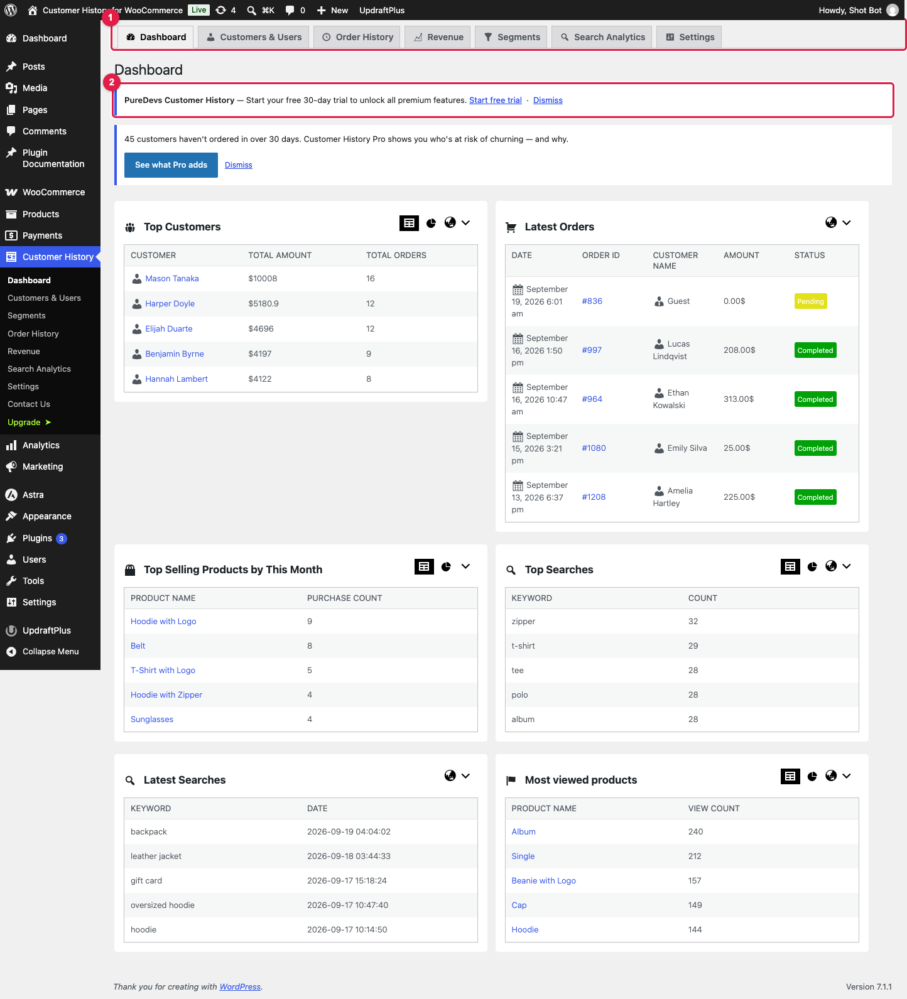 · ① Free tab bar (Search Analytics instead of Sessions and Statistics) ② Freemius trial notice. The `dashboard-attention` upsell banner is the box directly below ②. |

**What it shows.** Up to two blue info boxes. The **trial notice** comes from the Freemius gate: "PureDevs Customer History — Start your free 30-day trial to unlock all premium features." with "Start free trial" and "Dismiss" (after a used trial it reads "Your trial has ended — upgrade to keep premium features." with "Upgrade now"). The **upsell banner** is one of:
- `dashboard-attention`: "%s customers haven't ordered in over 30 days. Customer History Pro shows you who's at risk of churning — and why."
- `data-window-90d`: "The free version includes your most recent 90 days of activity. Customer History Pro includes your full history — your older data is already collected and waiting."

Each upsell banner has a "See what Pro adds" button and a "Dismiss" link.

**How it's computed.** `dashboard-attention` appears when the count of customers with no order in over 30 days is above zero. `data-window-90d` appears when a query on the page was clamped to the 90-day window.

**Interactions.** **One upsell banner per page load at most**, so when both conditions hold only the first is shown. Dismissal is permanent per user and per banner. The trial notice is dismissed per user and per plugin version. "See what Pro adds" opens the Freemius upgrade page in a new tab.

**Empty state.** No banner when neither condition holds or the user dismissed it.

**Demo prerequisites.** A Free install (no `pro/` folder or no licence), a user who has not dismissed the banners, and some customers inactive for over 30 days.

**Accuracy notes.** ⛔ The banners advertise Pro only. No Free feature is disabled by them, and nothing is migrated on upgrade.

**Source.** `admin/partials/templates/dashboard.php:26-45`; `includes/class-pdwchs-upsell.php:18, 132-174`; trial notice `pro/Trial-Gate.php:83-111`

---

## A2 · Customers & Users

| | |
|---|---|
| **Menu** | Customer History → Customers & Users (second tab of the top tab bar) |
| **URL** | `admin.php?page=pd-woo-customers` |
| **Tier** | FREE page showing the most recent 100 customers. Pro removes the cap and adds eight filters, six columns, keyword search, a rows-per-page selector and lifecycle filters. |
| **Full-page shot** | 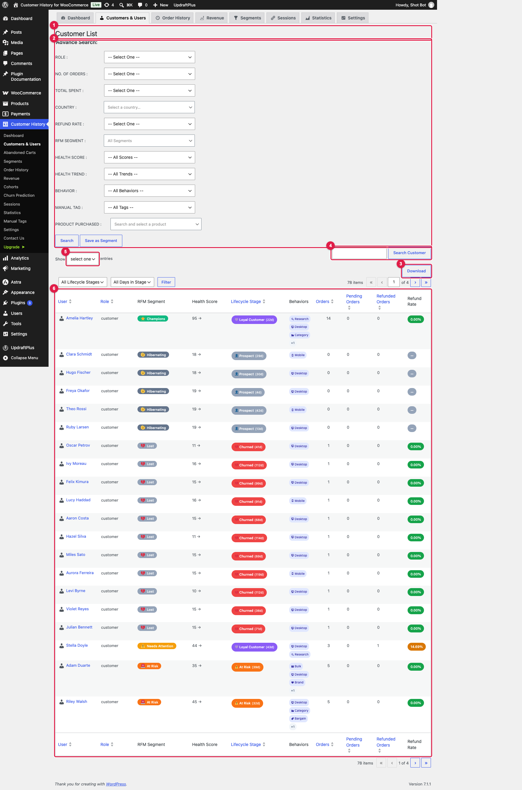 (Pro) · 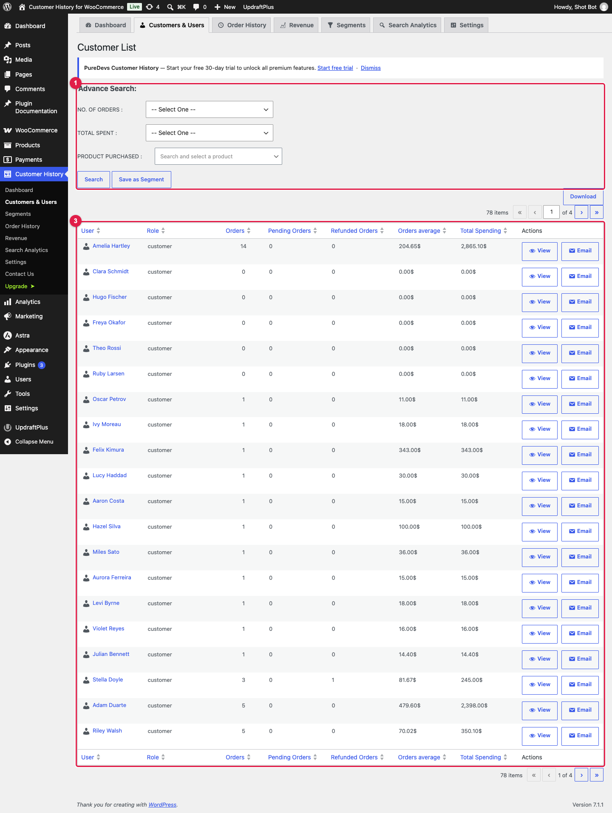 (Free) |
| **Entries** | CUST-01 … CUST-05 |

The page title is **"Customer List"**. Top to bottom: the advanced-search fieldset, the keyword search box and rows-per-page selector (Pro), the Download button, the Free scope banner when it applies, then a standard WordPress list table. Every name in the table links to that customer's profile (A3). The same filters that narrow this list are what a saved segment stores (A7), so this page is also where segments are created.

### CUST-01 · "Customer List" page overview — FREE + PRO

| | |
|---|---|
| **Where** | Customer History → Customers & Users |
| **Screenshot** |  · ① Page title ② Advanced search filters ③ Download CSV ④ Keyword search (Pro) ⑤ Rows per page (Pro) ⑥ Customer list. Free view:  · ① Free filters: orders, total spent, product purchased ② 100-customer scope banner (not visible in this capture, see below) ③ Free columns only |

**What it shows.** Every WordPress user in the administrator, customer and subscriber roles, one row each, with order counts and spend. On Free the list is cut to the **most recent 100 customers** after all filtering. When the store has more than 100, a banner reads: *"The free version includes up to 100 customers in this list — you have %s in total. Customer History Pro includes every customer."* with a **"See what Pro adds"** button and a **"Dismiss"** link.

**How it's computed.** Order counts and totals come from WooCommerce customer functions and order queries, HPOS-aware. The cap is the `pdwchs_customer_list_limit` filter (default 100); Pro returns 0, meaning unlimited. The setting "Hide users with no orders" (SET-01) removes registered users who never ordered.

**Interactions.** ③ **"Download"** streams `customers_order_history_{Y-m-d}.csv` with columns *User name, User role, Orders, Pending orders, Refund orders, Orders average, Total spent*. It exports the current filtered set, and on Free the capped set. ② ④ ⑤ ⑥ are covered in CUST-02, CUST-05 and CUST-04.

**Empty state.** The default WordPress list-table message, "No items found."

**Demo prerequisites.** At least 20 customers with varied order counts so sorting and filtering change the list visibly. To show the Free banner the store needs more than 100 customers; the demo store used for `FREE-03` has fewer, so that capture shows no banner.

**Accuracy notes.** ⛔ The 100-customer figure is a display limit on Free. All customers are still tracked and scored; say "Free shows the most recent 100", never "Free tracks 100 customers".

**Source.** `admin/partials/templates/customers.php:14, 172-193`; `includes/class-pd-customer-history-customers.php:261-281, 363-381`

### CUST-02 · "Advance Search:" filters — FREE + PRO

| | |
|---|---|
| **Where** | Customers & Users, fieldset directly under the page title |
| **Screenshot** | 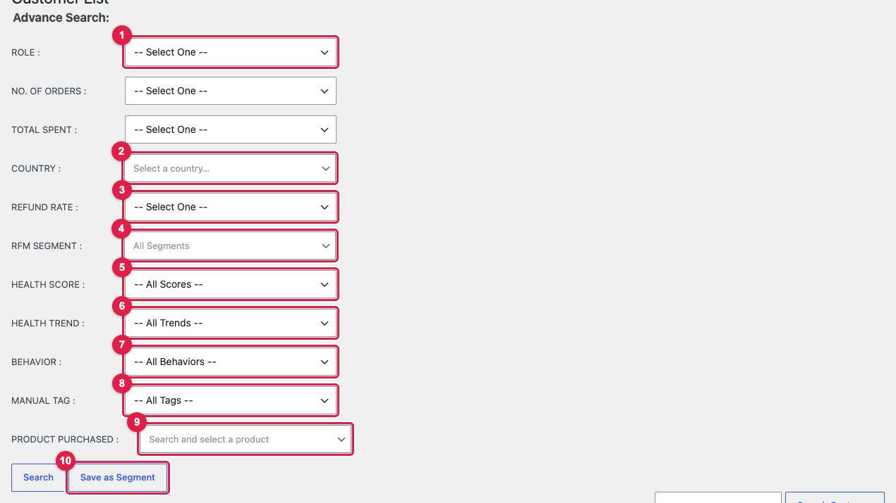 · ① Role (Pro) ② Country (Pro) ③ Refund Rate (Pro) ④ RFM Segment (Pro) ⑤ Health Score (Pro) ⑥ Health Trend (Pro) ⑦ Behavior (Pro) ⑧ Manual Tag (Pro) ⑨ Product Purchased ⑩ Save as Segment |

**What it shows.** A fieldset whose legend reads **"Advance Search:"** (the spelling is hard-coded in the template and is not translated on this page). Eleven labelled filters on Pro, three on Free:

| Filter label | Tier | Control |
|---|---|---|
| Role : | PRO | Admin / Subscriber / Customer |
| No. of orders : | FREE | `-- Select One --` / Equal / Greater then / Less then, plus a number input and an ✕ clear button |
| Total Spent : | FREE | Same three operators, number input, ✕ |
| Country : | PRO | Searchable list of 249 countries |
| Refund Rate : | PRO | Same three operators, numeric input 0–100 (step 0.01) |
| RFM Segment : | PRO | `-- All Segments --` plus the 11 segments, each with its icon |
| Health Score : | PRO | `-- All Scores --`, 💚 Excellent (81-100), 💛 Good (61-80), 🟡 Fair (41-60), 🟠 Poor (21-40), 🔴 Critical (0-20) |
| Health Trend : | PRO | `-- All Trends --`, ↗ Improving, → Stable, ↘ Declining |
| Behavior : | PRO | `-- All Behaviors --` plus the 15 behavioral tags |
| Manual Tag : | PRO | `-- All Tags --` plus every manual tag |
| Product Purchased : | FREE | Searchable product picker, placeholder `-- Search and select a product --`, options shown as `Name (ID: n)` |

Below them: **"Search"** and **"Save as Segment"** buttons. The operator labels "Greater then" and "Less then" are the strings the UI shows.

**How it's computed.** Filters are applied in PHP to the customer set, in the same pipeline a saved segment uses. Intelligence filters read the nightly scores (B5); Refund Rate and Manual Tag register themselves as segment criteria too.

**Interactions.** Pick any combination and press **Search**; the page reloads with the criteria in the URL. ⑩ opens the modal in CUST-03 and stores exactly the criteria currently in the URL. Lifecycle stage has its own filter above the table (CUST-05).

**Empty state.** None of its own; an over-narrow filter yields "No items found." in the table.

**Demo prerequisites.** Customers in at least four RFM segments and three health bands, several countries, a few manual tags assigned, and the nightly jobs run at least once. Without that the Pro dropdowns filter to nothing.

**Accuracy notes.** ⚑ Content rule: ④ ⑤ ⑥ ⑦ expose RFM segments, health scores and behavioral tags, which are on the never-pitch list in `docs/content/PureDevs_Proof_Marketing_Ad_Strategy_v1.md` §4.5. Show them when walking the filter set; do not build a piece around them without the owner's decision. The product picker loads every published product into the page, so very large catalogs make this page heavy.

**Source.** `admin/partials/templates/customers.php:17-114`; `pro/Intelligence/Intelligence.php:668-748`; `pro/Analytics/Revenue/Refund-Rate-Filter.php:114-148`; `pro/CRM/Tags-Filter.php:74-96`

### CUST-03 · "Save as Segment" modal — FREE + PRO

| | |
|---|---|
| **Where** | Customers & Users → apply at least one filter → **Save as Segment** |
| **Screenshot** | 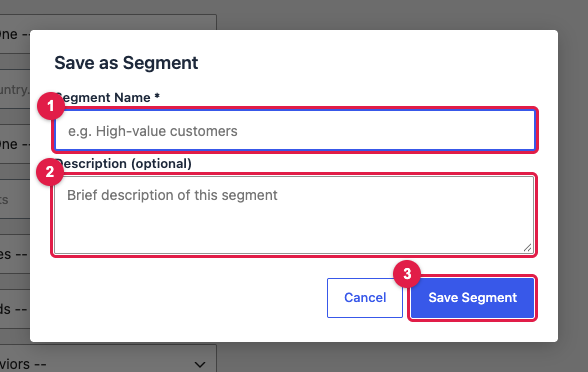 · ① Segment name ② Description (optional) ③ Save Segment (callout boxes are not drawn on this capture; the three controls are the two fields and the blue button) |

**What it shows.** A modal titled **"Save as Segment"** with **"Segment Name"** (required, up to 191 characters, placeholder *"e.g. High-value customers"*), **"Description (optional)"** (placeholder *"Brief description of this segment"*), and the buttons **"Cancel"** and **"Save Segment"**.

**How it's computed.** The script reads the current page URL and keeps only whitelisted criteria keys; the segment stores those criteria, not a list of customers, so membership is re-evaluated every time the segment is loaded, counted or exported (A7).

**Interactions.** With no filter in the URL the modal shows *"No filters applied. Cannot save empty segment."* On success: *"Segment saved successfully."* On a server error: *"An error occurred. Please try again."* On Free, saving a second custom segment replaces this modal with the upgrade modal documented in A18 (`FREE-06`).

**Empty state.** Not applicable.

**Demo prerequisites.** Run a filter first (for example No. of orders Greater then 2) so the save succeeds.

**Accuracy notes.** A segment is a saved filter, not a static list. Free allows one custom segment; Pro is unlimited (A7, B3).

**Source.** `admin/partials/templates/customers.php:118-149`; `admin/class-pd-customer-history-admin.php:177-190`; `admin/js/pdwchs-save-segment.js`

### CUST-04 · Customer list columns — FREE + PRO

| | |
|---|---|
| **Where** | Customers & Users, the list table |
| **Screenshot** | 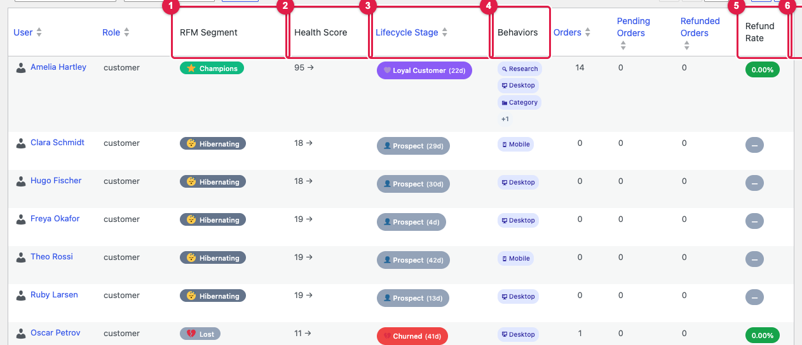 · ① RFM Segment ② Health Score ③ Lifecycle Stage ④ Behaviors ⑤ Refund Rate ⑥ Avg Order Gap ⑦ View / Email actions |

**What it shows.** Fourteen columns on Pro, eight on Free, in this order: **User** (icon + name linking to the profile), **Role**, *RFM Segment* (Pro, colored segment badge), *Health Score* (Pro), *Lifecycle Stage* (Pro), *Behaviors* (Pro, up to three mini-tags plus a `+N` overflow chip, or a grey `--`), **Orders**, **Pending Orders**, **Refunded Orders**, *Refund Rate* (Pro), *Avg Order Gap* (Pro), **Orders average**, **Total Spending**, **Actions**.

**How it's computed.** Free columns come from WooCommerce order data per user. The four intelligence columns read the nightly scores. **Refund Rate** = refunded amount as a share of what the customer was billed, across completed, processing and refunded orders, registered customers only; badge green below 10 %, amber from 10 %, red from 30 %, `—` with no qualifying orders. **Avg Order Gap** = mean days between orders from the nightly churn calculation; green below 30 days, amber from 30, red from 90, `—` until scored or with a single order. Both column headers carry a hover explanation.

**Interactions.** Sortable: User, Role, Orders, Pending Orders, Refunded Orders, Orders average, Total Spending, Lifecycle Stage. ⑦ holds two buttons: **"View"** opens the profile (A3) and **"Email"** opens the compose page (A4).

**Empty state.** "No items found."

**Demo prerequisites.** Some customers with partial refunds (so Refund Rate shows all three colors) and customers with 3+ orders (so Avg Order Gap is populated).

**Accuracy notes.** ⚑ Content rule on ① ② ④ (RFM, health score, behavioral tags; strategy §4.5). Refund Rate and Avg Order Gap are blank for guests. Scores are as of the last nightly run, not live.

**Source.** `includes/class-pd-customer-history-customers.php:45-91, 360, 626-640`; `pro/Intelligence/Intelligence.php:774-838`; `pro/Analytics/Revenue/Refund-Rate-Column.php:74-149`; `pro/Intelligence/Order-Gap-Column.php:63-147`

### CUST-05 · List controls: search, rows per page, lifecycle filters — PRO

| | |
|---|---|
| **Where** | Customers & Users, between the filter fieldset and the table |
| **Screenshot** | 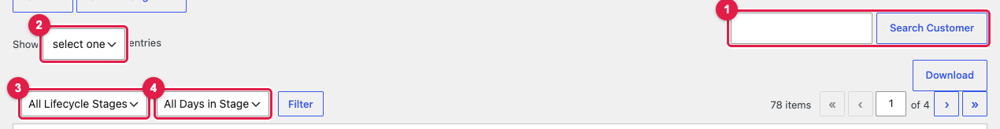 · ① Search by name or email ② Show N entries ③ Lifecycle stage ④ Days in stage |

**What it shows.** ① a search box with the button **"Search Customer"**. ② a **"Show"** selector with 10 / 20 / 50 / 100 entries. ③ **"All Lifecycle Stages"** dropdown listing the six stages. ④ **"All Days in Stage"** dropdown with *0-30 days, 31-60 days, 61-90 days, 90+ days*, followed by a **"Filter"** button. All four are Pro-only.

**How it's computed.** Search matches the customer's name or email. The lifecycle controls read the stage and days-in-stage stored by the nightly lifecycle job (B4.3). The dashboard's Lifecycle Funnel and At Risk widgets link here with the stage pre-selected.

**Interactions.** ③ and ④ sit in the table navigation and submit with **Filter**; the other filters already applied are preserved. On Free none of these render: the page uses standard WordPress pagination, and rows per page comes from Settings → General Settings → "Results per page" (default 10).

**Empty state.** "No items found."

**Demo prerequisites.** Customers spread across lifecycle stages with realistic days-in-stage values.

**Accuracy notes.** Days in stage counts from the date the nightly job recorded the stage change, so a freshly activated store shows 0 for everyone on day one.

**Source.** `admin/partials/templates/customers.php:150-171`; `includes/class-pd-customer-history-customers.php:385-402, 648-712`

---

## A3 · Customer Details (profile)

| | |
|---|---|
| **Menu** | None. Hidden page, opened from a customer's name or the **View** button anywhere in the plugin. |
| **URL** | `admin.php?page=pd-woo-customer&user_id=N` |
| **Tier** | FREE page: order history, Financial Summary, Personal Information, Notes. Pro adds the Activity Timeline, five intelligence cards and Manual Tags. Free shows six locked previews in their place. |
| **Full-page shot** | 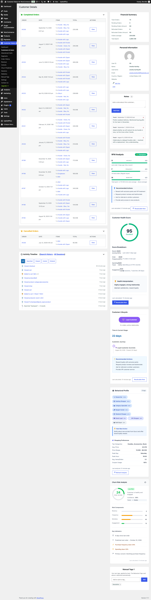 (Pro) · 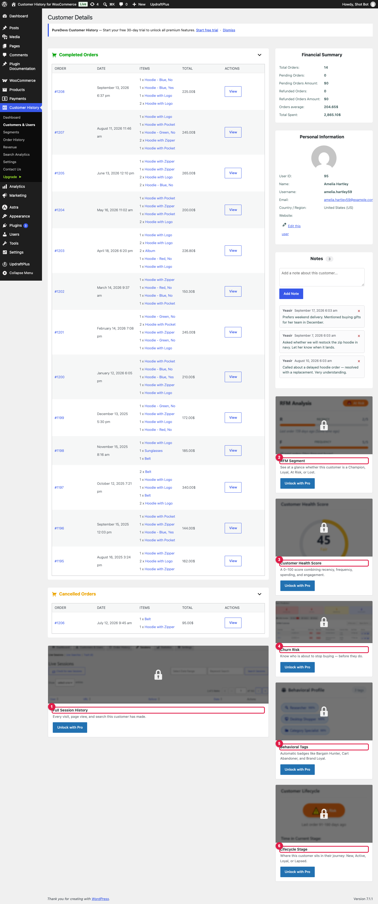 (Free) |
| **Entries** | PROF-01 … PROF-11, PROF-L |

The page title is **"Customer Details"**. It has no tab bar and **no tabs**: everything is stacked cards in two columns. The wide left column holds the order history and, on Pro, the Activity Timeline. The right sidebar renders in this fixed order: **Financial Summary → Personal Information → Notes → RFM Analysis → Customer Health Score → Customer Lifecycle → Behavioral Profile → Churn Risk Analysis → Manual Tags**. Registered customers only; guests have no profile page. A user without the `manage_woocommerce` capability sees an "Error" screen with *"I'm sorry, you are not allowed to see this page!"*.

### PROF-01 · "{Status} Orders" order history — FREE

| | |
|---|---|
| **Where** | Profile, left column, top |
| **Screenshot** | 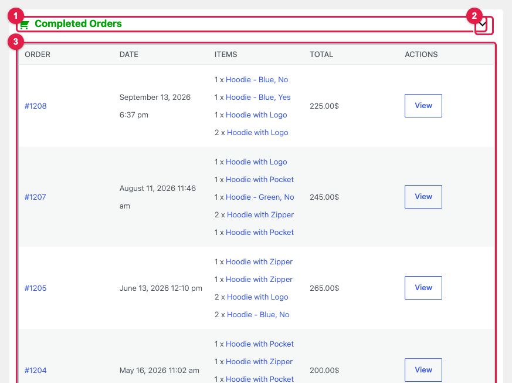 · ① One collapsible group per order status ② Collapse / expand ③ Order / Date / Items / Total / Actions |

**What it shows.** One panel per WooCommerce order status that has orders, headed **"{Status label} Orders"** (for example "Completed Orders", "Processing Orders", "Cancelled Orders"). Table columns: **Order** (`#id`), **Date**, **Items** (one line per item as `qty x product`), **Total**, **Actions** (a **"View"** button).

**How it's computed.** Iterates WooCommerce's registered order statuses and queries the customer's orders per status, newest first, capped at **20 orders per group**.

**Interactions.** ② collapses the group. Order numbers and **View** open the native WooCommerce order editor; item names open the product editor.

**Empty state.** A single panel reading **"No orders found!"** when the customer has no orders at all.

**Demo prerequisites.** A customer with orders in at least two statuses.

**Accuracy notes.** The 20-per-group cap means a very active customer's older orders are not listed here; the Order History page (A5) has them.

**Source.** `admin/partials/templates/customer-details.php:23-95`

### PROF-02 · "Activity Timeline" — PRO

| | |
|---|---|
| **Where** | Profile, left column, below the order groups |
| **Screenshot** | 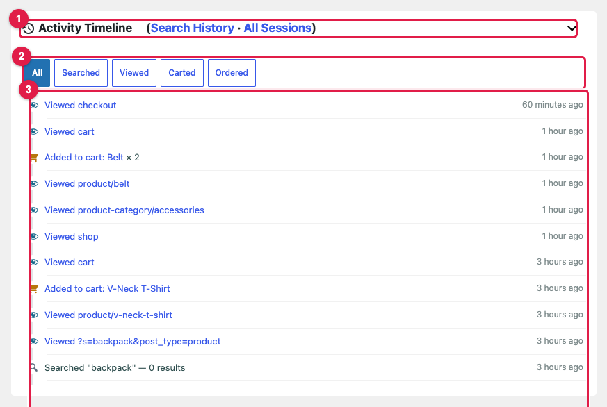 · ① Heading with Search History / All Sessions links ② All / Searched / Viewed / Carted / Ordered ③ Chronological events ④ Load older. Filtered to orders: 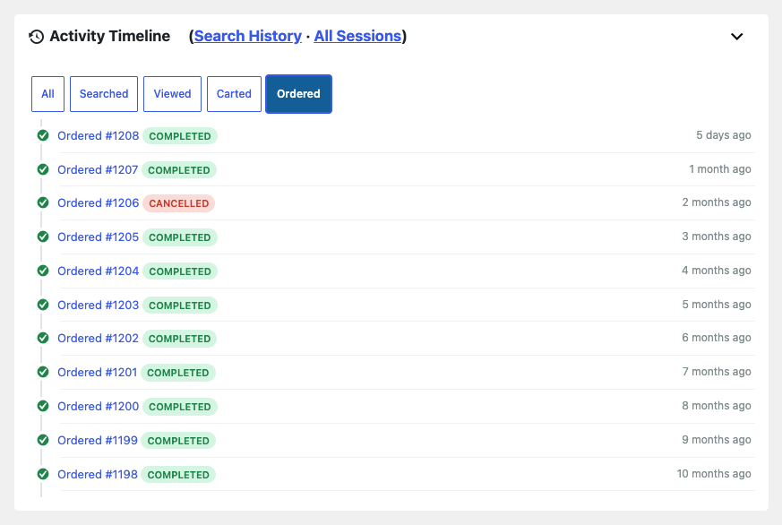 |

**What it shows.** One chronological stream joining what the customer searched, viewed, added to the cart and ordered. Row wording: *Searched "term"* (plus *— N results* when a count was recorded), *Viewed {page}* (links to the page), *Added to cart: {product}* (plus *× N* above one), *Ordered #{id}* with the order-status badge, and cart abandoned / cart recovered lines with the cart total. Each row shows a relative time; the exact time is in the tooltip.

**How it's computed.** Pure presentation over data already stored: the sessions table, WooCommerce orders (any status) and the carts table. No new tracking. Guest activity attached by the guest-to-customer merge (B6) appears here too.

**Interactions.** ① links jump to Live Searches and Live Sessions filtered to this customer. ② filters by event type without a page reload. ④ **"Load older"** pages further back. The panel collapses like the order groups.

**Empty state.** *"No recorded activity for this customer yet."* followed by *"Activity is recorded from the date this plugin was activated — earlier visits and orders are not shown here."*

**Demo prerequisites.** A customer who browsed while logged in (or as a guest who later logged in), searched, added to cart and ordered, ideally with one abandoned cart.

**Accuracy notes.** Admin and shop-manager browsing is not recorded by default (B1), so testing as an admin leaves the timeline empty. ⚑ The strategy doc lists "per-customer session history" among the phrases not to use as a hook (§4.5).

**Source.** `pro/Timeline/templates/timeline.php:30-77`; `pro/Timeline/Timeline-Panel.php:39-215`; `pro/Timeline/Timeline-Data.php:35-40`

### PROF-03 · "Financial Summary" — FREE

| | |
|---|---|
| **Where** | Profile, sidebar, first card |
| **Screenshot** | 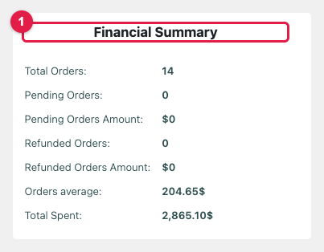 · ① Seven totals for this customer |

**What it shows.** Seven rows: **Total Orders**, **Pending Orders**, **Pending Orders Amount**, **Refunded Orders**, **Refunded Orders Amount**, **Orders average**, **Total Spent**.

**How it's computed.** From the customer's WooCommerce orders. Orders average = total spent ÷ order count.

**Interactions.** Read-only.

**Empty state.** Zeros.

**Demo prerequisites.** A customer with at least one refunded and one pending order so no row is zero.

**Accuracy notes.** Pending and refunded amounts render with the raw currency symbol and an unformatted number, while the last two rows use WooCommerce price formatting; expect that small inconsistency on screen.

**Source.** `admin/partials/templates/customer-details.php:100-232`

### PROF-04 · "Personal Information" — FREE

| | |
|---|---|
| **Where** | Profile, sidebar, second card |
| **Screenshot** | 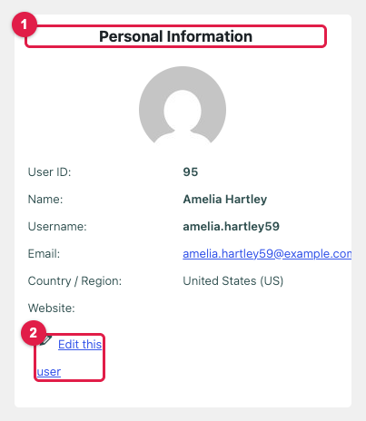 · ① Identity and contact ② Edit this user |

**What it shows.** Avatar, then **User ID**, **Name**, **Username**, **Email** (mailto link), **Country / Region** (only when a billing or shipping country exists) and **Website**.

**How it's computed.** WordPress user fields and WooCommerce billing/shipping meta.

**Interactions.** ② **"Edit this user"** opens the WordPress user editor. There is no link to the email compose page from the profile; that lives on the customer list (A4).

**Empty state.** Missing fields are simply blank.

**Demo prerequisites.** A customer with a billing country set.

**Accuracy notes.** The plugin does not edit customer data; the link hands off to WordPress.

**Source.** `admin/partials/templates/customer-details.php:234-313`

### PROF-05 · "Notes" — FREE

| | |
|---|---|
| **Where** | Profile, sidebar, third card (above every Pro card) |
| **Screenshot** | 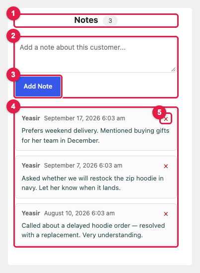 · ① Heading with live count ② Compose a private note ③ Add Note ④ Newest first, author and date ⑤ Delete |

**What it shows.** Heading **"Notes"** with a count chip, a textarea with the placeholder *"Add a note about this customer..."*, the **"Add Note"** button, and the list of notes newest first. Each note shows the author's display name, the date and time (relative time in the tooltip), a `×` delete button and the text. A deleted author renders as *"Deleted user (#id)"*.

**How it's computed.** Stored in the plugin's own notes table, keyed to the customer. Up to 50 newest notes are listed; a note can be up to 5,000 characters.

**Interactions.** Add and delete happen in place without a reload. Validation: *"Please enter a note first."* Delete confirmation: *"Delete this note?"*

**Empty state.** *"No notes yet. Add one above."*

**Demo prerequisites.** Two or three realistic notes from different dates.

**Accuracy notes.** Notes are private to admins and never shown to the customer. They are covered by WordPress's personal-data export and erase tools (group "Customer Notes"). ⛔ They are plain annotations: no tasks, reminders, follow-ups or custom fields.

**Source.** `includes/crm/templates/customer-notes-panel.php:16-52`; `includes/crm/class-pdwchs-notes.php:26, 118-172, 305-411`

### PROF-06 · "RFM Analysis" card — PRO

| | |
|---|---|
| **Where** | Profile, sidebar, after Notes |
| **Screenshot** | 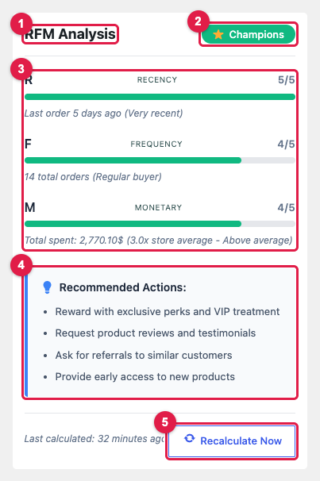 · ① Heading ② Segment badge ③ R / F / M scores out of 5 ④ Recommended Actions ⑤ Recalculate Now |

**What it shows.** Heading **"RFM Analysis"** with the customer's segment badge (icon, name, segment color) or a **"No Data"** badge. Three score rows, **R Recency**, **F Frequency**, **M Monetary**, each as `n/5` with a colored bar and a plain-language description (the Monetary line compares the customer to the store average). **"Recommended Actions:"** lists the four suggestions for that segment. Footer: *"Last calculated: … ago"* or *"Not calculated yet"*.

**How it's computed.** Scoring bands and the segment rules are in B4.1. Recalculated nightly at 2:00 AM and whenever one of the customer's orders completes.

**Interactions.** ⑤ **"Recalculate Now"** recomputes this one customer immediately.

**Empty state.** "No Data" badge and "Not calculated yet" before the first run.

**Demo prerequisites.** Nightly RFM job run, or press ⑤ on camera.

**Accuracy notes.** ⚑ Content rule: RFM is on the never-pitch list (strategy §4.5). ⛔ "Recommended Actions" is advisory text only; the plugin performs none of those actions.

**Source.** `pro/Intelligence/templates/customer-rfm-card.php:18-129`; rules `pro/Intelligence/RFM.php:104-260`

### PROF-07 · "Customer Health Score" card — PRO

| | |
|---|---|
| **Where** | Profile, sidebar, after RFM Analysis |
| **Screenshot** | 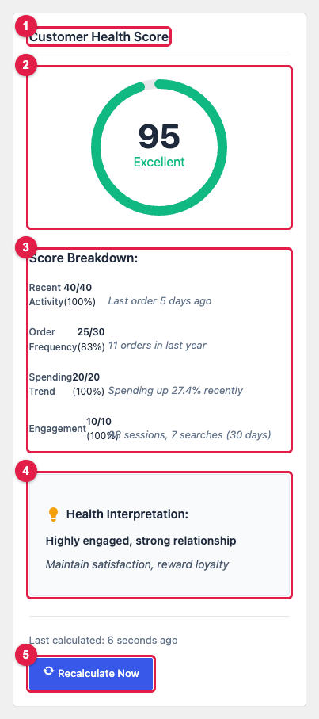 · ① Heading with trend chip ② 0–100 gauge ③ Score Breakdown: four components ④ Health Interpretation ⑤ Recalculate Now |

**What it shows.** Heading **"Customer Health Score"** with a trend chip when the score moved: *↗ Up N points* or *↘ Down N points* (nothing when Stable). A circular gauge with the score and the band word (Excellent, Good, Fair, Poor, Critical) in the band color. **"Score Breakdown:"** with four bars: **Recent Activity** /40, **Order Frequency** /30, **Spending Trend** /20, **Engagement** /10, each with a one-line description. **"Health Interpretation:"** gives the band description and a suggested action.

**How it's computed.** Formula, bands and the ±5-point trend rule are in B4.2. Nightly at 3:00 AM and on order completion.

**Interactions.** ⑤ **"Recalculate Now"** for this customer.

**Empty state.** Card renders with zeros until the first calculation.

**Demo prerequisites.** Two calculations at least a day apart, with a change of 5+ points, to show a trend chip.

**Accuracy notes.** ⚑ Content rule: health scores are on the never-pitch list (strategy §4.5). ⛔ The interpretation text mentions campaigns and offers as suggestions to the owner; the plugin sends nothing.

**Source.** `pro/Intelligence/templates/customer-health-card.php:63-239`; formula `pro/Intelligence/Health.php:111-367, 662-708`

### PROF-08 · "Customer Lifecycle" card — PRO

| | |
|---|---|
| **Where** | Profile, sidebar, after Health Score |
| **Screenshot** | 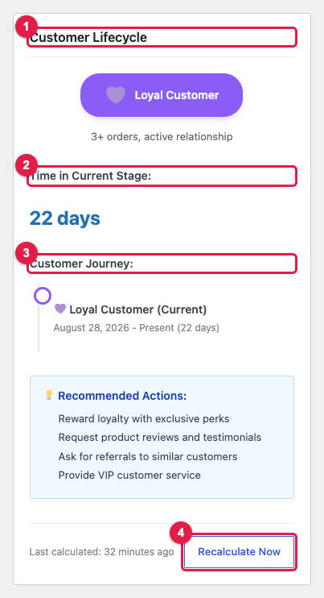 · ① Heading ② Days in stage ③ Stage history ④ Recalculate Now |

**What it shows.** Heading **"Customer Lifecycle"**, a large stage badge (icon + stage name in the stage color) with the stage description, **"Time in Current Stage:"** as *N days*, **"Customer Journey:"** as a vertical list of every stage the customer has been in with entered date, exit date or *Present*, and days spent, then **"Recommended Actions:"** for the stage. Footer: *"Last calculated: …"*.

**How it's computed.** Stage rules are in B4.3. Every stage change is written to a history table, which is what the journey list reads. Nightly at 4:00 AM and on order completion.

**Interactions.** ④ **"Recalculate Now"**.

**Empty state.** A single "Present" entry until the customer changes stage.

**Demo prerequisites.** A customer who has moved through at least two stages, which needs the plugin active across those dates (or back-dated demo data).

**Accuracy notes.** The journey only goes back to when Pro started calculating; it is not reconstructed from old orders.

**Source.** `pro/Intelligence/templates/customer-lifecycle-card.php:48-136`; rules `pro/Intelligence/Lifecycle.php:86-156, 679-759`

### PROF-09 · "Behavioral Profile" card — PRO

| | |
|---|---|
| **Where** | Profile, sidebar, after Customer Lifecycle |
| **Screenshot** | 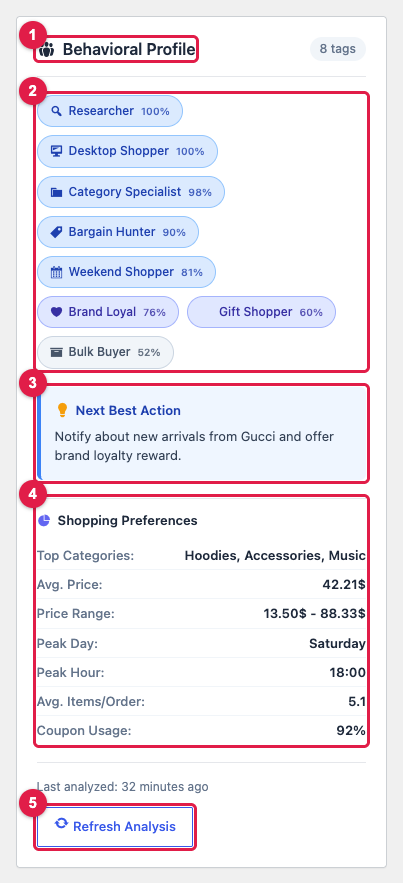 · ① Heading with tag count ② Detected tags with confidence % ③ Next Best Action ④ Shopping Preferences ⑤ Refresh Analysis |

**What it shows.** Heading **"Behavioral Profile"** with a *N tag(s)* counter. Tag chips with icon, label and confidence percent, colored high (80+), medium (60+) or low; hovering a chip shows what the pattern means. **"Next Best Action"**: one sentence. **"Shopping Preferences"** rows: *Top Categories* (top three), *Avg. Price*, *Price Range*, *Peak Day*, *Peak Hour*, *Avg. Items/Order*, *Coupon Usage*. Footer: *"Last analyzed: … ago"* or *"Not analyzed yet"*.

**How it's computed.** The 15 detectors and their thresholds are in B4.4. Nightly at 5:00 AM and queued when an order completes.

**Interactions.** ⑤ **"Refresh Analysis"** re-runs the detectors for this customer.

**Empty state.** *"No behavioral patterns detected yet. Click Refresh Analysis below."*

**Demo prerequisites.** A customer with 5+ orders and 5+ sessions; most detectors need three to five orders before they can fire.

**Accuracy notes.** ⚑ Content rule: behavioral tags are on the never-pitch list (strategy §4.5). ⛔ "Next Best Action" is a suggestion to the store owner; nothing is triggered. Use only the 15 tag names in B4.4; earlier listings named badges that do not exist.

**Source.** `pro/Intelligence/templates/customer-behavioral-card.php:33-169`; detectors `pro/Intelligence/Behavioral.php:33-91`

### PROF-10 · "Churn Risk Analysis" card — PRO

| | |
|---|---|
| **Where** | Profile, sidebar, after Behavioral Profile |
| **Screenshot** |  · ① Heading ② Risk score ring, level, confidence, trend ③ Risk Components ④ Key Indicators ⑤ Recalculate |

**What it shows.** Heading **"Churn Risk Analysis"**. A score ring (0–100, sublabel *Risk Score*), a risk badge (*Low Risk, Medium Risk, High Risk, Critical Risk*) with its description, **Confidence:** N % and **Trend:** *Worsening / Improving / Stable*. **"Risk Components"**: four bars for *Recency, Frequency, Monetary, Engagement* (each 0–100; green to 30, amber to 60, red to 80, dark red above). **"Key Indicators"**: conditional bullets such as *N days since last order*, *N days overdue for purchase*, *Predicted next order: ~ date*, *Purchase frequency down N%*, *Spending down N%*, *No site visits in 30 days*, *Primary concern: …*. For high and critical risk only, a **"Follow Up"** block with one button, **"Email this customer"**, which opens the manual compose page (A4). Footer: *"Last calculated: … ago"*.

**How it's computed.** Weights, levels and alert rules are in B4.5. Nightly at 2:00 AM and on order completion. Needs at least two orders.

**Interactions.** ⑤ recalculates this customer. "Email this customer" only navigates to the compose form.

**Empty state.** With fewer than two orders the card is titled **"Churn Risk"** and reads *"Insufficient order history for churn prediction. Minimum 2 orders required."*

**Demo prerequisites.** One low-risk and one high-risk customer; the Follow Up block only appears on the latter.

**Accuracy notes.** ⚑ Content rule: churn scores are on the never-pitch list (strategy §4.5). ⛔ Prediction only. The coupon builder and the automated win-back email were removed in 3.0.2; the card neither creates offers nor contacts the customer. The predicted next-order date is an estimate from the customer's own order gap.

**Source.** `pro/Intelligence/templates/customer-churn-card.php:66-372`; `pro/Intelligence/Churn.php:42-75, 141-166`

### PROF-11 · "Manual Tags" panel — PRO

| | |
|---|---|
| **Where** | Profile, sidebar, last card |
| **Screenshot** |  · ① Heading with count ② Manual vs automatic tags note ③ Add or pick a tag ④ Assigned tags, × to remove |

**What it shows.** Heading **"Manual Tags"** with a count chip. Hint: *"Your own tags, applied by hand. The Behavioral Tags card above is detected automatically."* An input with the placeholder *"Add or pick a tag..."* that suggests existing tags, an **"Add"** button, and the assigned tags as chips with a `×` to remove.

**How it's computed.** Tags and assignments live in two plugin tables. Typing a new name creates the tag and assigns it in one step.

**Interactions.** Add and remove in place. Tags are managed (renamed, deleted, counted) on the Manual Tags page (A13) and can be used as a list filter (CUST-02 ⑧) and a segment condition.

**Empty state.** *"No tags yet. Add one above."*

**Demo prerequisites.** Three or four tags already created so the suggestion list is not empty.

**Accuracy notes.** ⛔ Tags are labels only. Nothing is triggered by a tag, and tags are never assigned automatically. Covered by the personal-data export and erase tools.

**Source.** `pro/CRM/templates/customer-tags-panel.php:18-47`; `pro/CRM/Tags-Panel.php:37`; `pro/CRM/Tags.php:29-36`

### PROF-L · Locked Pro previews — FREE only

| | |
|---|---|
| **Where** | Profile on Free: one card in the left column (where the timeline would be) and five in the sidebar after Notes |
| **Screenshot** |  · ① Locked: Full Session History ② Locked: RFM Segment ③ Locked: Health Score ④ Locked: Churn Risk ⑤ Locked: Behavioral Tags ⑥ Locked: Lifecycle Stage. Close-up:  · ① Title ② Unlock with Pro |

**What it shows.** Six preview cards, each a blurred sample image under a dark overlay with a lock icon, then a title, a one-line description and a blue **"Unlock with Pro"** button. Exact copy:

| Title | Description |
|---|---|
| Full Session History | Every visit, page view, and search this customer has made. |
| RFM Segment | See at a glance whether this customer is a Champion, Loyal, At Risk, or Lost. |
| Customer Health Score | A 0–100 score combining recency, frequency, spending, and engagement. |
| Churn Risk | Know who is about to stop buying — before they do. |
| Behavioral Tags | Automatic badges like Bargain Hunter, Cart Abandoner, and Brand Loyal. |
| Lifecycle Stage | Where this customer sits in their journey: New, Active, Loyal, or Lapsed. |

**How it's computed.** Nothing is computed. The images are static files shipped in `admin/img/pro-previews/`; no Pro code exists in the free build.

**Interactions.** The button opens the Freemius upgrade page in a new tab.

**Empty state.** If an image file is missing the card falls back to text only.

**Demo prerequisites.** A Free install (or the Free tier forced on a development site).

**Accuracy notes.** The preview images are illustrations, not this customer's data. The sidebar order on Free is RFM, Health, Churn, Behavioral, Lifecycle, which differs from the Pro card order. ⚑ These cards advertise exactly the features on the strategy doc's never-pitch list (§4.5); that tension is noted in §D.3.

**Source.** `admin/partials/templates/customer-details.php:97, 316-322`; `includes/class-pdwchs-upsell.php:25-58, 99-129`; `admin/css/pdwchs-upsell.css:4-73`

---

## A4 · Send Email to Customer

| | |
|---|---|
| **Menu** | None. Hidden page, opened from the **Email** button in the customer list's Actions column (CUST-04 ⑦) and from "Email this customer" on a high-risk churn card (PROF-10). |
| **URL** | `admin.php?page=pd-woo-customer-email&user_id=N` |
| **Tier** | FREE |
| **Full-page shot** |  |
| **Entries** | MAIL-01 |

A plain compose form for one message to one customer. It is the plugin's only customer-facing outbound action, and it happens only when the admin writes a message and presses Send. The page has no tab bar.

### MAIL-01 · "Send Email to Customer" — FREE

| | |
|---|---|
| **Where** | Customers & Users → a row's **Email** button |
| **Screenshot** |  · ① Compose form ② Subject ③ Message editor ④ Send Email ⑤ Customer sidebar |

**What it shows.** Page title **"Send Email to Customer"**. Main panel **"Email Form"** with **"To:"** (the customer's address, read-only, described as *"Customer email address (read-only)"*), **"Subject:"** (required, *"Enter the email subject"*), **"Message:"** (a minimal visual editor, ten rows, no media button, *"Enter your email message"*), and a submit row with **"Send Email"**, **"Back to Customer Details"** and **"Back to Customer List"**. Sidebar card **"Customer Information"**: avatar, User ID, Name, Username, Email, Country / Region, Website, with the links **"View Customer Details"** and **"Edit this user"**.

**How it's computed.** On submit the form is nonce-checked and the message is sent once through WordPress's `wp_mail()` as HTML, from the site name and admin email address. The subject is sanitized as plain text and the body is limited to safe post HTML.

**Interactions.** Success notice: **"Email sent successfully!"** Failure: **"Failed to send email. Please try again."** Validation messages: *"Invalid user ID provided."*, *"User not found."*, *"Invalid email address for this user."*, *"Email subject is required."*, *"Email message is required."*

**Empty state.** Without access or a valid customer: title **"Error"**, *"I'm sorry, you are not allowed to see this page!"*, and a **"Back to Customer List"** link.

**Demo prerequisites.** A customer with a real-looking email address. Delivery depends on the site's mail setup, so use a mail catcher when filming a send.

**Accuracy notes.** ⛔ This is a manual, one-to-one email the store owner writes and sends. It is never automated, scheduled, bulk or triggered by a score. ⛔ The code defines welcome, follow-up and promotion templates but no screen uses them; do not mention email templates. Sent messages are not logged or listed anywhere in the plugin.

**Source.** `admin/partials/templates/customer-email.php:29-202`; `includes/class-pd-customer-history-email.php:30-149`

---

## A5 · Order History

| | |
|---|---|
| **Menu** | Customer History → Order History (third tab of the top tab bar) |
| **URL** | `admin.php?page=pd-woo-order-history` |
| **Tier** | FREE page. Free has a date-range filter only; Pro adds three filters, a keyword search and a rows-per-page selector. |
| **Full-page shots** |  (Pro) ·  (Free) |
| **Entries** | ORD-01 |

A store-wide order list in the plugin's own layout: every order, newest first, with the customer linked to their plugin profile and the order linked to the WooCommerce order editor. The plugin has no order-detail page of its own and never edits an order. Page title `<h1>` **"Order History"**.

### ORD-01 · "Order History" filters and the "Last Orders" table — FREE + PRO

| | |
|---|---|
| **Where** | The whole page: the **"Advance Search:"** fieldset on top, the list controls below it, then the table under the `<h2>` **"Last Orders"** |
| **Screenshot** |  · ① Date range ② Total Amount (Pro) ③ Payment Method (Pro) ④ Order Status (Pro) ⑤ Keyword search (Pro) ⑥ "Last Orders" table. Free view:  · ① Date range (90-day floor) ② Order list |

**What it shows.** Fieldset legend **"Advance Search:"** containing: **"Date :"** (text input, placeholder **"Select Date Range"**, with an ✕ clear button); on Pro also **"Total Amount :"** (`-- Select One --` / **Equal** / **Greater then** / **Less then**, plus a revealed amount input), **"Payment Method :"** (`-- Select One --` plus every WooCommerce payment gateway) and **"Order Status :"** (`-- Select One --` plus every WooCommerce order status); then a **"Search"** button. Below the fieldset, on Pro only: an order keyword search box and **"Show"** N entries (10 / 20 / 50 / 100). Then `<h2>` **"Last Orders"** and the table with seven columns: **Date**, **Order ID**, **Customer Name**, **Items & Qty**, **Total**, **Payment Method**, **Status** (colored status pill). Guests render as **Guest** in bold; registered customers link to their Customer Details page (A3). "Greater then" / "Less then" are the literal UI spellings.

**How it's computed.** Orders are read through WooCommerce's order API (HPOS and legacy storage both supported), all statuses included. On Free the date picker's earliest selectable date is the 90-day floor, passed to the script as `pdwchsAdminVars.minDate`; the latest selectable date is today. Rows per page come from `?show-items` (Pro control) or the "Results per page" setting (SET-01), default 10.

**Interactions.** ① opens the bundled date-range picker and writes hidden `start_date` / `end_date` fields; ②③④ narrow the list (Pro); "Search" submits; ⑤ filters by keyword (Pro); in ⑥ every column except **Items & Qty** is sortable, the Order ID opens the WooCommerce order editor (`post.php?post={id}&action=edit`), each item links to the product editor, and standard WordPress pagination sits above and below the table.

**Empty state.** None of its own; the standard list-table message "No items found."

**Demo prerequisites.** Orders in several statuses and with more than one payment method (so ③ and ④ have something to filter), at least one guest order, and orders inside the last 90 days so the Free view is not empty.

**Accuracy notes.** ⛔ The page lists and links orders; it does not change them. The keyword search, the three extra filters and the rows-per-page selector are Pro. On Free the date range cannot reach further back than 90 days.

**Source.** `admin/partials/templates/order-history.php:15-119`; table `includes/class-pd-customer-order-history.php:43-54, 143-158, 166-183, 222-232`; date floor `admin/class-pd-customer-history-admin.php:218-220`, `admin/js/pd-customer-history-admin.js:169-197`

---

## A6 · Revenue

| | |
|---|---|
| **Menu** | Customer History → Revenue (fourth tab of the top tab bar) |
| **URL** | `admin.php?page=pd-woo-revenue` |
| **Tier** | FREE page, identical on Pro except that the 90-day floor is lifted. |
| **Full-page shots** |  (Pro) ·  (Free) |
| **Entries** | REV-01 … REV-03 |

The free revenue snapshot: a date filter, five KPI cards with period-over-period change, and one trend chart. Page title `<h1>` **"Revenue"**. There is no separate "Revenue Analytics" page anywhere in the plugin: Pro's full revenue stack (time-series with granularity, new / returning / guest split, data-integrity check, retention and expected CLV, LTV distribution) renders on the **Dashboard** as widgets DASH-10, DASH-11 and DASH-12, and the product-level reports live under Statistics (STAT-06, STAT-09, STAT-12). This page has no upsell block.

### REV-01 · Date filter — FREE

| | |
|---|---|
| **Where** | Top of the page, directly under the title |
| **Screenshot** |  · ① From / To / Apply. Free:  · ① From date cannot go earlier than 90 days back |

**What it shows.** Two native date inputs labelled **"From"** and **"To"** and a primary **"Apply"** button.

**How it's computed.** Defaults: To = today in site time, From = To minus 29 days (a 30-day window). On Free the From input carries a `min` attribute equal to the 90-day floor, and any earlier start date is clamped server-side as well. On Pro the floor is empty, so any range is allowed.

**Interactions.** ① pick a range and press Apply; the page reloads with the cards and chart recalculated, and the comparison period becomes the equally long period immediately before.

**Empty state.** Not applicable.

**Demo prerequisites.** None beyond orders in the chosen range.

**Accuracy notes.** ⛔ On Free say "the most recent 90 days"; older orders are still in WooCommerce and become readable the moment Pro is active.

**Source.** `admin/partials/templates/revenue.php:17-22, 55-64`; clamp `includes/class-pdwchs-data-window.php:17-42`

### REV-02 · KPI cards: "Net Revenue", "Orders", "Avg Order Value", "Customers", "Repeat Purchase Rate" — FREE

| | |
|---|---|
| **Where** | Card row under the date filter |
| **Screenshot** |  · ② KPI cards |

**What it shows.** Five cards, each with a gray label, a large value and a change badge versus the previous period (green ▲, red ▼, or a gray em-dash when there is nothing to compare): **"Net Revenue"** (currency-formatted), **"Orders"**, **"Avg Order Value"**, **"Customers"**, and **"Repeat Purchase Rate"** (a percentage, with the fine-print caption **"Registered customers only"**). The Repeat Purchase Rate card is new in 3.1.2.

**How it's computed.** Only **completed** and **processing** orders count. Repeat Purchase Rate = the share of registered customers who ordered in the window and placed more than one order in it. Queries are HPOS-aware and cached in a 30-minute transient whose key includes the date range and the read-window size, so Free and Pro never share a stale value.

**Interactions.** None; the cards follow the date filter.

**Empty state.** Values read zero and the badge shows the em-dash; the chart panel shows its own message (REV-03).

**Demo prerequisites.** Orders in both the selected period and the period before it, so the badges show movement; at least a few registered customers with two or more orders in the window so the rate is not 0 %.

**Accuracy notes.** ⛔ Guests are excluded from Repeat Purchase Rate (the caption says so). Pending, on-hold, cancelled, refunded and failed orders are excluded from every card. Figures can lag by up to 30 minutes because of the cache.

**Source.** `admin/partials/templates/revenue.php:39-48, 66-103`; data `includes/analytics/class-pdwchs-revenue-data-free.php:28-35, 42, 60, 68, 294, 302`

### REV-03 · "Net revenue over time" — FREE

| | |
|---|---|
| **Where** | Panel under the KPI cards |
| **Screenshot** |  · ③ Trend chart heading ④ Daily net revenue. Free:  · ② Trend chart |

**What it shows.** `<h2>` **"Net revenue over time"** above a line chart: one point per day, filled area, no legend, y-axis starting at zero, 320 px tall.

**How it's computed.** Daily buckets of net revenue from completed and processing orders in the selected range, same clamp and cache rules as REV-02. Rendered with the locally bundled Chart.js (no CDN).

**Interactions.** Hover a point for the day's value. There is no granularity switch on this page (Daily / Weekly / Monthly exists only in the Pro dashboard widget, DASH-10).

**Empty state.** **"No completed orders in this period yet. Revenue will appear here as orders come in."** (shown when the period has zero qualifying orders).

**Demo prerequisites.** Orders spread across the range so the line has shape.

**Accuracy notes.** ⛔ Daily only on this page. Do not describe it as the Pro "Revenue Analytics" widget.

**Source.** `admin/partials/templates/revenue.php:104-132`; `includes/analytics/class-pdwchs-revenue-data-free.php:109`; Chart.js enqueue `admin/class-pd-customer-history-admin.php:299-300, 373-376`

---

## A7 · Segments

| | |
|---|---|
| **Menu** | Customer History → Segments (fifth tab of the top tab bar) |
| **URL** | `admin.php?page=pd-woo-segments` |
| **Tier** | FREE page with **1** custom segment; Pro lifts the cap, seeds five ready-made segments and adds two export presets. |
| **Full-page shots** |  (Pro) ·  (Free) |
| **Entries** | SEG-01 … SEG-04 |

A segment is a saved set of customer-list filters. Segments are **created on the Customers & Users page** ("Save as Segment", CUST-03) and managed here. A segment stores criteria, not a member list: the count, the Load action and the export all re-run the filters at that moment. Page title `<h1>` **"Customer Segments"**.

### SEG-01 · "Saved Segments" — FREE + PRO

| | |
|---|---|
| **Where** | The main panel of the page |
| **Screenshot** |  · ① Saved Segments panel ② + New Segment → Customers page ③ table columns ④ row actions |

**What it shows.** Panel `<h2>` **"Saved Segments"** with a primary **"+ New Segment"** button on the right. Table columns: **Customer Segment**, **Description**, **Customers**, **Created By**, **Created**, **Actions**. Seeded segments carry a **"Default"** badge next to the name. An empty description renders as an em-dash; a segment with no author (the seeded ones) shows **"System"** under Created By.

**How it's computed.** **Customers** is a live count: the stored criteria are run through the same filter pipeline as the Customers list each time the page loads. On Free that pipeline still respects the Free limits. All rows are rendered on one page (no pagination).

**Interactions.** ② goes to `pd-woo-customers`, where filters are chosen and saved; ④ is covered in SEG-02.

**Empty state.** **"No segments saved yet. Use the "Save as Segment" button on the Customers page to create your first segment."**

**Demo prerequisites.** Two or three custom segments with descriptions and visibly different counts (Pro), or exactly one (Free).

**Accuracy notes.** ⛔ Segments are saved filters for viewing and exporting. They do not trigger emails, tags, discounts or any action.

**Source.** `admin/partials/templates/segments-list.php:6-33`; table `admin/class-pdwchs-segments-list-table.php:16-25, 45-53, 109-139`; count `includes/segments/class-pdwchs-segments-manager.php:262-296`

### SEG-02 · Row actions: Load, export preset, Export CSV, Delete — FREE + PRO

| | |
|---|---|
| **Where** | The Actions cell of every row |
| **Screenshot** |  · ① Load into the Customers page ② Standard / Klaviyo / Mailchimp preset (Pro) ③ Export CSV ④ Delete (not on Default segments) |

**What it shows.** Buttons **"Load"**, **"Export CSV"** and **"Delete"**, plus an export-format `<select>` between Load and Export CSV. The select is rendered **only when more than one preset is registered**: Free registers one preset, **Standard**, so no select appears; Pro adds **Klaviyo** and **Mailchimp**. **Delete** is hidden on Default segments.

**How it's computed.** Export streams a CSV named `segment-{slug}-{Y-m-d}.csv` with a UTF-8 BOM (opens cleanly in Excel). **Standard** columns: **Name, Email, Total Orders, Total Spent, Last Order Date, RFM Segment, Health Score** (the last two are empty on Free). **Klaviyo**: `Email`, `First Name`, `Last Name`, `Total Orders`, `Total Spent`, `Last Order Date`, `RFM Segment`. **Mailchimp**: the same with `Email Address` as the first header. The vendor headers are deliberately not translated so the file imports without remapping.

**Interactions.** ① rebuilds the Customers & Users URL from the stored criteria and opens the filtered list; ② chooses the column layout; ③ downloads the file; ④ asks **"Are you sure you want to delete this segment? This cannot be undone."** before deleting.

**Empty state.** An empty segment still exports a file with the header row.

**Demo prerequisites.** Pro active to show the preset select; a segment with a healthy member count.

**Accuracy notes.** ⛔ The Klaviyo and Mailchimp presets are **column layouts for a file you download**. The plugin connects to no external service, API or account, and nothing is synced or pushed. Never write "Klaviyo integration" or "sync to Mailchimp".

**Source.** `admin/class-pdwchs-segments-list-table.php:55-107`; `includes/segments/class-pdwchs-segments-export.php:51-105, 122-152, 241-262`; `pro/Segments/Export-Presets.php:50-104`; confirm string `admin/class-pd-customer-history-admin.php:210`; loader `admin/js/pdwchs-segments-list.js:3-7`

### SEG-03 · The five ready-made segments ("Ready-made Pro segments" teaser on Free) — PRO

| | |
|---|---|
| **Where** | Pro: the first five rows of Saved Segments, each with the "Default" badge. Clean Free install: a second, locked panel below Saved Segments. |
| **Screenshot** |  (Pro rows) ·  · ① Saved Segments ② locked teaser table ③ Unlock with Pro |

**What it shows.** On Pro, five segments are seeded once and cannot be deleted:

| Segment | Criteria |
|---|---|
| **High Value At Risk** | RFM segment = At Risk **and** total spent greater than 500 |
| **Loyal Champions** | RFM segment = Champions |
| **Needs Attention** | RFM segment = Needs Attention |
| **Hibernating** | RFM segment = Hibernating |
| **High Health Declining** | Health score range = Fair **and** health trend = down |

On a clean Free install the same five appear instead as a locked panel: `<h2>` **"Ready-made Pro segments"** (lock icon) with a primary **"Unlock with Pro"** button; intro **"Pro auto-builds these intelligence segments from RFM and customer health scoring — no setup required."**; a dimmed table with columns **Segment** / **What it finds** and an **"Unlock with Pro"** button per row. Teaser copy, verbatim: High Value At Risk — "Big spenders who have gone quiet — win them back before they churn."; Loyal Champions — "Your most frequent, highest-value repeat buyers."; Needs Attention — "Once-active customers starting to slip toward lapse."; Hibernating — "Long-inactive customers worth a re-engagement push."; High Health Declining — "Healthy customers whose engagement is trending down."

**How it's computed.** Seeded by Pro on activation, only when no Default row exists. Member counts depend on the nightly RFM and health jobs (B5), so they read 0 until those have run. The Free teaser is static text; a teaser row is suppressed when a real segment of the same name already exists, and the whole panel is suppressed when none remain.

**Interactions.** Pro: Load and Export CSV as in SEG-02. Free: every "Unlock with Pro" button opens the upgrade page in a new tab.

**Empty state.** Not applicable.

**Demo prerequisites.** Pro: RFM and health scores calculated so the counts are non-zero. Free: FREE-05 shows a clean Free install, one custom segment plus the locked teaser. If Pro was ever active on the store, the five segments already exist as real Default rows and the teaser panel is hidden.

**Accuracy notes.** ⚑ Content rule: these segments are built on RFM and health scores, which are on the never-pitch list (`docs/content/PureDevs_Proof_Marketing_Ad_Strategy_v1.md` §4.5). ⛔ The teaser copy uses the phrases "win them back" and "re-engagement push"; that is in-product upsell wording, not a capability. The plugin finds these customers and does nothing to them.

**Source.** `pro/Segments/Pro-Defaults.php:27-96`; teaser `includes/class-pdwchs-upsell.php:64-87`, `admin/partials/templates/segments-list.php:37-103`

### SEG-04 · Free cap: one custom segment — FREE

| | |
|---|---|
| **Where** | Triggered on the Customers & Users page when a second "Save as Segment" is attempted on Free |
| **Screenshot** |  · ① "Unlock unlimited segments with Pro" ② "Upgrade to Pro" ③ "Maybe later" |

**What it shows.** A modal with the title **"Unlock unlimited segments with Pro"**, the message **"Free plan is limited to 1 custom segment. Upgrade to Pro for unlimited segments."**, the label **"Plus ready-made intelligence segments:"** followed by the five names from SEG-03, a primary **"Upgrade to Pro"** button (new tab) and a **"Maybe later"** link.

**How it's computed.** The cap counts non-default rows against the `pdwchs_segment_creation_cap` filter (1 on Free). The save request returns the error code `pdwchs_segment_cap_reached`, and the script renders the modal from the payload. Pro returns an effectively unlimited cap.

**Interactions.** "Maybe later" or a click on the dark backdrop closes it; the existing segment is untouched. Deleting the existing segment frees the slot.

**Empty state.** Not applicable.

**Demo prerequisites.** Free tier with exactly one custom segment, then apply any filter on Customers & Users and save again.

**Accuracy notes.** ⛔ The limit is on **saved custom segments**, not on filtering: any filter combination can still be applied and exported from the Customers list on Free.

**Source.** `includes/segments/class-pdwchs-segments-manager.php:77-94`; payload `includes/segments/class-pdwchs-segments-ajax.php:113-126`; modal `admin/js/pdwchs-save-segment.js:21-54`; Pro cap `pro/Segments/Segment-Cap.php:13-15`

---

## A8 · Search Analytics (Free only)

| | |
|---|---|
| **Menu** | Customer History → Search Analytics (sixth tab of the Free tab bar) |
| **URL** | `admin.php?page=pd-woo-search-analytics` |
| **Tier** | **FREE only.** The menu item and tab are not registered when Pro is active, because Sessions and Statistics (A9, A10) supersede them. |
| **Full-page shot** |  |
| **Entries** | SA-01 … SA-06 |

Four stacked tables showing what shoppers search for and look at, read from the tracking table (B1) within the 90-day Free window. Page title `<h1>` **"Search Analytics"**. Each table shows up to 20 rows. There are no charts (Chart.js is not loaded on this page), no filters, no pagination and no export. When a query was clamped, the 90-day banner appears under the title: **"The free version includes your most recent 90 days of activity. Customer History Pro includes your full history — your older data is already collected and waiting."** with **"See what Pro adds"** and **"Dismiss"**.

### SA-01 · "Heads up" notice about administrator activity — FREE

| | |
|---|---|
| **Where** | Inline info notice above the first panel |
| **Screenshot** |  · ① Heads-up notice about admin activity |

**What it shows.** **"Heads up: your own administrator activity isn't recorded by default, so this page stays empty while you browse the store as an admin. To see searches and product views here, visit your store while logged out or as a customer."**

**How it's computed.** Shown to users who can manage WooCommerce while the "Save admin sessions" option is off. That option only has a control on Pro (SET-01), so on Free the notice is always present.

**Interactions.** None; it is not dismissible.

**Empty state.** Not applicable.

**Demo prerequisites.** None. When recording a demo, generate storefront activity in a logged-out or customer browser session.

**Accuracy notes.** ⛔ Store administrators and shop managers are never tracked on Free. Do not film an admin searching the storefront and expect it to appear here.

**Source.** `admin/partials/templates/search-analytics.php:29-36`; gate `public/class-pd-customer-history-public.php:65`

### SA-02 · "Top Keyword Searches" — FREE

| | |
|---|---|
| **Where** | First panel |
| **Screenshot** |  · ② Top Keyword Searches |

**What it shows.** Table **Keyword** / **Count**, the 20 most-searched terms.

**How it's computed.** Counts of `ACTION::search::{term}` rows in the tracking table inside the 90-day window, grouped by term.

**Interactions.** None.

**Empty state.** Header row only.

**Demo prerequisites.** Storefront searches by non-admin visitors.

**Accuracy notes.** Only searches made through the WordPress/WooCommerce search are recorded; a third-party search widget that bypasses it is not.

**Source.** `admin/partials/templates/search-analytics.php:39-65`; `includes/data/class-pdwchs-search-stats-data.php:132-135`

### SA-03 · "Last Searches" — FREE

| | |
|---|---|
| **Where** | Second panel |
| **Screenshot** |  · ③ Last Searches |

**What it shows.** Table **Keyword** / **Date**, the 20 most recent searches, newest first.

**How it's computed.** The latest search rows within the 90-day window.

**Interactions.** None.

**Empty state.** Header row only.

**Demo prerequisites.** Recent storefront searches.

**Accuracy notes.** It lists terms and times, not who searched. Per-customer search history is a Pro profile feature (PROF-02).

**Source.** `admin/partials/templates/search-analytics.php:69-95`; `includes/data/class-pdwchs-search-stats-data.php:163-166`

### SA-04 · "Zero-Result Searches" — FREE

| | |
|---|---|
| **Where** | Third panel |
| **Screenshot** |  · ④ Zero-Result Searches |

**What it shows.** Table **Search Term** / **Times Searched** / **Last Searched**, up to 20 terms that returned no products. New in 3.1.2.

**How it's computed.** Since 3.1.2 every recorded search stores the number of results WordPress found; this panel lists terms whose count was 0, inside the 90-day window. The date recording began is kept in the option `pdwchs_results_count_since`.

**Interactions.** None.

**Empty state.** Two variants. With a recorded start date: **"No zero-result searches recorded yet. Collecting since %s — terms appear here as visitors search your store and find nothing."** Without one: **"No zero-result searches recorded yet. Terms appear here as visitors search your store and find nothing."**

**Demo prerequisites.** A few storefront searches for things the catalog does not sell, made after the 3.1.2 update.

**Accuracy notes.** ⛔ Data accrues only from the day the site runs 3.1.2; earlier searches have no result count and never appear. It is a report: the plugin does not redirect, suggest or "resolve" empty searches. Do not quote industry zero-result percentages (§D.4).

**Source.** `admin/partials/templates/search-analytics.php:99-147`; `includes/data/class-pdwchs-search-stats-data.php:293-313`; since-option `includes/class-pd-customer-history-activator.php:164`, `includes/data/class-pdwchs-sessions-data.php:101`

### SA-05 · "Most Viewed Products" — FREE

| | |
|---|---|
| **Where** | Fourth panel |
| **Screenshot** |  · ⑤ Most Viewed Products |

**What it shows.** Table **Product** (links to the product page in a new tab) / **View Count**, top 20.

**How it's computed.** Tracked page views whose path starts with `product/`, resolved from slug to product, within the 90-day window.

**Interactions.** Product name opens the storefront product page.

**Empty state.** Header row only.

**Demo prerequisites.** Product page views by non-admin visitors.

**Accuracy notes.** Counts are page views, not unique visitors.

**Source.** `admin/partials/templates/search-analytics.php:151-192`; `includes/helper/class-pdwchs-helper.php:346-357`

### SA-06 · "Top {Taxonomy plural} Views" — does not render on Free

| | |
|---|---|
| **Where** | Would follow Most Viewed Products |
| **Screenshot** | None (the panel is never output on Free) |

**What it shows.** Nothing on Free. The template loops over the product taxonomies returned by a Pro helper class; without that class the list is empty, so no category panel is printed.

**How it's computed.** Category and brand page views are still **recorded** on Free (B1); only the report is Pro (STAT-11, and the dashboard "Most viewed {Taxonomy}" widgets DASH-05 / DASH-08).

**Interactions.** Not applicable.

**Empty state.** Not applicable.

**Demo prerequisites.** Not applicable.

**Accuracy notes.** ⛔ Do not list "top viewed categories" as a Free report. The 3.0.0 brief and the wp.org screenshot caption for this page say it is; the 3.1.2 code does not render it on Free.

**Source.** `admin/partials/templates/search-analytics.php:196-207`; helper `pro/Helpers/Pro-Helpers.php:75-93`

---

---

## A9 · Sessions — PRO

| | |
|---|---|
| **Menu** | Customer History → Sessions. Also the **Sessions** tab of the top tab bar (Pro only). |
| **URL** | `admin.php?page=pd-woo-sessions` (Live Sessions) · `pd-woo-searches` (Live Searches) · `pd-woo-trash` (Trash) |
| **Tier** | PRO. On Free the menu item, the tab and all three views do not exist. |
| **Full-page shots** |  (sub-navigation) ·  ·  ·  |
| **Entries** | SESS-01 … SESS-03 |

Sessions is the raw view of the tracking table (Part B1): one row per recorded event, newest first. The three views share one template and one list table; a sub-navigation under the page title switches between **Live Sessions**, **Live Searches** and **Trash (N)**, where N is the live count of trashed rows. "Live" means "not trashed", not "real-time": rows appear as visitors browse, and the page is refreshed by reloading or by the "Check for new Sessions" button. Everything here is read from data collected since the plugin was activated; on Pro there is no 90-day read window.

### SESS-01 · "Live Sessions" — PRO

| | |
|---|---|
| **Where** | Sessions → sub-nav tab **Live Sessions** (default) · slug `pd-woo-sessions` |
| **Screenshot** |  · ① Page title ② Sub-navigation ③ Check for new Sessions ④ Date range + keyword search ⑤ Rows per page ⑥ Report table |

**What it shows.** Page title "Live Sessions". A list table with the columns **User** · **URL** · **Referer** · **Date** · **Actions**. Each row is one tracked event: a page, product or category path, a search, an add-to-cart or a new order (the `ACTION::…` rows are shown in readable form, for example "Search: hoodie"). User is the customer's name for logged-in visitors and a guest label for user id 0.

**How it's computed.** A direct read of `{prefix}pd_woo_customer_history_sessions` where the row is not trashed, filtered by the optional date range and keyword, paged by the rows-per-page value. Rows recorded for crawlers carry the reserved bot user id `999999999999999` and are listed only when Settings → General Settings → "Show BOT sessions" is Yes. Store administrators and shop managers are not recorded at all unless "Save admin sessions" is Yes (SET-01).

**Interactions.** ③ "Check for new Sessions" reloads the list. ④ "Select Date Range" picker plus a "Keyword Search" box with the submit button "Search Sessions". ⑤ "Show N entries" (10 / 20 / 50 / 100). In ⑥ the Actions cell has a **Delete** button that moves the row to Trash and shows the notice "Your session was deleted, you can find it in trash". Appending `&user_id=N` to the URL limits the list to one customer; the profile's Activity Timeline links here as "All Sessions".

**Empty state.** The standard list-table "No items found." row.

**Demo prerequisites.** Browse the storefront logged out or as a customer before filming; an admin browsing alone produces no rows.

**Accuracy notes.** ⛔ A row identifies a visitor only by WordPress user id, IP address and PHP session id. Do not describe it as visitor identification, fingerprinting or session replay. Deleting here is a soft delete into Trash.

**Source.** `pro/Stats/templates/live-sessions.php:50-108`; columns `pro/Stats/Sessions-List-Table.php:225-232`; row actions `pro/Stats/Sessions-List-Table.php:261-264`; bot filter `pro/Helpers/class-pd-customer-history-helper.php:298`

### SESS-02 · "Live Searches" — PRO

| | |
|---|---|
| **Where** | Sessions → sub-nav tab **Live Searches** · slug `pd-woo-searches` (hidden page, no menu entry) |
| **Screenshot** |  · ① Page title ② Sub-navigation ③ Date range + keyword search ④ Report table |

**What it shows.** Page title "Live Searches". The same table and columns as SESS-01, limited to search events, so the URL column reads as the search term each visitor typed.

**How it's computed.** Same query as SESS-01 restricted to rows whose stored value starts with `ACTION::search::`.

**Interactions.** ③ date range and "Keyword Search" → "Search Sessions". Rows can be trashed exactly as in SESS-01. `&user_id=N` limits the list to one customer; the profile's Activity Timeline links here as "Search History".

**Empty state.** The standard list-table "No items found." row.

**Demo prerequisites.** A spread of storefront searches from customers and guests, including a few with no results.

**Accuracy notes.** This is the row-level log. Aggregated counts live in STAT-02 (Keywords) and STAT-03 (Zero-Result Searches).

**Source.** `pro/Stats/templates/live-sessions.php:50, 62`; registration `pro/Stats/Sessions-List-Table.php:63-70`

### SESS-03 · "Trash" — PRO

| | |
|---|---|
| **Where** | Sessions → sub-nav tab **Trash (N)** · slug `pd-woo-trash` (hidden page, no menu entry) |
| **Screenshot** |  · ① Page title ② Sub-navigation ③ Report table |

**What it shows.** Page title "Trash". Rows that were deleted from Live Sessions or Live Searches, with the same five columns. The tab label carries the live count, for example "Trash (0)".

**How it's computed.** The same table read, limited to rows whose soft-delete flag is set.

**Interactions.** The Actions cell has a **Restore** button; restoring shows "Your session was restored, you can find it in live sessions". The "Check for new Sessions" button is not shown on this view. Permanent removal is done from Settings → Empty Tables (SET-05).

**Empty state.** The standard list-table "No items found." row (this is what the demo screenshot shows).

**Demo prerequisites.** Trash one or two rows first if the restore flow has to be filmed.

**Accuracy notes.** Trashed rows are excluded from every report until restored.

**Source.** `pro/Stats/templates/live-sessions.php:26-35, 52, 63`; registration `pro/Stats/Sessions-List-Table.php:71-78`

---

## A10 · Statistics — PRO

| | |
|---|---|
| **Menu** | Customer History → Statistics. Also the **Statistics** tab of the top tab bar (Pro only). "Cohorts" additionally has its own menu item (A14). |
| **URL** | `admin.php?page=pd-woo-stats` opens the first report; every other report is a hidden page reached from the sub-navigation |
| **Tier** | PRO. On Free the closest equivalent is the Search Analytics page (A8), which Pro hides. |
| **Full-page shots** |  (sub-navigation) and one shot per report below |
| **Entries** | STAT-01 … STAT-13 |

Statistics is a family of report pages that share one sub-navigation, rendered as a row of links under the page title. The tabs appear in this order: **Site Pages** · **Keywords** · **Zero-Result Searches** · **Viewed vs Purchased Ratio** · **Top Selling Products by This Month** · **Product Revenue** · **Conversion Funnel** · **Cohort Retention** · **Frequently Bought Together** · **Geographic Performance** · one **"{Taxonomy} View"** tab per eligible product taxonomy (on the demo store: **Brand View** and **Category View**) · **Revenue Patterns** · **Total Spent**. The Statistics top tab stays highlighted on all of them. Six reports are plain sortable list tables built from the tracking data; the others are chart pages that load their data over AJAX after the filters are applied. Revenue figures count completed and processing orders only unless an entry says otherwise.

### STAT-01 · "Site Pages" — PRO

| | |
|---|---|
| **Where** | Statistics → tab **Site Pages** (default) · slug `pd-woo-stats` |
| **Screenshot** |  · ① Page title ② Sub-navigation ③ Keyword search ④ Rows per page ⑤ Report table |

**What it shows.** Page title "Site Pages". Columns **Sessions** · **URL**: every storefront path that was visited, with the number of tracked visits, most visited first.

**How it's computed.** A grouped count over the tracking table by stored path, excluding trashed rows.

**Interactions.** ③ "Keyword Search" box with the submit button "Search Sessions" filters by path. ④ "Show N entries" (10 / 20 / 50 / 100). Standard list-table paging.

**Empty state.** The standard list-table "No items found." row.

**Demo prerequisites.** Varied storefront browsing: shop, category, product, cart and checkout pages.

**Accuracy notes.** Counts are tracked page loads, not unique visitors.

**Source.** `pro/Stats/templates/stats-pages.php:17-23`; columns `pro/Stats/Stats-List-Table.php:178-183`

### STAT-02 · "Keywords" — PRO

| | |
|---|---|
| **Where** | Statistics → tab **Keywords** · slug `pd-woo-search-stats` |
| **Screenshot** |  · ① Page title ② Sub-navigation ③ Keyword search ④ Report table |

**What it shows.** Page title "Keywords". Columns **Searches** · **Keywords**: each storefront search term with how many times it was searched.

**How it's computed.** A grouped count of `ACTION::search::{term}` rows. This is the full-history version of the Free "Top Keyword Searches" panel (SA-02).

**Interactions.** ③ "Keyword Search" → "Search Sessions" filters the term list. Rows per page and paging as in STAT-01.

**Empty state.** The standard list-table "No items found." row.

**Demo prerequisites.** At least a dozen distinct search terms with uneven counts.

**Accuracy notes.** The search keyword is escaped on output as of 3.1.2 (security fix in the changelog).

**Source.** `pro/Stats/templates/search-keywords-page.php:17-23`; columns `pro/Stats/Stats-List-Table.php:184-189`

### STAT-03 · "Zero-Result Searches" — PRO

| | |
|---|---|
| **Where** | Statistics → tab **Zero-Result Searches** · slug `pd-woo-zero-result-searches` |
| **Screenshot** |  · ① Page title ② Sub-navigation ③ Search terms ④ Report table |

**What it shows.** Page title "Zero-Result Searches". Columns **Search Term** · **Times Searched** · **Last Searched**: the terms shoppers searched for that returned no products.

**How it's computed.** Search rows whose stored result count is 0, grouped by term. The result count is recorded at search time from the number of posts WordPress found. It has only been recorded since the store was updated to 3.1.2, so terms accrue from that date and older searches never appear.

**Interactions.** ③ search box with placeholder and button "Search Terms". Sortable columns, rows per page and paging.

**Empty state.** The standard list-table "No items found." row. (The Free panel SA-04 carries the dated "Collecting since …" message.)

**Demo prerequisites.** Storefront searches for products the catalog does not have, made after the 3.1.2 update.

**Accuracy notes.** ⛔ This is a report. The plugin does not redirect searches, suggest products or "resolve" empty results. Do not quote any industry statistic about zero-result search rates (§D.4).

**Source.** `pro/Stats/templates/zero-result-searches-page.php:27-33`; columns `pro/Stats/Stats-List-Table.php:190-196`; reader `includes/data/class-pdwchs-search-stats-data.php:293-313`

### STAT-04 · "Product View Count" — PRO

| | |
|---|---|
| **Where** | Statistics → tab **Viewed vs Purchased Ratio** · slug `pd-woo-product-view-stats` |
| **Screenshot** |  · ① Page title ② Sub-navigation ③ Product search ④ Report table |

**What it shows.** The tab is labelled "Viewed vs Purchased Ratio"; the page title reads "Product View Count". Columns **Product Name** · **View Count** · **Purchase Count** · **View vs Purchase Ratio**.

**How it's computed.** Views are tracked paths that start with `product/`, resolved to the product. Purchases come from order line items. The ratio compares the two per product.

**Interactions.** ③ "Product Search" box with the button "Search Products". Rows per page and paging.

**Empty state.** The standard list-table "No items found." row.

**Demo prerequisites.** Products with many views and few purchases next to products that convert well, so the ratio column varies.

**Accuracy notes.** Views are page loads of the product page, including repeat views by the same visitor.

**Source.** `pro/Stats/templates/product-view-stats-page.php:18-23`; columns `pro/Stats/Stats-List-Table.php:197-204`

### STAT-05 · "Top Selling Products by This Month" — PRO

| | |
|---|---|
| **Where** | Statistics → tab **Top Selling Products by This Month** · slug `pd-woo-top-selling-stats` |
| **Screenshot** |  · ① Page title ② Sub-navigation ③ Report table |

**What it shows.** Page title "Top Selling Products by This Month". Columns **Product Name** · **Purchase Count**. It is the full list behind the dashboard widget of the same name (DASH-03) and the target of that widget's "View All" link on Pro.

**How it's computed.** Line items of orders created in the current calendar month with the status on-hold, processing or completed, counted per product.

**Interactions.** A "Product Search" box with the button "Search Products", rows per page and paging.

**Empty state.** The standard list-table "No items found." row.

**Demo prerequisites.** Orders dated in the current month; film early in a month and the list is short.

**Accuracy notes.** ⛔ The window is fixed to the current calendar month and there is no date picker. It counts on-hold orders, which the revenue reports do not, so the two must not be presented as the same figure.

**Source.** `pro/Stats/templates/top-selling-products.php:17-22`; columns `pro/Stats/Stats-List-Table.php:205-210`; query `includes/class-pd-customer-history.php:1064-1092`

### STAT-06 · "Product Revenue & Comparison" — PRO

| | |
|---|---|
| **Where** | Statistics → tab **Product Revenue** · slug `pd-woo-product-revenue` |
| **Screenshot** |  · ① Products (max 3) · Date Range · Granularity · Apply ② One line per product ③ Summary cards |

**What it shows.** Page title "Product Revenue & Comparison". A filter row, a line chart with one series per selected product, and a grid of summary cards under it.

**How it's computed.** AJAX `pdwchs_get_product_revenue_over_time`. Revenue per product per period is read from WooCommerce's own order-product lookup table, so it follows WooCommerce Analytics' view of line-item revenue.

**Interactions.** ① "Products (max 3)" multi-select with the placeholder "Select up to 3 products…"; "Date Range" picker (default "Last 30 Days"); "Granularity" radios **Day** / **Week** / **Month**; **Apply**. Nothing is drawn until Apply is pressed.

**Empty state.** Before Apply: "Select at least one product and click Apply." While loading: "Loading...". On failure: "Error loading data. Please try again."

**Demo prerequisites.** Two or three products with steady sales across the chosen range. WooCommerce Analytics must have processed the orders, otherwise the lookup table is empty.

**Accuracy notes.** The comparison is capped at three products.

**Source.** `pro/Analytics/templates/product-revenue-chart.php:9-61`; `pro/Analytics/Products/Product-Reports-Ajax.php:69, 220-227, 300`

### STAT-07 · "Aggregate Conversion Funnel" — PRO

| | |
|---|---|
| **Where** | Statistics → tab **Conversion Funnel** · slug `pd-woo-conversion-funnel-stats` |
| **Screenshot** |  · ① Date Range · Granularity · Apply ② Visitors → Add to Cart → Checkout Started → Purchased ③ Stage-to-stage conversion rates ④ Funnel Over Time ⑤ Per-product session funnel (Last N days) ⑥ Num of Days |

**What it shows.** Two reports on one page. First, under the title "Aggregate Conversion Funnel": a bar chart with four bars, **Visitors**, **Add to Cart**, **Checkout Started** and **Purchased**; four stat cards, **Visitors → Add to Cart**, **Add to Cart → Checkout Started**, **Checkout Started → Purchased** and **Overall Conversion**, each a percentage; and a line chart under the heading "Funnel Over Time". Second, under a second title "Conversion Funnel Visualization (Last N days)": a per-product table with the columns **Product Name** · **Funnel Roadmap** · **Conversion**.

**How it's computed.** Store-wide, from distinct tracked sessions in the range. Visitors = every session. Add to Cart = sessions with an add-to-cart event. Checkout Started = sessions that loaded the checkout page, not counting the order-received page. Purchased = sessions that reached the order-received page or recorded a new-order event. AJAX `pdwchs_get_aggregate_funnel` and `pdwchs_get_funnel_over_time`.

**Interactions.** ① "Date Range" picker (default "Last 30 Days"), "Granularity" radios **Day** / **Week** / **Month**, **Apply**. For the per-product table: a "Product Search" box, "Show :" N entries (10 / 20 / 50 / 100) and ⑥ "Num of Days :" with **3 days**, **7 days** (default), **15 days** and **1 month**. All three table columns are sortable.

**Empty state.** "No funnel data for this period." While loading: "Loading…". On failure: "Error loading data. Please try again."

**Demo prerequisites.** Many more browsing sessions than carts, and more carts than orders, so the bars step down clearly.

**Accuracy notes.** The funnel counts sessions, not people; one shopper with three visits is three sessions. It is a store-wide aggregate and does not show an individual visitor's path.

**Source.** `pro/Analytics/Funnel/templates/aggregate-funnel.php:16-112`; stage definitions `pro/Analytics/Funnel/Funnel-Data.php:37-45`; labels `pro/Analytics/Funnel/Funnel-Ajax.php:47-48, 120-124`; table `pro/Analytics/Funnel/Funnel-Session-List-Table.php:31-37`

### STAT-08 · "Cohort Retention" — PRO

| | |
|---|---|
| **Where** | Statistics → tab **Cohort Retention**, and the menu item Customer History → **Cohorts** · slug `pd-woo-cohorts` |
| **Screenshot** |  · ① Customers / Revenue view ② Export CSV ③ Average retention by month since first order ④ Cohort × M+0 … M+12 heat-map. Revenue view:  |

**What it shows.** Page title "Cohort Retention". A toolbar with the view toggle **Customers** / **Revenue**, an **Export CSV** button and the stamp "Generated %s ago". A chart of average retention by month since first order. A heat-map table: **Cohort** (first-order month) · **Customers** (cohort size) · **M+0** … **M+12**. In the Customers view each cell is the percentage of the cohort that ordered again in that month; in the Revenue view each cell is a currency amount. Cells are shaded in ten steps by decile. A month that has not finished shows a dash with the tooltip "This month has not ended yet."

**How it's computed.** A cohort is the calendar month of a buyer's first completed or processing order. Registered customers are identified by account, guest checkouts by billing email. Up to 24 acquisition months are kept, each followed for 12 months. The whole matrix is calculated by a daily job at 3:30 AM, plus one run about five minutes after Pro is activated, and stored, so the page never calculates on load.

**Interactions.** ① switches between the two views (`?view=customers` or `?view=revenue`). ② downloads `cohorts-{view}-{Y-m-d}.csv` with a UTF-8 byte-order mark and the header Cohort, Customers, M+0 … M+12.

**Empty state.** Before the first calculation: "Cohort data has not been generated yet." with "Cohorts are calculated once a day. The first calculation runs within a few minutes of activation — check back shortly." With no qualifying orders: "No cohorts yet." with "Cohorts appear once the store has completed or processing orders."

**Demo prerequisites.** At least six to twelve months of orders with repeat buyers, and the daily job run once after the data exists.

**Accuracy notes.** The page footnote must be respected in any explanation: "Cohorts count registered customers by account and guest checkouts by billing email. A shopper who checked out as a guest and later registered appears in both. These totals will not match the new-vs-returning split on the Revenue dashboard, which counts guests separately." Figures are as of the last daily run, not live.

**Source.** `pro/Analytics/Cohorts/templates/cohort-table.php:18-143`; page `pro/Analytics/Cohorts/Cohort-Page.php:20, 43-50`; export `pro/Analytics/Cohorts/Cohort-Export.php:58-76`; engine `pro/Analytics/Cohorts/Cohort-Data.php:24-36`; schedule `pro/Analytics/Cohorts/Cohort-Cron.php:44-50`

### STAT-09 · "Frequently Bought Together" — PRO

| | |
|---|---|
| **Where** | Statistics → tab **Frequently Bought Together** · slug `pd-woo-product-correlations` |
| **Screenshot** |  · ① Anchor Product ② Window: 30 / 60 / 90 / 180 days ③ Show top 5 / 10 / 20 ④ Rank / Product / Co-occurrences / Confidence |

**What it shows.** Page title "Frequently Bought Together". After an anchor product is chosen, a table of the products most often bought in the same order: **Rank** · **Product** · **Co-occurrences** · **Confidence**.

**How it's computed.** AJAX `pdwchs_get_product_correlations`. For the chosen product and look-back window, it counts how many orders contained both products, using WooCommerce's order-product lookup table. Confidence is the share of the anchor product's orders that also contained the other product.

**Interactions.** ① "Anchor Product" select with the placeholder "— Select a product —"; the table loads as soon as a product is picked. ② "Window" toggle **30 days** / **60 days** / **90 days** (default) / **180 days**. ③ "Show top" toggle **5** / **10** (default) / **20**. Changing either toggle reloads the table.

**Empty state.** Before a product is chosen: "Select a product above to see frequently bought together items." With no pairs: "No frequently bought together data for this product and window." While loading: "Loading...". On failure: "Error loading data. Please try again."

**Demo prerequisites.** Multi-item orders, so that pairs exist. Pick an anchor product that sells often.

**Accuracy notes.** ⛔ This is an admin report. The plugin does not add a recommendation or "bought together" widget to the storefront and does not change any product.

**Source.** `pro/Analytics/templates/product-correlations.php:10-111`; `pro/Analytics/Products/Product-Reports-Ajax.php:71, 228-235, 323`; engine `pro/Analytics/Products/Product-Correlations-Data.php`

### STAT-10 · "Geographic Performance" — PRO

| | |
|---|---|
| **Where** | Statistics → tab **Geographic Performance** · slug `pd-woo-geographic` |
| **Screenshot** |  · ① Date range + Apply ② Net sales · Orders · Items · Countries ③ Compare countries ④ Country A ⑤ Comparison chart ⑥ Sortable country table |

**What it shows.** Page title "Geographic Performance". A date-range toolbar; a summary row with **Net sales**, **Orders**, **Items** and **Countries**; a "Compare countries" region with two selects, two metric panels listing **Net sales**, **Orders**, **Items** and **Unique products**, and a grouped bar chart; and the main table **Country** · **Net sales** · **Orders** · **Items** · **Unique products**.

**How it's computed.** Completed and processing orders in the range, grouped by each order's own billing country, guest checkouts included. Orders with no billing country are grouped under "Unknown" so the rows add up to the store total. The comparison chart plots each metric as a percentage of the higher of the two countries.

**Interactions.** ① the page has its own "Date range" picker and **Apply**; the default window is the last 30 days. ④ "Country A" and "Country B" default to the top two countries by net sales and update the panels and chart over AJAX (`pdwchs_geographic_compare`). The compare region appears only when at least two countries have orders. ⑥ every column is sortable; the default sort is net sales, highest first, and the sort is kept when the range changes.

**Empty state.** "No orders between %1$s and %2$s." with "Try a wider date range. Only completed and processing orders are counted."

**Demo prerequisites.** Orders from at least five or six billing countries inside the selected range.

**Accuracy notes.** ⛔ There is no map, and no city or region drill-down: the report is a table plus a bar chart by country. The page footnote explains the totals: "Orders are grouped by their own billing country, including guest checkouts. Orders with no billing country are grouped under "Unknown" and are counted in the totals, which is what makes these rows add up to the store total. There is no combined unique-product count: a product sold in two countries would be counted twice."

**Source.** `pro/Analytics/Geographic/templates/geographic-report.php:41-294`; page `pro/Analytics/Geographic/Geographic-Page.php:38-84`

### STAT-11 · "{Singular} View" taxonomy pages — PRO

| | |
|---|---|
| **Where** | Statistics → one tab per eligible product taxonomy, labelled "{Singular} View" · slug `pd-woo-{singular}-stats&pd_taxonomy={taxonomy}`. On the demo store: **Category View** (`pd-woo-category-stats&pd_taxonomy=product_cat`) and **Brand View** (`pd-woo-brand-stats&pd_taxonomy=product_brand`) |
| **Screenshot** |  (Category View) ·  (Brand View) · ① Page title ② Sub-navigation ③ Report table |

**What it shows.** The page title is the taxonomy's singular name followed by "View", for example "Category View". Columns **Count** · **{Singular}**: how many tracked views each category or brand archive received.

**How it's computed.** Tracked paths that belong to the taxonomy's archive pages, counted per term. A tab is created for every public product taxonomy that has an admin screen, except product type, product visibility, product tags, shipping classes and the attribute taxonomies.

**Interactions.** A "Keyword Search" box with the button "Search Sessions", rows per page and paging.

**Empty state.** The standard list-table "No items found." row.

**Demo prerequisites.** Visitors browsing category pages. The Brand View tab exists only when WooCommerce brands are in use.

**Accuracy notes.** ⛔ The set of tabs differs from store to store, so do not promise a fixed list. These are archive-page views, not sales by category.

**Source.** `pro/Stats/templates/stats-tax-view.php:19-25`; columns `pro/Stats/Taxonomy-Stats-List-Table.php:38-46`; tab list `pro/Stats/templates/top-sub-nav-stats.php:64-78`; eligible taxonomies `pro/Helpers/Pro-Helpers.php:75-93`

### STAT-12 · "Revenue Patterns" — PRO

| | |
|---|---|
| **Where** | Statistics → tab **Revenue Patterns** · slug `pd-woo-revenue-patterns` |
| **Screenshot** |  (Day of Week) · ① Date Range · View · Apply ② Best / worst day and hour ③ Revenue by day of week. Other views:  (Hour of Day) ·  (Heatmap) |

**What it shows.** Page title "Revenue Patterns". Summary cards naming the **Best** and **Worst** periods with their **Revenue** and **Orders**, then one of three views of the same data: a bar chart of revenue by day of week, a bar chart of revenue by hour of day, or a day × hour heat-map grid.

**How it's computed.** AJAX `pdwchs_get_revenue_patterns`. Completed and processing orders in the range, bucketed by the weekday and hour they were placed, in site time.

**Interactions.** ① "Date Range" picker (default "Last 30 Days"), a "View" toggle **Day of Week** (default) / **Hour of Day** / **Heatmap**, and **Apply**. Nothing is drawn until Apply is pressed.

**Empty state.** Before Apply: "Select a date range and click Apply to view revenue patterns." With no orders: "No revenue data for this date range." While loading: "Loading...". On failure: "Error loading data. Please try again."

**Demo prerequisites.** A few hundred orders spread over the week, with visible peaks, so the best and worst cards differ and the heat-map has contrast.

**Accuracy notes.** Hours follow the site's timezone setting, not the shopper's.

**Source.** `pro/Analytics/templates/revenue-patterns.php:12`; `pro/Analytics/Products/Product-Reports-Ajax.php:73, 236-243, 354-359`; engine `pro/Analytics/Products/Revenue-Patterns-Data.php`

### STAT-13 · "Total Spent" — PRO

| | |
|---|---|
| **Where** | Statistics → tab **Total Spent** (last tab) · slug `pd-woo-stats-spent` |
| **Screenshot** |  · ① Page title ② Sub-navigation ③ Rows per page ④ Report table |

**What it shows.** Page title "Total Spent". Columns **Total spent** · **Users** · **Total Orders** · **Orders Average**: customers ranked by lifetime spend, with their order count and average order value.

**How it's computed.** WooCommerce's lifetime totals per customer (total spent and order count); the average is total spent divided by order count.

**Interactions.** ③ "Show N entries" (10 / 20 / 50 / 100) and paging. This page has no search box.

**Empty state.** The standard list-table "No items found." row.

**Demo prerequisites.** Customers with clearly different lifetime totals.

**Accuracy notes.** Registered customers only; guest orders have no account to total against.

**Source.** `pro/Stats/templates/stats-spent.php:15`; columns `pro/Stats/Stats-List-Table.php:211-218`

---

## A11 · Abandoned Carts — PRO

| | |
|---|---|
| **Menu** | Customer History → Abandoned Carts |
| **URL** | `admin.php?page=pd-woo-abandoned-carts` (detail view: same slug + `&cart_id=N`) |
| **Tier** | PRO. The menu item, the dashboard widget (DASH-13) and the settings card (SET-03) do not exist on Free. |
| **Full-page shots** |  (list) ·  (detail) |
| **Entries** | CART-01, CART-02, CART-L |

The plugin snapshots the WooCommerce cart every time it changes and keeps one row per cart with a status. This page lists those rows and lets the admin open any one to see who it belonged to, what was in it, and what happened to it. It is a report: nothing on this page contacts the shopper.

⛔ **Observation only.** No recovery emails, no reminders, no coupons, no "win back" of any kind. The dashboard widget and the settings card both name an "Automation Add-on" for recovery actions; that is a separate product and is not part of this plugin. Never write "recover abandoned carts"; write "see which carts were abandoned and which were later recovered".

### CART-01 · "Abandoned Carts" list — PRO

| | |
|---|---|
| **Where** | Customer History → Abandoned Carts. Page title "Abandoned Carts"; the panel header repeats "Abandoned Carts" with a cart icon. |
| **Screenshot** |  · ① Status · Date range · Min total · Filter ② Customer / Items / Total / Status / Last Updated / Actions table |

**What it shows.** A `WP_List_Table` with six columns: **Customer** (display name and email linking to the customer profile; for guests a grey **Guest** badge plus the captured email when there is one), **Items** (item count), **Total** (cart value), **Status** (colored chip: Active, Abandoned, Recovered, Completed), **Last Updated** ("%s ago", with the absolute time in the tooltip), **Actions** (a **View Detail** button).

**How it's computed.** Rows come from the `{prefix}pdwchs_carts` table written by the cart tracker (CART-L). Status values are set by the tracker (active, completed), the 15-minute abandonment check (abandoned) and the recovery detector (recovered).

**Interactions.** ① Filter bar: status select (**All Statuses**, Active, Abandoned, Recovered, Completed), a **Date range** picker, a **Min total** number input, and **Filter**. Sortable columns: **Total**, **Items**, **Last Updated** (default, newest first). "View Detail" opens CART-02. The dashboard widget's "View abandoned carts →" link lands here pre-filtered to `status=abandoned` and the last 7 days.

**Empty state.** "No carts found matching your filters." When tracking is switched off, a warning above the table reads "Cart tracking is currently disabled. Enable it in Settings → Abandoned Cart Tracking."

**Demo prerequisites.** Cart tracking enabled (default on), a mix of all four statuses, some guest carts with a captured email, and a few abandoned carts inside the last 7 days so the dashboard widget has a value to show.

**Accuracy notes.** ⛔ Observation only (see section note). The Guest email appears only when "Email early capture" is on and the shopper typed an email on the checkout page.

**Source.** `pro/Carts/templates/abandoned-carts-list.php:9-33`; list table `pro/Carts/Abandoned-Carts-List-Table.php:36-43, 247-264, 362-399, 407-475`

### CART-02 · "Cart Detail" — PRO

| | |
|---|---|
| **Where** | Abandoned Carts → **View Detail** on any row (`&cart_id=N`). Back link "← Back to Abandoned Carts". |
| **Screenshot** |  · ① "Cart Detail" heading with status chip ② Customer or guest details ③ Cart Contents ④ Status Timeline |

**What it shows.** Heading **Cart Detail** with the status chip, then a two-column layout. Main column, box **Customer**: for a registered shopper the display name (links to the profile) and email, or "(account deleted)"; for a guest the **Guest** badge, the captured email, **IP:** and **User Agent:** (truncated at 80 characters); then **Cart created:**. Main column, box **Cart Contents**: table **Image · Product · Qty · Unit Price · Line Total**, variation attributes under the product name, "(Product deleted)" when the product no longer exists, and a **Cart Total** footer row. Sidebar box **Status Timeline**: **Cart created**, **Last updated**, **Marked abandoned**, **Recovered**, **Checkout completed**; timestamps that do not exist are skipped and the latest one is marked current. Sidebar box **Linked Order** (only when the cart led to an order): "Linked order: #N" linking to the WooCommerce order editor, or "Linked order: #N (deleted)".

**How it's computed.** Reads the stored cart snapshot (the JSON WooCommerce cart contents captured at the last change), so prices and quantities are what the shopper saw at that moment.

**Interactions.** Links only: customer profile, WooCommerce order editor, back to the list. There are no action buttons.

**Empty state.** "No items captured." inside Cart Contents. Invalid requests show "Unauthorized or invalid cart." or "Cart not found."

**Demo prerequisites.** Use a registered customer's abandoned cart with two or three items for the main shot; a recovered cart shows the fullest timeline and the Linked Order box.

**Accuracy notes.** ⛔ Observation only. The page has no "send reminder" or "create coupon" control and must not be described as having one.

**Source.** `pro/Carts/templates/cart-detail.php:11-24, 39-44, 57-102, 109-181, 192-199, 228-236`

### CART-L · Cart lifecycle, schedule and privacy — PRO

| | |
|---|---|
| **Where** | No screen of its own; it explains the Status column (CART-01) and the Status Timeline (CART-02). Settings live in SET-03. |
| **Screenshot** | — (see  callout ④) |

**What it shows.** The four statuses and how a cart moves between them: **active** → **abandoned** → **recovered**, or **active** → **completed**.

**How it's computed.** *Active*: the tracker upserts a snapshot on `woocommerce_cart_updated`, add to cart, item removed and cart emptied (empty carts are skipped). *Completed*: set when the order is placed (classic and Store API checkout). *Abandoned*: a job that runs **every 15 minutes** flips active carts idle longer than the timeout (**default 60 minutes**, minimum 5), 500 rows per batch. *Recovered*: when an order is placed from a cart that had been marked abandoned, the recovery detector (priority 20, after the tracker) sets it to recovered and stores the order id. A **daily cleanup at 6:00 AM** deletes cart rows older than the retention setting (**default 90 days**, minimum 7). On login a guest cart is re-keyed to the account.

**Interactions.** Four settings on Settings → Abandoned Cart Tracking (SET-03): Cart tracking, Email early capture, Abandonment timeout (minutes), Data retention (days).

**Empty state.** Not applicable.

**Demo prerequisites.** To show a status change live, set the timeout to 5 minutes, leave a cart idle, and wait for the next 15-minute tick.

**Accuracy notes.** **Email early capture** posts the billing email typed on the checkout page before the order exists; it needs both "Cart tracking" and "Email early capture" on. Each row stores cart contents, item count, total, currency, IP address, user agent and timestamps. The tracker registers a WordPress personal-data **exporter and eraser** for cart records. ⛔ "Recovered" means the shopper came back and bought on their own; the plugin did nothing to cause it.

**Source.** `pro/Carts/Cart-Tracker.php:26-51`; `pro/Carts/Cart-Cron.php:35-98`; `pro/Carts/Cart-Recovery-Detector.php:27-28`; `pro/Carts/Cart-Email-Capture.php:11-30`; settings `pro/Carts/Abandoned-Carts-List-Table.php:104-241`

---

## A12 · Churn Prediction — PRO

| | |
|---|---|
| **Menu** | Customer History → Churn Prediction |
| **URL** | `admin.php?page=pd-woo-churn-prediction` (tabs: `&tab=at-risk` default, `alerts`, `analytics`, `settings`) |
| **Tier** | PRO. On Free the feature appears only as the locked "Churn Risk" card on the profile (A18). |
| **Full-page shots** |  ·  ·  ·  |
| **Entries** | CHURN-S, CHURN-01 … CHURN-04 |

One page, four tabs, with a summary strip above the tabs. Scores are produced by the nightly churn job (2:00 AM) and alerts by an hourly job; nothing here is calculated on page load. Definitions (score weights, risk bands, alert priority) are in B4.5.

⚑ **Content rule.** Churn scores are on the never-pitch list in `docs/content/PureDevs_Proof_Marketing_Ad_Strategy_v1.md` §4.5. Every entry in this section carries the flag.

⛔ **Prediction and admin alerting only.** The "Create Coupon" action and the automated win-back email were removed in 3.0.2 (`docs/DEFERRED-FIXES.md` #1). The page creates no coupons and sends nothing to customers. The only email it can send is the alert to the admin recipient (CHURN-04). The RFM component of the ensemble predictor is fixed but **not wired into the scores shown on screen** (3.0.2 changelog).

### CHURN-S · Summary stat grid — PRO

| | |
|---|---|
| **Where** | Top of the Churn Prediction page, above the tab bar, on every tab. Page title "Churn Prediction". |
| **Screenshot** |  · ① Critical / High / Medium / Active Alerts ② At-Risk · Alerts · Analytics · Settings |

**What it shows.** Four boxes: **Critical Risk**, **High Risk**, **Medium Risk**, **Active Alerts**. Below them the tab bar: **At-Risk Customers**, **Alerts** (with a badge showing the active-alert count when above zero), **Analytics**, **Settings**.

**How it's computed.** Counts of customers per stored risk level and of alerts not yet resolved or dismissed.

**Interactions.** ② switches tabs by reloading with `?tab=`.

**Empty state.** Zeros.

**Demo prerequisites.** The nightly churn job and the hourly alert job must have run at least once.

**Accuracy notes.** ⚑ Content rule. ⛔ Prediction only (see section note).

**Source.** `pro/Intelligence/templates/churn-prediction.php:70-119`

### CHURN-01 · "At-Risk Customers" tab — PRO

| | |
|---|---|
| **Where** | Churn Prediction → first tab (default). Panel heading "At-Risk Customers". |
| **Screenshot** |  · ③ Risk level filter ④ Sort ⑤ At-risk table with score, indicator, value, last order |

**What it shows.** Eight columns: **Customer**, **Email**, **Risk Score** (a colored "N%"), **Risk Level** (badge), **Primary Indicator** (Extended absence, Declining purchase frequency, Declining spending, or Reduced engagement), **Customer Value** (lifetime spend plus "%d orders"), **Last Order** ("%d days ago"), **Actions** (View Profile, Send Email). Top **25** rows.

**How it's computed.** Reads the stored churn scores. Customers need at least 2 orders (setting) to be scored at all.

**Interactions.** ③ risk select: **All Risk Levels**, Critical, High, Medium. ④ sort select: **Highest Risk First**, Lowest Risk First, Highest Value First. **View Profile** opens the customer profile (PROF-10 shows the full breakdown). **Send Email** opens the manual one-to-one compose page (A4).

**Empty state.** "No at-risk customers detected. Your customers are healthy!"

**Demo prerequisites.** Customers with a long gap since their last order after a history of regular orders, so High and Critical rows exist.

**Accuracy notes.** ⚑ Content rule. ⛔ "Send Email" is the same manual, admin-written email as everywhere else; it is not a win-back sequence. The list is capped at 25 and has no pagination or export.

**Source.** `pro/Intelligence/templates/churn-prediction.php:127-215`

### CHURN-02 · "Churn Alerts" tab — PRO

| | |
|---|---|
| **Where** | Churn Prediction → Alerts (`&tab=alerts`). Panel heading "Churn Alerts". |
| **Screenshot** |  · ① Heading ② New / In Progress / Resolved ③ Status (inline) ④ Assigned To (inline) |

**What it shows.** Summary chips **New**, **In Progress**, **Resolved**, then a table of eight columns: **Priority** ("P1"–"P10" badge, styled urgent at 8+, high at 5+, otherwise normal), **Customer** (name and email), **Alert** (title in the pattern "{Level} Risk Alert: {customer}"), **Risk** ("N%" badge), **Value**, **Status**, **Assigned To**, **Created** ("%s ago"). Top 25, sorted by priority then newest.

**How it's computed.** The hourly job creates an alert when a customer is at **critical** risk, when their risk level **rose** since the last history row, or when they are **newly at risk**. Priority = base 5, +4 if critical or +2 if high, +2 if lifetime spend ≥ 1000 or +1 if ≥ 500, +1 if 60 or more days overdue, clamped to 1–10.

**Interactions.** ③ inline **Status** select per row: New, Viewed, In Progress, Resolved, Dismissed. ④ inline **Assigned To** select: Unassigned plus every administrator and shop manager. Both save by AJAX.

**Empty state.** "No active alerts. Churn alerts will appear here when customers are at risk."

**Demo prerequisites.** Alerts enabled (default) and at least one High or Critical customer, then one run of the hourly alert job.

**Accuracy notes.** ⚑ Content rule. ⛔ Alerts are internal records with a status and an assignee. They trigger nothing: no task, no reminder, no message to the customer. Do not call this "workflow" or "automation".

**Source.** `pro/Intelligence/templates/churn-prediction.php:224-312`; rules `pro/Intelligence/Churn-Alerts.php:218-300, 430-455, 656`

### CHURN-03 · "Churn Analytics" tab — PRO

| | |
|---|---|
| **Where** | Churn Prediction → Analytics (`&tab=analytics`). Panel heading "Churn Analytics". |
| **Screenshot** |  · ① Risk Distribution doughnut ② Alert Statistics ③ Stacked risk bar |

**What it shows.** Three cards. **Risk Distribution**: a doughnut with the legend "Low: N", "Medium: N", "High: N", "Critical: N" (green, amber, red, dark red). **Alert Statistics (30 Days)**: **Total Alerts**, **Resolved**, **Avg Resolution** (hours or days), **Resolution Rate** (%). **Customer Risk Summary** (full width): one stacked horizontal bar of the four levels with percentage labels underneath.

**How it's computed.** Counts from the stored scores and from alerts created in the last 30 days; resolution time is the gap between an alert's creation and its Resolved status.

**Interactions.** None beyond chart tooltips.

**Empty state.** Zeros and an empty chart.

**Demo prerequisites.** Mark a few alerts Resolved on CHURN-02 first so Resolved, Avg Resolution and Resolution Rate are not zero.

**Accuracy notes.** ⚑ Content rule. ⛔ "Resolution" is the admin changing a status by hand; it does not mean the customer was retained.

**Source.** `pro/Intelligence/templates/churn-prediction.php:321-425`

### CHURN-04 · "Churn Prediction Settings" tab — PRO

| | |
|---|---|
| **Where** | Churn Prediction → Settings (`&tab=settings`). Panel heading "Churn Prediction Settings". |
| **Screenshot** |  · ① Risk Level Thresholds ② Scoring Weights (must total 100) ③ Alert Settings (admin email only) ④ Minimum Orders ⑤ Save Settings |

**What it shows.** An AJAX-saved form in four sections.

| Section | Field | Default | Description shown |
|---|---|---|---|
| **Risk Level Thresholds** — "Define the score ranges for each risk level (0-100 scale)." | Low Risk Maximum | 30 | "Scores 0 to this value are Low Risk." |
| | Medium Risk Maximum | 60 | |
| | High Risk Maximum | 80 | "Scores above Medium to this value are High Risk. Above this is Critical." |
| **Scoring Weights** — "Adjust the weight of each factor in churn score calculation. Weights must total 100." | Recency Weight | 40% | live **Total:** readout |
| | Frequency Weight | 25% | |
| | Monetary Weight | 20% | |
| | Engagement Weight | 15% | |
| **Alert Settings** | Enable Alerts | on | "Enable churn alerts and email notifications" |
| | Alert Triggers | both on | "Alert for High Risk customers", "Alert for Critical Risk customers" |
| | Alert Email Recipient | empty | "Leave empty to use the site admin email." |
| **General Settings** | Minimum Orders | 2 (range 1–10) | "Minimum number of orders required before churn prediction is calculated." |

**How it's computed.** Values are stored in the `{prefix}pdwchs_churn_settings` table and read by the nightly job, so a change shows in scores after the next calculation (or a "Recalculate" on a profile card).

**Interactions.** ⑤ **Save Settings** (AJAX `pdwchs_save_churn_settings`).

**Empty state.** Not applicable; defaults are seeded on activation.

**Demo prerequisites.** None.

**Accuracy notes.** ⚑ Content rule. ⛔ The alert email goes to the **Alert Email Recipient** or the site admin address. It is never sent to the customer. Several tuning keys exist in the table without a UI (recency cut-points, decline thresholds, batch limit, history window); do not describe them as configurable.

**Source.** `pro/Intelligence/templates/churn-prediction.php:435-600`; defaults `pro/Intelligence/Churn.php:141-166`; recipient `pro/Intelligence/Churn-Alerts.php:501-539`

---

## A13 · Manual Tags — PRO

| | |
|---|---|
| **Menu** | Customer History → Manual Tags |
| **URL** | `admin.php?page=pd-woo-manual-tags` |
| **Tier** | PRO (new in 3.1.2) |
| **Full-page shot** |  |
| **Entries** | TAGS-01 |

The management screen for the store owner's own tags. Tags are applied and removed on a customer's profile (PROF-11); this page is where they are created in bulk, renamed, counted and deleted. Manual tags sit beside the 15 automatic behavioral tags but are a separate system: nothing assigns a manual tag automatically.

### TAGS-01 · "Manual Tags" page — PRO

| | |
|---|---|
| **Where** | Customer History → Manual Tags. Page title "Manual Tags". |
| **Screenshot** |  · ① Create a tag ② Name / Slug / Customers / Created / Actions ③ Rename ④ Delete |

**What it shows.** A create row (text input with placeholder "New tag name..." and an **Add Tag** button) and a table with five columns: **Name**, **Slug**, **Customers** (count), **Created**, **Actions** (**Rename**, **Delete**).

**How it's computed.** Tags live in `{prefix}pdwchs_tags`, assignments in `{prefix}pdwchs_customer_tags`. Names are limited to 100 characters; the slug is generated from the name and must be unique, so creating a name that already exists returns the existing tag.

**Interactions.** ① type a name and press **Add Tag**. ③ **Rename** prompts "Enter the new tag name" and re-slugs the tag. ④ **Delete** confirms with "Delete this tag? This removes it from %d customers." The **Customers** count links to the customer list filtered by that tag (`pd-woo-customers&tag_filter={id}`). Validation strings: "Please enter a tag name first.", "A tag named %s already exists."

**Empty state.** "No tags yet. Create one above."

**Demo prerequisites.** Three or four tags with different customer counts, at least one applied to the customer used for profile shots.

**Accuracy notes.** Manual tags are also a **Manual Tag** filter on the customer list (CUST-02) and a saved-segment condition, and they appear as chips on the profile panel (PROF-11). The tags class registers a WordPress personal-data **exporter and eraser**. ⛔ No automatic tagging, no tag-triggered actions, no sync of tags to any email tool.

**Source.** `pro/CRM/templates/tag-management.php:17-56`; page `pro/CRM/Tags-Admin-Page.php:51-58, 152-161`; data `pro/CRM/Tags.php:29-36, 54-108`; filter `pro/CRM/Tags-Filter.php:44-96`

---

## A14 · Cohorts (menu item) — PRO

The **Cohorts** menu item (`admin.php?page=pd-woo-cohorts`) opens the page titled **Cohort Retention**. It is the same page as the "Cohort Retention" tab of the Statistics sub-navigation. See **STAT-08** for the full entry and screenshots.

---

---

## A15 · Settings

| | |
|---|---|
| **Menu** | Customer History → Settings (last tab of the top tab bar); also the "Settings" link under the plugin's name on the Plugins screen |
| **URL** | `admin.php?page=pd-woo-settings` |
| **Tier** | FREE page with two cards; Pro adds fields to both cards, two more cards and a session data tools column. |
| **Full-page shots** |  (Pro) ·  (Free) |
| **Entries** | SET-01 … SET-05 |

Every section is a card with an icon, a heading and a one-line subtitle (unified in 3.1.2). The two free cards share one form with a single **"Save"** button; each Pro card has its own form and save button. After saving, the page shows **"Settings Saved"**; a failed nonce check shows **"Security check failed!"**. Churn-prediction settings are not here; they are a tab on the Churn Prediction page (CHURN-04). Page title `<h1>` **"Settings"**.

### SET-01 · "General Settings" — FREE + PRO

| | |
|---|---|
| **Where** | First card; subtitle **"How customer data is listed inside the admin."** |
| **Screenshot** |  · ① Results per page ② Show BOT sessions (Pro) ③ Save admin sessions (Pro) ④ Hide users with no orders. Free:  · ① Two free fields |

**What it shows.**

| Field | Tier | Control | Description shown | Option key | Default |
|---|---|---|---|---|---|
| **Results per page** | FREE | number | "Rows shown per page on the customer, session and search lists." | `pd-woo-results_per_page` | 10 |
| **Show BOT sessions** | PRO | No / Yes | "List sessions identified as crawlers alongside real visitors." | `pd-woo-show_bot_sessions` | No |
| **Save admin sessions** | PRO | No / Yes | "Record sessions for logged-in store administrators." | `pd-woo-default_save_admin_session` | No |
| **Hide users with no orders** | FREE | No / Yes | "Leave registered users who never ordered out of the customer list." | `pd-woo-hide_users_with_no_orders` | No |

**How it's computed.** "Hide users with no orders" also affects the Top Customers dashboard widget (DASH-01). Bot detection itself exists only on Pro (user-agent match); on Free bots are stored as ordinary guests (B1).

**Interactions.** Change values and press **"Save"** at the bottom of the form (shared with SET-02).

**Empty state.** Not applicable.

**Demo prerequisites.** None.

**Accuracy notes.** ⛔ On Free there is no tracking-related setting at all: administrator activity is never recorded and cannot be switched on (see SA-01).

**Source.** `admin/partials/templates/plugin-settings.php:74-135`; defaults `includes/class-pd-customer-history-activator.php:35-41`

### SET-02 · "Reports" (the admin digest) — FREE + PRO

| | |
|---|---|
| **Where** | Second card; subtitle **"The emailed digest of store activity."** |
| **Screenshot** |  · ① Order (free) ② Top customers (free) ③ Search (Pro) ④ Most viewed products (Pro) ⑤ Most viewed categories (Pro) ⑥ Weekly / Monthly ⑦ Recipient. Free:  · ② Order + Top customers, Weekly/Monthly, recipient |

**What it shows.**

| Field | Tier | Control | Description shown | Option key | Default |
|---|---|---|---|---|---|
| **Generate reports** | FREE + PRO | checkboxes: **Order**, **Top customers** (Free); **Search**, **Most viewed products**, **Most viewed categories** (Pro) | "With none selected, no digest is sent and no attachment is built." | `pd-woo-generate_weekly_report` | Order |
| **Send reports** | FREE | **Weekly** / **Monthly** | "How often the digest is sent." | `pdwchs_digest_interval` | Weekly |
| **Send reports to** | FREE | email input, placeholder `admin@example.com` | "The address every digest is delivered to." | `pd-woo-send_weekly_report_to` | empty → the WordPress admin email |

**How it's computed.** Saving reschedules the digest: the first send is the next midnight in site time, then every 7 days (Weekly, covering the last 7 days) or every 30 days (Monthly, covering the last 30). Any invalid interval value is coerced to Weekly. Contents and attachments are described in B2. The Weekly / Monthly choice is new in 3.1.2.

**Interactions.** Tick sections, choose the cadence and recipient, press **"Save"**. There is no "send test" button and no preview.

**Empty state.** With no section ticked, no email is ever sent.

**Demo prerequisites.** None for the screen. To show a digest email, orders must exist in the reporting period.

**Accuracy notes.** ⛔ The digest goes to **the store admin only**, never to customers. It is a report email with CSV attachments, not a newsletter or campaign.

**Source.** `admin/partials/templates/plugin-settings.php:54-63, 137-207`; scheduling `includes/class-pd-customer-history.php:106-113, 183-187, 203-270`

### SET-03 · "Abandoned Cart Tracking" — PRO

| | |
|---|---|
| **Where** | Third card (Pro only); subtitle **"Observe and store WooCommerce cart activity for reporting."** |
| **Screenshot** |  · ① Cart tracking ② Email early capture ③ Abandonment timeout ④ Data retention |

**What it shows.** Section note: **"Configure how WooCommerce cart activity is observed and stored. This feature records cart snapshots for reporting only — no recovery emails are sent and no coupons are generated. Recovery actions belong in the Automation Add-on."**

| Field | Control | Description shown | Option key | Default / minimum |
|---|---|---|---|---|
| **Cart tracking** | checkbox "Record cart snapshots" | "When unchecked, no cart rows are written or updated." | `pdwchs_cart_tracking_enabled` | on |
| **Email early capture** | checkbox "Capture the billing email at checkout" | "Capture the billing email on the checkout page before the order is placed." | `pdwchs_cart_email_capture_enabled` | on |
| **Abandonment timeout (minutes)** | number | "Minutes of inactivity before a cart is marked abandoned. Minimum 5." | `pdwchs_cart_abandonment_timeout_minutes` | 60 / min 5 |
| **Data retention (days)** | number | "Cart rows older than this many days are deleted by the cleanup cron. Minimum 7." | `pdwchs_cart_cleanup_days` | 90 / min 7 |

**How it's computed.** A job every 15 minutes marks carts idle longer than the timeout as abandoned; a daily job at 6:00 AM deletes rows older than the retention period (B5). With tracking off, the Abandoned Carts page shows a warning and the dashboard cart widget disappears (A11, DASH-13). Email early capture requires cart tracking to be on.

**Interactions.** Own submit button **"Save Cart Settings"**.

**Empty state.** Not applicable.

**Demo prerequisites.** Pro active.

**Accuracy notes.** ⛔ Observation only: no recovery emails, no coupons, no reminders. The **"Automation Add-on"** named in the note is a separate product and must not be described as part of this plugin or promised. "Email early capture" stores an email typed at checkout for reporting; it is never emailed.

**Source.** `pro/Carts/Abandoned-Carts-List-Table.php:104-241`; crons `pro/Carts/Cart-Cron.php:35-98`

### SET-04 · "Digest Segment Sheet" — PRO

| | |
|---|---|
| **Where** | Fourth card (Pro only); subtitle **"Attach a segment's member list to your report digest as a CSV file."** |
| **Screenshot** |  · ① Attach a segment CSV ② Segment |

**What it shows.** Note: **"The file is attached to the digest you already receive — enable at least one report type above, or no digest is sent."** and **"The segment's members are evaluated when the digest runs, not over the digest's date range."** Privacy warning: **"The file contains customer names and email addresses. Only enable this if the digest recipient should receive them."**

| Field | Control | Description shown | Option key | Default |
|---|---|---|---|---|
| **Attach a segment CSV** | checkbox "Attach the sheet to every digest" | "When unchecked, no file is built and the digest is unchanged." | `pdwchs_digest_segment_enabled` | off |
| **Segment** | select: "— Select a segment —" plus every saved segment | "Saved segments come from the Segments page. The digest uses the segment's current criteria." | `pdwchs_digest_segment_id` | none |

**How it's computed.** When the digest runs, the chosen segment's members are evaluated at that moment and attached as `segment-{slug}-{Y-m-d}.csv` in the Standard column layout; "Segment: {name}" is added to the email's list of reports. An empty segment still attaches a header-only file.

**Interactions.** Own submit button **"Save Digest Segment Settings"**. New in 3.1.2.

**Empty state.** With no saved segments the select holds only the placeholder.

**Demo prerequisites.** At least one saved segment and one report type ticked in SET-02.

**Accuracy notes.** ⛔ The attachment rides on the admin digest; it is not sent to the segment's members and is not an audience sync.

**Source.** `pro/Digest/Segment-Sheet.php:33-39, 88-106, 141-205, 259-272`

### SET-05 · Session data tools: "Export", "Import", "Empty Tables" — PRO

| | |
|---|---|
| **Where** | Right-hand column of the page (Pro only), three stacked boxes |
| **Screenshot** |  · ① Export all session data ② Import CSV ③ Custom Delete by date range / Delete All |

**What it shows.** **"Export"** (download icon): "Download a file containing all the information about your customers activities." with an **"Export"** button. **"Import"** (upload icon): "Imported data will be added to your database." with a file input and an **"Import"** button. **"Empty Tables"** (trash icon): warning **"You will lose saved Sessions & Searches!"**, a **"Custom Delete"** button that reveals a **"Select Date Range"** picker and a **"Delete"** button, and a **"Delete All"** button.

**How it's computed.** All three act on the tracking table (the sessions, searches and views behind every report, B1). Export streams a CSV of every row; Import appends rows from a CSV; Custom Delete removes rows inside the chosen range; Delete All empties the table. Orders, customers, notes, tags, segments and intelligence scores are not touched.

**Interactions.** Import, Delete and Delete All each ask **"Are you sure?"** first.

**Empty state.** Not applicable.

**Demo prerequisites.** Avoid filming the delete actions on a store whose demo data you want to keep: deletion is permanent and empties Search Analytics, Statistics, Sessions and the Activity Timeline.

**Accuracy notes.** ⛔ These are maintenance tools for the plugin's own tracking data. They are not a backup or migration feature for WooCommerce, and they do not remove cart rows (those follow the retention setting in SET-03).

**Source.** `admin/partials/templates/plugin-settings.php:210-271`; handlers `includes/class-pd-customer-history.php:693-696, 794-1001`

---

## A16 · WooCommerce order screen: Customer Intelligence meta box — PRO

| | |
|---|---|
| **Menu** | WooCommerce → Orders → open any order |
| **URL** | `admin.php?page=wc-orders&action=edit&id=N` (HPOS) or `post.php?post=N&action=edit` (legacy order storage) |
| **Tier** | PRO (new in 3.1.2). Free adds nothing to any WooCommerce screen. |
| **Full-page shot** |  (meta box in context) |
| **Entries** | WC-01 |

The one place the plugin appears outside its own menu. While processing an order, the admin sees a compact summary of who the customer is without leaving WooCommerce.

### WC-01 · "Customer Intelligence" meta box — PRO

| | |
|---|---|
| **Where** | WooCommerce order edit screen, side column, below the WooCommerce boxes. |
| **Screenshot** |  · ① Customer Intelligence meta box ② Health · RFM · Lifecycle · LTV · Last seen · Predicted next order ③ View full profile. In context:  · ① meta box in the sidebar |

**What it shows.** Rows in this order: **Health** ("N/100" with the status word and a colored dot), **RFM segment** (dot, icon, name), **Lifecycle** (dot, icon, name), **Lifetime value** (omitted when unknown), **Last seen** ("Today", "%s days ago" or "Never seen on site"), **Predicted next order** (omitted when not applicable). A score that does not exist yet reads **"Not calculated yet"**. Footer note **"Scores are calculated nightly."** and a **"View full profile"** link. For an order with no account the box shows only "This order was placed as a guest."

**How it's computed.** Reads the values already stored by the nightly jobs plus the customer's latest tracked session for "Last seen". Nothing is calculated when the order screen loads.

**Interactions.** ③ is the only control; it opens the plugin's customer profile (A3).

**Empty state.** "Not calculated yet" per row, or the guest sentence.

**Demo prerequisites.** Open an order that belongs to a registered customer with scores and recent sessions. A visit today makes "Last seen" read "Today".

**Accuracy notes.** Registered on both the HPOS screen (`woocommerce_page_wc-orders`) and the legacy `shop_order` screen. Display and link only: no buttons that act on the order or the customer. ⚑ Health and RFM rows fall under the content rule in `docs/content/PureDevs_Proof_Marketing_Ad_Strategy_v1.md` §4.5. ⛔ The box does not change the order, and the plugin never modifies WooCommerce orders.

**Source.** `pro/Intelligence/Order-Panel.php:40, 56, 77-84`; template `pro/Intelligence/templates/order-panel.php:33-156`

---

## A17 · WordPress system surfaces

| | |
|---|---|
| **Menu** | Tools → Site Health → Info · Tools → Export / Erase Personal Data · Plugins · the Freemius items under Customer History |
| **URL** | `site-health.php?tab=debug` · `export-personal-data.php` · `erase-personal-data.php` · `plugins.php` · `admin.php?page=pd-woo-dashboard-pricing` |
| **Tier** | FREE + PRO |
| **Full-page shots** |  ·  ·  |
| **Entries** | SYS-01 … SYS-04 |

Small touchpoints in core WordPress screens. None is a feature to film on its own, but each answers a question a viewer may ask: what does the plugin record about my usage, how does it handle privacy requests, and where is the upgrade page.

### SYS-01 · Site Health → Info → "PureDevs Customer History" — FREE

| | |
|---|---|
| **Where** | Tools → Site Health → Info tab → accordion section "PureDevs Customer History" (last section). |
| **Screenshot** |  · ① Section ② Four read-only fields; nothing leaves the server |

**What it shows.** Section description: "Local, non-identifying counters used to understand free-tier usage. This information stays on your server." Four fields: **Plugin version**, **Active tier** (Free or Pro), **First activated** (formatted date plus the raw timestamp, or "Not recorded yet"), **First free-tier limit reached** (one of `customer_cap`, `data_window`, `segment_cap`, `locked_feature`, or "None reached yet").

**How it's computed.** Two set-once WordPress options, `pdwchs_first_activated_at` and `pdwchs_first_cap_hit`, written the first time each event happens. Recording of the limit is skipped for Pro users.

**Interactions.** Read-only. It is included in WordPress's "Copy site info to clipboard" like any other section.

**Empty state.** "Not recorded yet" and "None reached yet".

**Demo prerequisites.** None.

**Accuracy notes.** Entirely local: the class makes no remote request and there is no endpoint. There is no opt-in or opt-out because nothing is transmitted. The bundled Freemius SDK has its own, separate opt-in dialog for licensing and updates. ⛔ Do not call this "usage analytics" or "telemetry we collect".

**Source.** `includes/class-pdwchs-telemetry.php:6-41, 52-84, 93-134`; stamp `includes/class-pd-customer-history-activator.php:133-135`

### SYS-02 · Tools → Export / Erase Personal Data — FREE + PRO

| | |
|---|---|
| **Where** | Tools → Export Personal Data and Tools → Erase Personal Data (core WordPress screens). |
| **Screenshot** |  · ① WordPress privacy tools — the plugin registers exporters and erasers for notes, tags and carts |

**What it shows.** The plugin adds no UI here. It registers handlers, so a standard WordPress export or erasure request for an email address includes the plugin's data.

**How it's computed.** **Free:** "Customer Notes" exporter and eraser (each note exported with Note, Date and Author name, 10 per page). **Pro:** exporters and erasers for manual tags and for cart records.

**Interactions.** The store owner runs the usual WordPress request flow; the plugin's groups appear in the generated export file.

**Empty state.** No group in the export when the person has no data of that kind.

**Demo prerequisites.** A customer with at least one note (and, on Pro, a tag and a cart) if the export file is to be shown.

**Accuracy notes.** Safe wording: "works with WordPress's personal-data export and erase tools". ⛔ Do not say "GDPR-compliant". Tracked session rows are not covered by an exporter; on Pro they can be deleted by date range (SET-05).

**Source.** `includes/crm/class-pdwchs-notes.php:21-22, 305-411`; `pro/CRM/Tags.php:35-36, 357-434`; `pro/Carts/Cart-Tracker.php:33-34, 238-312`

### SYS-03 · Plugins-list link and Freemius menu items — FREE

| | |
|---|---|
| **Where** | Plugins screen (row of the plugin) and the bottom of the Customer History menu. |
| **Screenshot** | — (the menu items are visible in , left sidebar) |

**What it shows.** On the Plugins screen the plugin row has a **Settings** action link to `admin.php?page=pd-woo-settings`. Under the Customer History menu, Freemius adds **Contact Us** and **Upgrade ➤**; the upgrade page slug is `pd-woo-dashboard-pricing`, which is also where every "Unlock with Pro" and "See what Pro adds" button leads when Freemius supplies no checkout URL.

**How it's computed.** Freemius is configured with `pricing: true` and `support: false` under the `pd-woo-dashboard` parent.

**Interactions.** Standard links.

**Empty state.** Not applicable.

**Demo prerequisites.** None.

**Accuracy notes.** The "Docs" and "Customer support" row-meta links exist in code but are never hooked, so they do not render. Do not show or mention them.

**Source.** `includes/class-pd-customer-history.php:1034-1039`; Freemius config `puredevs-customer-history-for-woocommerce.php:77-81`; fallback URL `includes/class-pdwchs-upsell.php:90-96`

### SYS-04 · Trial notice — PRO build without an active licence

| | |
|---|---|
| **Where** | WordPress Dashboard, the Plugins screen, and every plugin page (any screen id containing `pd-woo-`). |
| **Screenshot** |  · ① trial notice. Also visible as callout ② on  |

**What it shows.** A one-line admin notice prefixed **"PureDevs Customer History —"** with a call to action and a **Dismiss** link. Two states: never trialled (blue, info) — "Start your free 30-day trial to unlock all premium features." with **Start free trial**; trial used up (yellow, warning) — "Your trial has ended — upgrade to keep premium features." with **Upgrade now**.

**How it's computed.** Rendered by `pro/Trial-Gate.php`, which the Pro build always loads; it asks Freemius whether the trial has been used. When a licence or trial is active the notice is not shown and the Pro features load.

**Interactions.** The CTA opens the Freemius trial or upgrade URL. **Dismiss** hides the notice for that user **for the current plugin version**; it returns after the next update.

**Empty state.** Not applicable.

**Demo prerequisites.** A site running the Pro build with no licence and no trial.

**Accuracy notes.** This notice belongs to the **Pro build** (the zip from Freemius). The WordPress.org free build has no `pro/` folder and does not show it; Free users see the upsell banners in A18 instead. The screenshots labelled "Free" in this document were taken on a Pro build switched to the Free tier, which is why the notice appears in them. The 30-day figure comes from the plugin's Freemius configuration; confirm the trial is enabled on the Freemius dashboard before promising it (§E).

**Source.** `pro/pro.php:23`; `pro/Trial-Gate.php:14-19, 31-53, 57-111`

---

## A18 · The Free-tier experience

| | |
|---|---|
| **Menu** | Every Free page |
| **URL** | — |
| **Tier** | FREE |
| **Full-page shots** |  (dashboard) ·  (customers) ·  (profile) ·  (segments) ·  (Search Analytics) ·  (revenue) ·  (settings) ·  (order history) |
| **Entries** | FREE-A … FREE-D |

What a store owner sees before upgrading, where the limits show, and what changes when Pro switches on. Part B3 has the same limits in short form. The Free build advertises Pro but contains no Pro code: there are no disabled code paths and no licence checks in it.

Screenshot caveats for this section: **FREE-03** shows no 100-customer banner because the demo store has fewer than 100 customers. **FREE-05** and **FREE-06** show a clean Free install: one custom segment, the locked teaser, and the cap modal on a second save. On **FREE-01**, callout ② sits on the trial notice (SYS-04); the upsell banner is the box directly below it.

### FREE-A · The three Free limits — FREE

| | |
|---|---|
| **Where** | Customers & Users (100 customers), every dated report and date picker (90 days), Segments (1 custom segment). |
| **Screenshot** |  · ① Free filters ② scope banner position (not shown on this store) ③ Free columns only.  · ① From date cannot go earlier than 90 days back ② Trend chart.  · ① Date range (90-day floor) ② Order list |

**What it shows.** Three read limits, each set by one filter that Pro overrides.

| Limit | Free value | Filter | Where it shows |
|---|---|---|---|
| Customers in the list | most recent **100** | `pdwchs_customer_list_limit` | Customers & Users list, its CSV download, and the scope banner |
| Analytics read window | most recent **90 days** | `pdwchs_data_window_days` | Dashboard widgets, Search Analytics, Revenue cards and chart, the date pickers' minimum date |
| Saved custom segments | **1** | `pdwchs_segment_creation_cap` | Save as Segment flow (cap modal) |

**How it's computed.** The 100-customer limit slices the list after all filters are applied. The 90-day window rewrites any earlier start date to the floor inside each read query; cache keys carry the window so switching tiers never serves stale data. The segment cap counts non-default segments and returns the error "Free plan is limited to 1 custom segment. Upgrade to Pro for unlimited segments."

**Interactions.** The Revenue page's **From** field has a `min` attribute at the floor; the Order History date-range picker has the same minimum date.

**Empty state.** Not applicable.

**Demo prerequisites.** To show the 100-customer banner the store needs more than 100 customers; to show the 90-day banner it needs activity older than 90 days.

**Accuracy notes.** **Collection is never windowed.** Every session, search, view and order is stored from activation, for every customer; the limits only restrict what Free reads. Say "Free shows the most recent 100 customers and 90 days", never "Free only tracks 90 days".

**Source.** `includes/class-pdwchs-data-window.php:7-42`; `includes/class-pd-customer-history-customers.php:261-268`; `includes/segments/class-pdwchs-segments-manager.php:77-94`; `admin/partials/templates/revenue.php:58`; `admin/class-pd-customer-history-admin.php:218-220`

### FREE-B · Where upgrade prompts appear — FREE

| | |
|---|---|
| **Where** | Dashboard, Customers & Users, Search Analytics, customer profile, Segments, Save as Segment flow. |
| **Screenshot** |  · ① Free tab bar ② notice area (trial notice, with the upsell banner directly below).  · ① Full Session History ② RFM Segment ③ Health Score ④ Churn Risk ⑤ Behavioral Tags ⑥ Lifecycle Stage. Close-up:  · ① Title ② Unlock with Pro.  · ① Saved Segments. Cap modal `FREE-06`: to be captured |

**What it shows.** Four kinds of prompt, with this exact copy.

*Banners* (blue info notice with a **See what Pro adds** button and a **Dismiss** link):

| Banner | Page | Copy |
|---|---|---|
| `dashboard-attention` | Dashboard | "%s customers haven't ordered in over 30 days. Customer History Pro shows you who's at risk of churning — and why." |
| `data-window-90d` | Dashboard, Search Analytics | "The free version includes your most recent 90 days of activity. Customer History Pro includes your full history — your older data is already collected and waiting." |
| `customers-top100` | Customers & Users | "The free version includes up to 100 customers in this list — you have %s in total. Customer History Pro includes every customer." |

*Locked cards on the customer profile* (blurred preview image, lock overlay, title, description, **Unlock with Pro** button):

| Title | Description |
|---|---|
| Full Session History | "Every visit, page view, and search this customer has made." |
| RFM Segment | "See at a glance whether this customer is a Champion, Loyal, At Risk, or Lost." |
| Customer Health Score | "A 0–100 score combining recency, frequency, spending, and engagement." |
| Churn Risk | "Know who is about to stop buying — before they do." |
| Behavioral Tags | "Automatic badges like Bargain Hunter, Cart Abandoner, and Brand Loyal." |
| Lifecycle Stage | "Where this customer sits in their journey: New, Active, Loyal, or Lapsed." |

*Segments teaser*: panel **"Ready-made Pro segments"** with **Unlock with Pro**, the line "Pro auto-builds these intelligence segments from RFM and customer health scoring — no setup required.", and five dimmed rows: High Value At Risk, Loyal Champions, Needs Attention, Hibernating, High Health Declining (copy for each in SEG-03).

*Cap modal* (on a second "Save Segment"): title **"Unlock unlimited segments with Pro"**, the cap error message, the label **"Plus ready-made intelligence segments:"** with the five names, button **Upgrade to Pro**, link **Maybe later**.

**How it's computed.** The attention banner appears when at least one customer has not ordered in over 30 days; the 90-day banner when a read query was actually clamped on that request; the 100-customer banner when the store has more than 100 customers.

**Interactions.** At most **one banner per page load**. **Dismiss** is permanent per user and per banner. Every button opens the Freemius upgrade page in a new tab.

**Empty state.** No banner when its condition is not met; the teaser panel is hidden when the store already has the ready-made segments as real Default rows (a store where Pro was active before).

**Demo prerequisites.** A clean Free install with one saved segment, customers older than 30 days since their last order, and a user who has not dismissed the banners.

**Accuracy notes.** ⚑ Content rule: five of the six locked cards advertise RFM, health score, churn and behavioral tags, the features `docs/content/PureDevs_Proof_Marketing_Ad_Strategy_v1.md` §4.5 says never to pitch. Document them as they are; do not build a piece around them without the owner's decision. ⛔ The "Churn Risk" card copy is the plugin's own wording; in content, keep to "flags who is at risk" (§D.2). The locked cards are pictures, not live data for that customer.

**Source.** `includes/class-pdwchs-upsell.php:18-58, 64-87, 90-175`; `admin/partials/templates/dashboard.php:26-45`; `admin/partials/templates/customers.php:179-192`; `admin/partials/templates/search-analytics.php:19-27`; `admin/partials/templates/customer-details.php:97, 316-322`; `admin/partials/templates/segments-list.php:37-103`; `includes/segments/class-pdwchs-segments-ajax.php:113-126`; `admin/js/pdwchs-save-segment.js:21-54`

### FREE-C · Absent on Free — FREE

| | |
|---|---|
| **Where** | Whole admin. |
| **Screenshot** |  (Free dashboard) against  (Pro dashboard) ·  · ① Two free fields ② Order + Top customers, Weekly/Monthly, recipient |

**What it shows.** Everything below does not exist on Free; nothing is greyed out or disabled in its place, except the locked previews listed in FREE-B.

| Area | Absent on Free |
|---|---|
| Menu items | Abandoned Carts, Cohorts, Churn Prediction, Manual Tags, Sessions, Statistics and every Statistics report page |
| Top tab bar | Sessions and Statistics tabs (Free has a Search Analytics tab instead) |
| Dashboard | All 13 Pro widgets, and the "Most viewed {taxonomy}" widgets (categories, brands): the Free dashboard shows **six** widgets |
| Customer list | Columns RFM Segment, Health Score, Lifecycle Stage, Behaviors, Refund Rate, Avg Order Gap; filters Role, Country, Refund Rate, RFM Segment, Health Score, Health Trend, Behavior, Manual Tag; keyword search; "Show N entries"; lifecycle stage and days filters |
| Customer profile | Activity Timeline, the five intelligence cards, Manual Tags panel |
| Order History | Total Amount, Payment Method and Order Status filters; keyword search; "Show N entries" |
| Segments | More than one custom segment; the five ready-made segments; Klaviyo and Mailchimp export presets (the preset selector is hidden because only "Standard" exists) |
| Search Analytics | The "Top {taxonomy} Views" panel |
| Settings | "Show BOT sessions", "Save admin sessions"; digest sections Search, Most viewed products, Most viewed categories; the Abandoned Cart Tracking card; the Digest Segment Sheet card; Export / Import / Empty Tables |
| WooCommerce | The Customer Intelligence meta box on orders |
| Tracking | Cart tracking, email early capture, guest-to-customer merge, bot detection, proxy-aware IP |

**How it's computed.** `build.sh` strips the `pro/` folder from the WordPress.org zip, and every Pro-only control in a Free template is wrapped in `pdwchs_is_pro_active()`.

**Interactions.** Not applicable.

**Empty state.** Not applicable.

**Demo prerequisites.** None.

**Accuracy notes.** Because admin sessions are not recorded and the "Save admin sessions" setting is Pro-only, a store owner browsing their own shop on Free sees empty search and view reports until real visitors arrive; Search Analytics explains this in its notice (SA-01,  callout ①).

**Source.** `build.sh:52-60`; `admin/partials/templates/top-nav.php:26-41`; `admin/partials/templates/dashboard/top-taxonomy.php:4-7`; `admin/partials/templates/customers.php:19-33, 63-81, 150-171`; `admin/partials/templates/order-history.php:39-113`; `admin/partials/templates/plugin-settings.php:94-121, 158-171, 210-271`

### FREE-D · What changes the moment Pro is active — FREE → PRO

| | |
|---|---|
| **Where** | Whole admin, immediately after a licence or trial is activated on the Pro build. |
| **Screenshot** |  (before) ·  (after: menu and tab bar) |

**What it shows.** No second plugin and no migration. With a valid licence or trial the Pro code loads and: the customer cap and the 90-day window are lifted, the segment cap is lifted, the **Search Analytics** tab is replaced by **Sessions** and **Statistics**, the Pro menu items appear, the dashboard gains its 13 widgets, the customer list gains its columns and filters, the profile gains the timeline, cards and tags panel, and Settings gains its Pro fields and cards. The five ready-made segments are created.

**How it's computed.** One switch: `pdwchs_is_pro_active()`, answered by Freemius's `can_use_premium_code()`. On first load the Pro installer creates the intelligence, behavioral, churn, cart and tag tables and schedules the jobs listed in B5.

**Interactions.** None required from the user.

**Empty state.** Until the nightly jobs have run once, intelligence screens show their own "not calculated yet" states: the RFM matrix says scores "are recalculated nightly, and the matrix appears after the first run", cohorts say "The first calculation runs within a few minutes of activation", profile cards offer **Recalculate Now**.

**Demo prerequisites.** Activate Pro at least a day before filming, or press "Recalculate Now" on the profile used in the shot.

**Accuracy notes.** History older than 90 days and customers beyond the first 100 appear at once, because that data was always being collected. When a licence lapses the Pro code stops loading entirely and the site returns to the Free view; the collected data stays in the database. ⛔ Do not say data is "imported", "synced" or "migrated" on upgrade.

**Source.** `pro/Trial-Gate.php:14-19`; `pro/pro.php:37-48`; `pro/Scope-Uncap.php:12-13`; `pro/Segments/Segment-Cap.php:13-15`; `pro/Segments/Pro-Defaults.php:27-96`; `pro/Pro-Installer.php:9-64, 87-113`

---

# Part B · Cross-cutting behaviour (no single screen)

## B1 · What is tracked on the storefront

Tracking is server-side PHP. There is **no JavaScript tracker, no cookie of the plugin's own, no
consent banner and no opt-out control** in the free build; a PHP session is started on `init` and its
id is stored with each row. Everything goes into one table, `{prefix}pd_woo_customer_history_sessions`
(one row per event), which every report reads.

| Event | When it is recorded | Stored as |
|---|---|---|
| Keyword search + result count | On the `wp` hook, when the request is a WordPress search | `ACTION::search::{term}` with `results_count` = number of results (this is what makes Zero-Result Searches possible; recorded since 3.1.2 only) |
| Page, product or category view | In the footer of every non-404 front-end page | The request path, for example `product/hoodie`, `product-category/hoodies`, `shop`, `cart`, `checkout`, `checkout/order-received/123/` |
| Add to cart | `woocommerce_add_to_cart` | `ACTION::add_to_cart::{product_id}::{qty}` |
| New order | `woocommerce_new_order` | `ACTION::new_order::{order_id}` |

Each row also stores the user id (0 for guests, a reserved sentinel for bots on Pro), IP address, HTTP
referer, date and the PHP session id. Product views are derived on read from paths that start with
`product/`; category and brand views from the product-taxonomy paths.

**Who is not tracked.** Anyone who can manage WooCommerce (administrators and shop managers) is skipped
unless Pro's "Save admin sessions" setting is on. This is why an admin testing the store alone sees an
empty Search Analytics page (SA-01 shows the exact notice). **Bots** are only detected on Pro
(user-agent match on `bot|crawl|slurp|spider`); on Free they are recorded as ordinary guests.

**Pro additions to tracking** (all observation):

- **Cart tracking** (A11, settings in SET-03): snapshots the WooCommerce cart on every cart change,
  marks it completed at checkout, links a guest cart to the account on login, and can capture the
  billing email typed on the checkout page before the order exists ("Email early capture").
- **Guest-to-customer merge** (B6).
- **Proxy-aware IP** detection and bot detection.

⛔ Do not describe tracking as "cookie-less analytics", "GDPR-compliant by design" or "consent-managed".
State what is true: data stays on the store's server; the plugin registers WordPress personal-data
exporters and erasers for notes (Free), and for tags and carts (Pro); session rows can be deleted by
date range on Pro.

Source: `public/class-pd-customer-history-public.php:65-139`, `includes/data/class-pdwchs-sessions-data.php:181-229`, `includes/class-pd-customer-history.php:707-715, 766-786`.

## B2 · The email digest (admin-only)

An optional summary email to the **store owner**, never to customers. Configured on Settings → Reports
(SET-02) and, on Pro, Settings → Digest Segment Sheet (SET-04).

- **Cadence.** "Send reports": **Weekly** (last 7 days) or **Monthly** (last 30 days). The first send
  is the next midnight in site time after the setting is saved; the scheduler self-heals duplicates.
- **Recipient.** "Send reports to", falling back to the WordPress admin email.
- **Subject.** "Weekly reports" or "Monthly reports". **Body.** "Hi! Please check attached weekly/monthly
  reports for {sections} from {start} to {end}", a 3-row HTML preview per section, and "Please download
  attached files to see full reports".

| Section | Tier | CSV file and columns |
|---|---|---|
| Order | FREE | `customers_order_history_from_{start}_to_{end}.csv` — Date, Order ID, Customer ID, Quantity, Amount, Status |
| Top customers | FREE | `top_customers_history_from_{start}_to_{end}.csv` — Customer, Total Amount, Total Orders |
| Search | PRO | `customers_search_history_from_{start}_to_{end}.csv` — Keyword, Count |
| Most viewed products | PRO | Product ID, Product Name, Count |
| Most viewed categories | PRO | Category, Count |
| Segment sheet | PRO | `segment-{slug}-{Y-m-d}.csv` — the chosen saved segment's members (Standard export columns), evaluated when the digest runs |

- With no section selected, nothing is sent. With sections selected but no rows in the period, nothing
  is sent either.
- There is no "send test digest" button and no preview screen.

⛔ The digest is not a "customer newsletter", "campaign" or "automated outreach". It is one report email
to the admin.

Source: `includes/class-pd-customer-history.php:106-113, 140-154, 203-270, 280-553`; `pro/Intelligence/Intelligence.php:1550-1722`; `pro/Digest/Segment-Sheet.php`.

## B3 · Free limits, and what changes when Pro is active

| Limit | Free value | How it is enforced | What the user sees |
|---|---|---|---|
| Customers in the list | most recent **100** | `pdwchs_customer_list_limit` filter, applied after all filtering | Banner on Customers & Users: "The free version includes up to 100 customers in this list — you have N in total. Customer History Pro includes every customer." |
| Analytics read window | most recent **90 days** | `pdwchs_data_window_days` filter; every read query clamps its start date; the date pickers set a minimum date | Banner "The free version includes your most recent 90 days of activity. Customer History Pro includes your full history — your older data is already collected and waiting." on Dashboard and Search Analytics |
| Saved custom segments | **1** | `pdwchs_segment_creation_cap` filter | Modal "Unlock unlimited segments with Pro" when a second save is attempted |

**Collection is never windowed.** Every session, search, view, cart event and order is stored from the
day the plugin is activated, for every customer. The 90-day window only limits what Free *reads*.

**When Pro is active** the two filters return "unlimited" (`pro/Scope-Uncap.php`), the segment cap is
lifted, the Search Analytics tab is replaced by Sessions and Statistics, and the Pro menus, widgets,
columns, filters, cards, settings and presets appear (A18 lists them). No data is migrated; the
nightly jobs (B5) then populate the intelligence tables. Until they have run once, Pro screens show
their "not calculated yet" states.

**Pro gating.** Everything Pro hangs off one switch: the Freemius licence or trial
(`can_use_premium_code()`). When the licence lapses the entire Pro code tree stops loading; the data
stays in the database.

## B4 · Definitions — state these exactly

All Pro. Use these names and thresholds verbatim; do not round, rename or "simplify" a band.

### B4.1 RFM scoring and the segments (⚑ content rule)

Each customer gets three scores from 1 to 5 (0 = no completed orders), recalculated nightly at 2:00 AM.

| Score | 5 | 4 | 3 | 2 | 1 |
|---|---|---|---|---|---|
| **Recency** — days since last *completed* order | ≤ 30 | ≤ 60 | ≤ 90 | ≤ 180 | > 180 |
| **Frequency** — lifetime completed orders | ≥ 20 | ≥ 10 | ≥ 5 | ≥ 2 | 1 |
| **Monetary** — total spent ÷ store average spend | ≥ 3.0× | ≥ 2.0× | ≥ 1.5× | ≥ 0.75× | below |

Segments are assigned by the first matching rule, in this order:

| Segment | Rule | Icon | Description shown in the UI |
|---|---|---|---|
| Champions | R ≥ 4, F ≥ 4, M ≥ 4 | ⭐ | Your best customers - recent, frequent, high-value buyers |
| Loyal | R ≥ 3, F ≥ 4 | 💙 | Frequent buyers who are consistently engaged |
| Potential Loyalist | R ≥ 4, F 2–3 | 🌟 | Recent buyers showing promise for loyalty |
| New Customer | R ≥ 4, F = 1 | 🆕 | First-time buyers in critical retention window |
| Promising | R ≥ 3, F = 1, M ≥ 3 | 💎 | Recent big spenders with high potential value |
| Cannot Lose | R ≤ 2, F ≥ 4, M ≥ 4 | 🆘 | High-value customers at risk of churning |
| At Risk | R ≤ 2, F ≥ 3 | 🚨 | Previously good customers who are slipping away |
| Needs Attention | R 2–3, F 2–3 | ⚠️ | Average customers showing signs of decline |
| Lost | R = 1, F ≤ 1 | 💔 | Extremely inactive customers with very low recovery chance |
| Hibernating | R ≤ 2, F ≤ 2, M ≤ 2 | 😴 | Long inactive customers with low historical value |
| Undefined | anything else | ❓ | Customers who do not fit any standard segment criteria |

Say "ten segments" (Undefined is the catch-all). Because rules are evaluated in order, a first-time
buyer in the last 60 days is always "New Customer" before "Promising" can match, so "Promising" only
appears for single-order customers whose last order was 61–90 days ago with a monetary score of 3 or
more. The **RFM matrix** widget (DASH-21) plots recency band (rows) against frequency band (columns)
with a customer count per cell.

Source: `pro/Intelligence/RFM.php:104-260`, `pro/Intelligence/Segments-Labels.php:33-189`.

### B4.2 Customer Health Score (⚑ content rule)

A **0–100** score, recalculated nightly at 3:00 AM, the sum of four components:

| Component | Max | How it scores |
|---|---|---|
| Recent Activity | 40 | days since last completed order: ≤ 7 → 40, ≤ 30 → 35, ≤ 60 → 25, ≤ 90 → 15, ≤ 180 → 5, else 0 |
| Order Frequency | 30 | completed orders in the last 12 months: ≥ 12 → 30, ≥ 6 → 25, ≥ 4 → 20, ≥ 2 → 10, 1 → 5, 0 → 0 |
| Spending Trend | 20 | average of the last 3 orders vs the 3 before: ≥ +25 % → 20, ≥ +10 % → 17, ≥ 0 % → 14, ≥ −9 % → 10, ≥ −24 % → 5, else 0; fewer than 2 orders → neutral 10 |
| Engagement | 10 | sessions in the last 30 days (≥ 10 → 7, ≥ 5 → 5, ≥ 2 → 3, 1 → 1) plus searches in the last 30 days (≥ 5 → 3, ≥ 2 → 2, 1 → 1), capped at 10 |

Bands: **Excellent** 81–100 · **Good** 61–80 · **Fair** 41–60 · **Poor** 21–40 · **Critical** 0–20.
Trend vs the previous calculation: **↗ Up N points** when the change is ≥ +5, **↘ Down N points** when
≤ −5, otherwise **Stable**; the first calculation is always Stable. The "Declining Health Alert"
widget lists customers whose score fell by 10 or more points.

Source: `pro/Intelligence/Health.php:111-328, 353-367, 662-708`.

### B4.3 Lifecycle stages

Evaluated nightly at 4:00 AM, in this order (first match wins):

| Stage | Rule | Icon |
|---|---|---|
| Prospect | registered, 0 completed orders | 👤 |
| Churned | last order more than 180 days ago | 💔 |
| At Risk | last order 91–180 days ago | ⚠️ |
| Loyal Customer | 3+ orders and last order within 90 days | 💜 |
| Active Customer | 2 orders and last order within 90 days | ✅ |
| New Customer | exactly 1 order, within 90 days | 🆕 |
| At Risk (edge case) | exactly 1 order, more than 90 days ago ("Single purchase, now inactive") | ⚠️ |

Every transition is written to a history table with entered and exited dates, which is what the
"Customer Journey" list on the profile card (PROF-08) shows. "Days in stage" counts from the entry
date, so the "At Risk Customers (30+ Days)" widget (DASH-18) stays empty until a customer has been in
that stage for 30 days.

Source: `pro/Intelligence/Lifecycle.php:86-156, 487-492, 679-759`.

### B4.4 The 15 behavioral tags (⚑ content rule)

Detected nightly at 5:00 AM and again when an order completes. Each tag carries a confidence
percentage (chip colour: ≥ 80 high, ≥ 60 medium, below low). A tag that stops matching is
deactivated, not deleted.

| Tag | Rule (one line) | Minimum data |
|---|---|---|
| Bargain Hunter | coupon used on ≥ 70 % of orders | 3 orders |
| Impulse Buyer | ≥ 60 % of orders placed within 3 hours of the first session, or average decision time under 3 hours | 3 orders with sessions |
| Brand Loyal | top brand ≥ 40 % of items, or 2+ brands bought at least twice | 3 orders, 3 items |
| Gift Shopper | ≥ 50 % of orders in Feb, May, Jun, Nov or Dec, or ≥ 30 % with gift wrap, or ≥ 3 distinct products per order on average | 3 orders |
| Weekend Shopper | ≥ 60 % of orders on Saturday or Sunday | 5 orders |
| Night Owl | ≥ 50 % of orders between 21:00 and 03:00 | 5 orders |
| Cart Abandoner | (cancelled + pending) ÷ (completed + cancelled + pending) orders ≥ 30 % | 5 |
| Researcher | ≥ 5 sessions, or ≥ 3 days of browsing, before a purchase on average | 2 orders |
| Subscription Seeker | subscription items ≥ 25 % of items, or 2+ subscription products, or ≥ 5 subscription page views | 2 orders |
| Category Specialist | top category ≥ 50 % of items, or top two ≥ 70 % | 3 orders, 3 items |
| Bulk Buyer | ≥ 5 items per order on average, or any order of ≥ 10 items | 3 orders |
| Trendsetter | ≥ 30 % of purchased products bought within 30 days of the product's publish date | 3 orders, 3 products |
| Seasonal Shopper | ≥ 60 % of orders in a single season | 4 orders |
| Mobile Shopper | ≥ 70 % of sessions carry a mobile hint | 5 sessions |
| Desktop Shopper | ≥ 70 % of sessions carry no mobile hint | 5 sessions |

Note for accuracy: the Mobile/Desktop detectors read the stored *referer* string for mobile keywords
(the sessions table has no user-agent column), so treat those two tags as approximate.

Source: `pro/Intelligence/Behavioral.php:33-91, 348-1224`, `pro/Intelligence/Behavioral-Insights.php:43-143`.

### B4.5 Churn score, risk levels and alerts (⚑ content rule)

- **Score 0–100** = weighted sum of four 0–100 components: **Recency 40 %**, **Frequency 25 %**,
  **Monetary 20 %**, **Engagement 15 %** (weights editable on the Settings tab, must total 100).
  Recalculated nightly at 2:00 AM. Needs at least **2 orders** (editable); below that the profile card
  reads "Insufficient order history for churn prediction. Minimum 2 orders required."
- **Risk levels** (thresholds editable): **Low Risk** 0–30 · **Medium Risk** 31–60 · **High Risk**
  61–80 · **Critical Risk** 81–100.
- **Primary indicator** labels: Extended absence · Declining purchase frequency · Declining spending ·
  Reduced engagement.
- **Predicted next order** = the customer's typical order gap projected from the last order; "days
  overdue" is how far past that date they are.
- **Alerts** (hourly job) are created for critical-risk customers, for customers whose level rose,
  and for newly at-risk customers. Priority 1–10 = base 5, +4 critical / +2 high, +2 if lifetime
  spend ≥ 1000 / +1 if ≥ 500, +1 if 60+ days overdue. Statuses: New, Viewed, In Progress, Resolved,
  Dismissed. An alert email can go to **the admin recipient** configured on the Settings tab.

⛔ Prediction and admin alerting only. Since 3.0.2 there is no coupon creation and no win-back email
to the customer. The RFM component of the ensemble predictor is not wired into the score shown on
screen (documented in the 3.0.2 changelog).

Source: `pro/Intelligence/Churn.php:42-75, 141-166, 1025-1034`, `pro/Intelligence/Churn-Alerts.php:218-300, 430-455`, `pro/Intelligence/Churn-Predictor.php:51-56`.

### B4.6 Cohorts, retention, expected CLV, LTV, refund rate, order gap

- **Cohort** = the calendar month of a customer's first completed or processing order. Registered
  customers are identified by account, guests by billing email; a guest who later registers appears in
  both. Columns M+0 … M+12; up to 24 acquisition months. Recalculated daily at 3:30 AM and once 5
  minutes after activation. The matrix is stored, so the page loads instantly.
- **Retention window** (DASH-11): churn rate over a selectable window (15/30/60/90 days, 4/6/12/24
  months). **Expected CLV** = average monthly value × (1 ÷ churn rate). Registered customers only.
- **LTV distribution** (DASH-12): customers bucketed by lifetime spend into brackets that scale with the
  store (base brackets 0, 50, 100, 250, 500, 1000, 2500, scaled by powers of ten), with average and
  median lifetime value.
- **Refund rate** (CUST-04): refunded amount ÷ amount billed, across completed, processing and refunded
  orders, registered customers only; badge bands green < 10 %, amber ≥ 10 %, red ≥ 30 %.
- **Avg order gap** (CUST-04): mean days between orders from the nightly churn calculation; blank until
  scored or with a single order; badge bands green < 30 days, amber ≥ 30, red ≥ 90.

Source: `pro/Analytics/Cohorts/Cohort-Data.php:24-36`, `pro/Analytics/Revenue/Retention-Metrics.php:39-83`, `pro/Analytics/Revenue/LTV-Distribution.php:55`, `pro/Analytics/Revenue/Refund-Rate-Column.php:85-149`, `pro/Intelligence/Order-Gap-Column.php:71-147`.

## B5 · The nightly schedule (why numbers are not live)

Pro scores are batch jobs. When filming, let them run the night before, or use "Recalculate Now" on a
profile card. Times are site time.

| Job | When | What it recomputes |
|---|---|---|
| Store average spend | daily 1:00 AM | The baseline for the RFM monetary score |
| RFM | daily 2:00 AM | R/F/M scores and segment for every customer |
| Churn | daily 2:00 AM | Churn score, level, components, predicted next order, order gap |
| Health | daily 3:00 AM | Health score, components, trend |
| Cohorts | daily 3:30 AM (+ once, 5 min after activation) | The cohort matrix |
| Lifecycle | daily 4:00 AM | Stage, days in stage, history |
| Behavioral | daily 5:00 AM | All 15 tags and shopping preferences |
| Cart cleanup | daily 6:00 AM | Deletes cart rows older than the retention setting (default 90 days) |
| Cart abandonment check | every 15 minutes | Marks idle carts abandoned (default 60 minutes) |
| Churn alerts | hourly | Creates or escalates alerts |
| Churn cleanup | weekly, Sunday 3:00 AM | Prunes old history and resolved alerts |
| Session-merge backfill | one-off chain starting 10 min after Pro activation | Re-keys historical guest sessions (B6) |
| On order completion | immediately | Recomputes RFM, health, lifecycle and churn for that one customer and queues a behavioral re-analysis |

Free-side reads (dashboard widgets, revenue cards, search analytics) are live queries cached in
30-minute transients whose keys include the date range and window.

Source: `pro/Pro-Installer.php:30-64`, `pro/Intelligence/Intelligence.php:173, 470-494, 846-870`, `pro/Carts/Cart-Cron.php:86-98`, `pro/Analytics/Cohorts/Cohort-Cron.php:44-50`.

## B6 · Guest-to-customer merge (Pro)

When a visitor who browsed as a guest later logs in, registers or checks out, the plugin re-keys
that visitor's earlier anonymous session rows (searches, views, cart events) to the account by
matching the stored PHP session id. A one-time, resumable background backfill (200 sessions per tick)
repairs history that was collected before Pro was activated. It is pure data linkage: no
fingerprinting, no probabilistic cross-device matching, no settings, no UI. The visible effect is a
fuller Activity Timeline (PROF-02) and better engagement scores.

⛔ Do not call it "identity resolution" or "cross-device tracking".

Source: `pro/Tracking/Session-Merge.php:25-53`, `pro/Tracking/Session-Merge-Backfill.php:30-83`.

## B7 · Privacy and data handling

- All data is stored in the site's own database; the plugin makes no outbound requests of its own.
  (The bundled Freemius SDK runs its standard opt-in dialog for licensing and update checks; that is
  Freemius, not the plugin's analytics.)
- **Personal-data tools.** Registered with WordPress's exporter/eraser framework (Tools → Export /
  Erase Personal Data): "Customer Notes" (Free), manual tags and cart records (Pro).
- **Local telemetry.** Two set-once options (first activation time, first Free limit reached) shown
  read-only under Tools → Site Health → Info (SYS-01). Nothing is transmitted.
- **Session data tools (Pro).** Export all session rows to CSV, import a CSV, delete rows by date
  range, or delete all (SET-05). Cart rows are pruned automatically after the retention period.
- The manual customer email (A4) is sent with `wp_mail()` from the site; the message is not stored.

## B8 · Compatibility and technical facts safe to state

- WordPress 6.0+, WooCommerce 7.0+, "WC tested up to 11.0" declared in the plugin header, PHP 7.4+.
- Declares HPOS (custom order tables) compatibility and reads orders through WooCommerce CRUD.
- Requires WooCommerce; shows an admin error without it.
- Chart.js 4.4.1 bundled locally; on Free it is loaded only on the Dashboard and Revenue screens.
- Heavy queries cached in transients; scores computed by cron, not on page load.
- Internal cautions (do not claim the opposite in public copy): the WooCommerce 11.0 compatibility
  checklist in `tests/wc-11-compat-checklist.md` is marked not yet run; the plugin does not declare
  Blocks-checkout compatibility; the static-analysis configs cannot currently run, so do not claim
  "PHPStan-clean" or "security-scanned" (`docs/DEFERRED-FIXES.md` #3).

---
# §C · What changed from 3.0.0 to 3.1.2

`readme.txt` carries three post-2.x changelog entries: **3.0.0**, **3.0.2** and **3.1.2**. There are no
3.0.1, 3.1.0 or 3.1.1 entries (3.0.1 is folded into 3.0.2; 3.1.0 and 3.1.1 were planned stops that
never shipped separately). Everything below is in the shipped 3.1.2 build.

## C.1 · 3.1.2 — Release 1.5, "See the Whole Customer"

| Change | Tier | Where to see it |
|---|---|---|
| Repeat Purchase Rate card on the Revenue page, with period-over-period change | FREE | REV-02 |
| Zero-Result Searches panel on Search Analytics (recording starts on upgrade; the empty state shows the date) | FREE | SA-04 |
| Customer Notes: private, admin-only notepad on every profile; covered by personal-data export and erase | FREE | PROF-05 |
| Digest interval: weekly or monthly | FREE | SET-02, B2 |
| Cohort Retention: monthly cohorts heat-map, average-retention chart, customers and revenue views, CSV export, precomputed daily | PRO | STAT-08, A14 |
| Customer Activity Timeline on the profile: searches, views, cart events, orders, with filter and "Load older" | PRO | PROF-02 |
| Guest-to-Customer Merge with one-time backfill | PRO | B6 |
| Order-Screen Intelligence Panel on the WooCommerce order editor | PRO | WC-01 |
| Retention Metrics Pack: churn rate over 15/30/60/90 days and 4/6/12/24 months, expected CLV | PRO | DASH-11 |
| Manual Tags: page, profile panel, list filter, segment condition | PRO | TAGS-01, PROF-11, CUST-02 |
| Geographic Performance report with country comparison and its own date range | PRO | STAT-10 |
| LTV Distribution histogram with average and median | PRO | DASH-12 |
| Refund-rate column, "refund rate" filter and segment condition | PRO | CUST-04, CUST-02 |
| RFM matrix heat-map | PRO | DASH-21 |
| Average order-gap column | PRO | CUST-04 |
| Digest segment attachment | PRO | SET-04, B2 |
| Klaviyo and Mailchimp CSV export presets (files only) | PRO | SEG-02 |
| Dedicated Zero-Result Searches page under Statistics | PRO | STAT-03 |
| Settings page: every section uses the same card layout | FREE | A15 |
| Fixed: Delete button on Segments could paint outside the table | FREE | SEG-02 |
| Security: search keyword escaped on the Pro Keywords page | PRO | STAT-02 |
| Compatibility: "tested against WooCommerce 11.0" (see the B8 caution) | — | — |
| Upgrade notes: new tables and columns created automatically; uninstall cleanup split per build | — | — |

## C.2 · 3.0.2 (includes the unlisted 3.0.1)

- **Removed** the churn screen's "Create Coupon" action and the automated win-back email. The plugin
  now creates no coupons and sends no marketing email to customers. The manual one-to-one email tool
  (A4) is unchanged.
- Churn card shows a predicted next-order date next to "days overdue" (PROF-10).
- Fixed the RFM component of the churn predictor reading the wrong stored values; it is **not yet
  wired into on-screen scores**.
- Fixed Pro feature descriptions that listed behavioral badges the plugin does not produce.
- Removed unused legacy referral and points code; uninstall clears legacy referral settings.
- Tested against WooCommerce 10.7; bundled Freemius SDK 2.13.4 confirmed unaffected by the reported SDK
  vulnerabilities.
- 3.0.1: hardened guest, bot and registered-user handling in the sessions list; live demo details added
  to the listing.

## C.3 · 3.0.0 baseline (for context)

Customer Intelligence Dashboard with widgets and period comparison; Search & Discovery Analytics page;
per-customer profile; view tracking; Revenue snapshot; Order History page; Customer Segments with CSV
export; weekly admin digest; manual one-to-one email tool; Free-tier scope (100 customers, 90 days)
with scope banners; HPOS compatibility. **Repositioning note:** 2.1.8 bundled analytics that 3.x
moved into Pro. Any communication to existing 2.x users needs sign-off from the PureDevs owner; do not
frame it as "features you had are now paid".

---

# §D · Accuracy guardrails — do not claim

Read before writing or recording anything. These come from the project rules (`CLAUDE.md`), the
permanent cut list in `docs/R15/PureDevs_Final_Release_Plan_1_5_and_2_0.md` §6, the fix record in
`docs/DEFERRED-FIXES.md`, the 3.0.2 changelog, and the content strategy in
`docs/content/PureDevs_Proof_Marketing_Ad_Strategy_v1.md` §4.5.

## D.1 · Never say the plugin does these

| ❌ Do not claim | ✅ What is true |
|---|---|
| Sends automated, bulk or marketing emails to customers; "win-back", "re-engagement" or "recovery" emails | The only customer-facing email is a manual one-to-one message the admin writes and sends from a profile (A4). Digest and churn-alert emails go to the **admin** only. |
| Recovers abandoned carts, "wins back carts automatically", sends cart-recovery messages | Abandoned-cart tracking observes and reports: status, contents, value, timeline (A11). |
| Creates coupons, discounts, offers | Removed in 3.0.2. No coupon is created or managed anywhere. |
| Runs campaigns, automations, workflows, drip sequences, triggers | None. Churn alerts are records for the admin with a status and an assignee. |
| Connects to Klaviyo, Mailchimp, Google Sheets, a helpdesk, any API, webhook or sync | The Klaviyo and Mailchimp *export presets* are CSV column layouts for a file you download (SEG-02). No connection of any kind. |
| Loyalty points, referrals, tiers, rewards, NPS, surveys | None. Legacy referral and points code was removed. |
| Modifies orders, products or WooCommerce settings; impersonates customers | Read-only against WooCommerce. |
| Product recommendation widgets, "interest scoring", search redirects or a "resolution engine" for zero-result searches | Zero-Result Searches is a report (SA-04, STAT-03). Frequently Bought Together is a report (STAT-09), not a storefront widget. |
| Task management, reminders, follow-up scheduling, shipment tracking | Notes are plain text (PROF-05). |
| Cross-device or probabilistic identity matching, fingerprinting | Guest merge links sessions by the stored session id only (B6). |

## D.2 · Careful wording on what it does do

- **Churn is prediction and alerting, not prevention.** Say "flags who is at risk"; never "stops churn"
  or "brings customers back". The RFM component of the predictor is not yet wired into on-screen
  scores.
- **Scores are nightly.** Never "real-time customer scoring". Free-side widgets are near-live
  (30-minute cache).
- **Zero-Result Searches and result counts accrue from the 3.1.2 upgrade date**, not retroactively.
- **Cohorts count guests by billing email and registered customers by account**; totals will not match
  the Revenue widget's new/returning/guest split (the page says so).
- **Retention, expected CLV, repeat purchase rate and refund rate cover registered customers only.**
- **Free limits are read limits.** Say "Free shows the most recent 100 customers and 90 days";
  never "Free only tracks 90 days".
- **Free dashboard has six widgets.** `readme.txt` and the 3.0.0 brief say seven and list "top
  categories" under Free; in 3.1.2 the category and brand widgets, and the category panel on Search
  Analytics, only render with Pro. Do not show or promise category analytics as a Free feature until
  the owner decides whether that is a bug or the intended split.
- **Privacy.** Say "self-hosted, nothing leaves your server, works with WordPress's personal-data
  export and erase tools". Do not say "GDPR-compliant", "cookie-less", "consent-managed" or
  "anonymised" (IP addresses and emails are stored).
- **Compatibility.** "HPOS-compatible" is safe. Do not claim Blocks-checkout compatibility, a full
  WooCommerce 11 test pass (the internal checklist is unrun), or "statically analysed /
  security-scanned".
- **The "Automation Add-on"** named in the cart widget and cart settings copy is a separate product.
  Do not describe its features as part of this plugin, and do not promise it.
- **Email templates** exist in code but have no UI; do not advertise "email templates".
- **The Top Selling widget counts on-hold, processing and completed orders for the calendar month**;
  revenue cards count completed and processing only. They are different numbers.
- **Mobile Shopper / Desktop Shopper tags** are inferred from the stored referer string, not a
  user-agent; present them as approximate.

## D.3 · Content rule flags (⚑)

`docs/content/PureDevs_Proof_Marketing_Ad_Strategy_v1.md` §4.5 (18 Sep 2026) rules: **never pitch**
RFM, churn scores, health scores or behavioral tags, and never use recovery language, automation
claims, coupons, loyalty mechanics or "per-customer session history" as a hook. Entries flagged ⚑ in
Part A (DASH-14, DASH-15, DASH-16, DASH-19, DASH-20, DASH-21, PROF-06, PROF-07, PROF-09, PROF-10,
CHURN-01 to CHURN-04, the ready-made Pro segments in SEG-03, and B4.1, B4.2, B4.4, B4.5) are
documented here so the team can cross-check them in the dashboard; leading a piece with them needs the
owner's decision. Note the tension: the wp.org "Upgrade to Pro" section and the locked-preview cards
on Free (A18) still pitch exactly these features.

## D.4 · Statistic embargo

Do not publish the "23–41 % of searches return zero results" statistic (single unverified source) or
any figure from the strategy doc's "reported, spot-verify" list until it is verified against a primary
source. Numbers in this document's screenshots are synthetic demo data and must not be quoted as
customer results.

---

# §E · Pricing and CTA

Placeholder. Pull plan names, prices, billing period and trial length from the **Freemius
dashboard** (product 7511) before anything ships; never invent a number, discount or launch price.

- Pro plan name(s) and price(s): _[from Freemius]_
- Billing: _[from Freemius]_
- Trial: the plugin is configured for a **30-day trial without payment details** (`trial` block in the
  main plugin file); confirm it is enabled on the dashboard before saying so.
- Upgrade CTA inside the plugin: the Freemius pricing page at `admin.php?page=pd-woo-dashboard-pricing`
  and every "Unlock with Pro" / "See what Pro adds" button (A18).
- Free download: WordPress.org listing `puredevs-customer-history-for-woocommerce`.

---
# §F · Screenshot index and how to re-shoot

All images are in `docs/marketing/screenshots/` (102 files). IDs match the entry IDs in Part A.
Captured at 1440 px wide from a local demo store; the numbered callouts are drawn in the browser by
the capture script, so they can be regenerated exactly. "Tier" is the tier the site was in when the
shot was taken.

| ID | Tier | Screen | Page | Callouts | File |
|---|---|---|---|---|---|
| NAV-01 | pro | Plugin menu and top tab bar (Pro) | `pd-woo-dashboard` | 1 Customer History admin menu · 2 Top tab bar on every plugin page · 3 Sessions tab (Pro) · 4 Statistics tab (Pro) | 112 KB |
| NAV-02 | pro | Statistics sub-navigation (Pro) | `pd-woo-stats` | 1 Statistics sub-navigation: 14 report tabs | 28 KB |
| NAV-03 | pro | Sessions sub-navigation (Pro) | `pd-woo-sessions` | 1 Live Sessions / Live Searches / Trash | 18 KB |
| DASH-00 | pro | Dashboard, full page (Pro) | `pd-woo-dashboard` |  | 924 KB |
| DASH-01 | pro | Dashboard widget: Top Customers | `pd-woo-dashboard` | 1 Widget heading "Top Customers" · 2 Table / chart toggle · 3 View All → Customers & Users · 4 Collapse / expand · 5 Data table | 28 KB |
| DASH-01-chart | pro | Dashboard widget: Top Customers (chart view) | `pd-woo-dashboard` |  | 14 KB |
| DASH-02 | pro | Dashboard widget: Latest Orders | `pd-woo-dashboard` | 1 Widget heading "Latest Orders" · 2 View All → Order History · 3 Collapse / expand · 4 Data table | 52 KB |
| DASH-03 | pro | Dashboard widget: Top Selling Products by This Month | `pd-woo-dashboard` | 1 Widget heading "Top Selling Products by This Month" · 2 Table / chart toggle · 3 View All → Top Selling Products (Pro) · 4 Collapse / expand · 5 Data table | 24 KB |
| DASH-03-chart | pro | Dashboard widget: Top Selling Products by This Month (chart view) | `pd-woo-dashboard` |  | 16 KB |
| DASH-04 | pro | Dashboard widget: Top Searches | `pd-woo-dashboard` | 1 Widget heading "Top Searches" · 2 Table / chart toggle · 3 View All → searches · 4 Collapse / expand · 5 Data table | 18 KB |
| DASH-04-chart | pro | Dashboard widget: Top Searches (chart view) | `pd-woo-dashboard` |  | 12 KB |
| DASH-05 | pro | Dashboard widget: Most viewed Product categories | `pd-woo-dashboard` | 1 Widget heading "Most viewed Product categories" · 2 Table / chart toggle · 3 View All · 4 Collapse / expand · 5 Data table | 20 KB |
| DASH-05-chart | pro | Dashboard widget: Most viewed Product categories (chart view) | `pd-woo-dashboard` |  | 14 KB |
| DASH-06 | pro | Dashboard widget: Latest Searches | `pd-woo-dashboard` | 1 Widget heading "Latest Searches" · 2 View All · 3 Collapse / expand · 4 Data table | 27 KB |
| DASH-07 | pro | Dashboard widget: Most viewed products | `pd-woo-dashboard` | 1 Widget heading "Most viewed products" · 2 Table / chart toggle · 3 View All · 4 Collapse / expand · 5 Data table | 23 KB |
| DASH-07-chart | pro | Dashboard widget: Most viewed products (chart view) | `pd-woo-dashboard` |  | 14 KB |
| DASH-08 | pro | Dashboard widget: Most viewed Brands | `pd-woo-dashboard` | 1 Widget heading "Most viewed Brands" · 2 Table / chart toggle · 3 View All · 4 Collapse / expand · 5 Data table | 13 KB |
| DASH-08-chart | pro | Dashboard widget: Most viewed Brands (chart view) | `pd-woo-dashboard` |  | 10 KB |
| DASH-10 | pro | Revenue Analytics widget (Pro) | `pd-woo-dashboard` | 1 Heading · 2 Date-range picker (presets) · 3 Data-integrity badge · 4 Four KPI cards with change vs previous period · 5 Daily / Weekly / Monthly · 6 Revenue Over Time line chart · 7 Revenue by Customer Type: new / returning / guest | 86 KB |
| DASH-11 | pro | Retention widget (Pro) | `pd-woo-dashboard` | 1 Heading shows the selected window · 2 Window preset: 15d … 24 months · 3 Expected CLV and churn-rate cards · 4 Churn rate per period · 5 Period / Base / Churned / Rate table | 68 KB |
| DASH-12 | pro | Lifetime value distribution widget (Pro) | `pd-woo-dashboard` | 1 Heading · 2 Average and median LTV · 3 Customers counted · 4 Histogram by spend bracket · 5 Bracket / Customers / Share table | 55 KB |
| DASH-13 | pro | Abandoned Carts widget (Pro) | `pd-woo-dashboard` | 1 Heading · 2 Count and value at risk · 3 Observation-only note · 4 Link to the Abandoned Carts page | 20 KB |
| DASH-14 | pro | Customer Segments (RFM Analysis) widget (Pro) | `pd-woo-dashboard` | 1 Heading · 2 Refresh · 3 Doughnut of segment share · 4 Clickable legend (filters the customer list) · 5 Last updated stamp | 57 KB |
| DASH-15 | pro | Customer Health Distribution widget (Pro) | `pd-woo-dashboard` | 1 Heading · 2 Refresh · 3 One bar per band: Excellent … Critical | 37 KB |
| DASH-16 | pro | Declining Health Alert widget (Pro) | `pd-woo-dashboard` | 1 Heading · 2 Customers with a 10+ point drop | 16 KB |
| DASH-17 | pro | Customer Lifecycle Funnel widget (Pro) | `pd-woo-dashboard` | 1 Heading · 2 Prospect → New → Active → Loyal (click a stage to filter) · 3 At Risk and Churned counts · 4 Total customers tracked | 33 KB |
| DASH-18 | pro | At Risk Customers (30+ Days) widget (Pro) | `pd-woo-dashboard` | 1 Heading · 2 Customers in the At Risk stage for 30+ days · 3 View All At Risk Customers | 129 KB |
| DASH-19 | pro | Behavioral Segments widget (Pro) | `pd-woo-dashboard` | 1 Heading · 2 Customers per behavioural tag · 3 Insights list | 122 KB |
| DASH-20 | pro | Churn Risk Overview widget (Pro) | `pd-woo-dashboard` | 1 Heading · 2 Critical / High / Medium / Active Alerts · 3 Top 5 by risk score · 4 Latest alerts with priority · 5 Link to Churn Prediction page | 67 KB |
| DASH-21 | pro | RFM matrix widget (Pro) | `pd-woo-dashboard` | 1 Heading · 2 How to read the grid · 3 Recency (rows) × frequency (columns), count per cell · 4 Scores last calculated | 37 KB |
| CUST-01 | pro | Customers & Users, full page (Pro) | `pd-woo-customers` | 1 Page title · 2 Advanced search filters · 3 Download CSV · 4 Keyword search (Pro) · 5 Rows per page (Pro) · 6 Customer list | 379 KB |
| CUST-02 | pro | Customer filters (Pro shows every filter) | `pd-woo-customers` | 1 Role (Pro) · 2 Country (Pro) · 3 Refund Rate (Pro) · 4 RFM Segment (Pro) · 5 Health Score (Pro) · 6 Health Trend (Pro) · 7 Behavior (Pro) · 8 Manual Tag (Pro) · 9 Product Purchased · 10 Save as Segment | 62 KB |
| CUST-03 | pro | Save as Segment modal | `pd-woo-customers&order_number=greater_then&order_number_input=2` | 1 Segment name · 2 Description (optional) · 3 Save Segment | 24 KB |
| CUST-04 | pro | Customer list columns (Pro adds six) | `pd-woo-customers` | 1 RFM Segment · 2 Health Score · 3 Lifecycle Stage · 4 Behaviors · 5 Refund Rate · 6 Avg Order Gap · 7 View / Email actions | 86 KB |
| CUST-05 | pro | List controls: keyword search, rows per page, lifecycle filters (Pro) | `pd-woo-customers` | 1 Search by name or email · 2 Show N entries · 3 Lifecycle stage · 4 Days in stage | 19 KB |
| PROF-00 | pro | Customer Details, full page (Pro) | `pd-woo-customer&user_id={HERO}` |  | 700 KB |
| PROF-01 | pro | Order history grouped by status | `pd-woo-customer&user_id={HERO}` | 1 One collapsible group per order status · 2 Collapse / expand · 3 Order / Date / Items / Total / Actions | 64 KB |
| PROF-02 | pro | Activity Timeline (Pro) | `pd-woo-customer&user_id={HERO}` | 1 Heading with Search History / All Sessions links · 2 All / Searched / Viewed / Carted / Ordered · 3 Chronological events · 4 Load older | 58 KB |
| PROF-02b | pro | Activity Timeline filtered to Ordered (Pro) | `pd-woo-customer&user_id={HERO}` |  | 63 KB |
| PROF-03 | pro | Financial Summary | `pd-woo-customer&user_id={HERO}` | 1 Seven totals for this customer | 20 KB |
| PROF-04 | pro | Personal Information | `pd-woo-customer&user_id={HERO}` | 1 Identity and contact · 2 Edit this user | 25 KB |
| PROF-05 | pro | Notes | `pd-woo-customer&user_id={HERO}` | 1 Heading with live count · 2 Compose a private note · 3 Add Note · 4 Newest first, author and date · 5 Delete | 41 KB |
| PROF-06 | pro | RFM Analysis card (Pro) | `pd-woo-customer&user_id={HERO}` | 1 Heading · 2 Segment badge · 3 R / F / M scores out of 5 · 4 Recommended Actions · 5 Recalculate Now | 50 KB |
| PROF-07 | pro | Customer Health Score card (Pro) | `pd-woo-customer&user_id={HERO}` | 1 Heading with trend chip · 2 0–100 gauge · 3 Score Breakdown: four components · 4 Health Interpretation · 5 Recalculate Now | 62 KB |
| PROF-08 | pro | Customer Lifecycle card (Pro) | `pd-woo-customer&user_id={HERO}` | 1 Heading · 2 Days in stage · 3 Stage history · 4 Recalculate Now | 46 KB |
| PROF-09 | pro | Behavioral Profile card (Pro) | `pd-woo-customer&user_id={HERO}` | 1 Heading with tag count · 2 Detected tags with confidence % · 3 Next Best Action · 4 Shopping Preferences · 5 Refresh Analysis | 69 KB |
| PROF-10 | pro | Churn Risk Analysis card (Pro) | `pd-woo-customer&user_id={HERO}` | 1 Heading · 2 Risk score ring, level, confidence, trend · 3 Risk Components · 4 Key Indicators · 5 Recalculate | 54 KB |
| PROF-11 | pro | Manual Tags panel (Pro) | `pd-woo-customer&user_id={HERO}` | 1 Heading with count · 2 Manual vs automatic tags note · 3 Add or pick a tag · 4 Assigned tags, × to remove | 19 KB |
| MAIL-01 | pro | Send Email to Customer | `pd-woo-customer-email&user_id={HERO}` | 1 Compose form · 2 Subject · 3 Message editor · 4 Send Email · 5 Customer sidebar | 114 KB |
| ORD-01 | pro | Order History (Pro filters visible) | `pd-woo-order-history` | 1 Date range · 2 Total Amount (Pro) · 3 Payment Method (Pro) · 4 Order Status (Pro) · 5 Keyword search (Pro) · 6 Order table | 406 KB |
| REV-01 | pro | Revenue page | `pd-woo-revenue` | 1 From / To / Apply · 2 KPI cards · 3 Trend chart · 4 Daily net revenue | 146 KB |
| SEG-01 | pro | Customer Segments page (Pro) | `pd-woo-segments` | 1 Saved Segments panel · 2 + New Segment → Customers page · 3 Segment / Description / Customers / Created By / Created / Actions · 4 Load · export preset · Export CSV · Delete | 201 KB |
| SEG-02 | pro | Segment row actions (Pro export presets) | `pd-woo-segments` | 1 Load into the Customers page · 2 Standard / Klaviyo / Mailchimp preset (Pro) · 3 Export CSV · 4 Delete (not on Default segments) | 58 KB |
| SESS-01 | pro | Live Sessions (Pro) | `pd-woo-sessions` | 1 Page title · 2 Sub-navigation · 3 Check for new Sessions · 4 Date range + keyword search · 5 Rows per page · 6 Report table | 291 KB |
| SESS-02 | pro | Live Searches (Pro) | `pd-woo-searches` | 1 Page title · 2 Sub-navigation · 3 Date range + keyword search · 4 Report table | 287 KB |
| SESS-03 | pro | Trash (Pro) | `pd-woo-trash` | 1 Page title · 2 Sub-navigation · 3 Report table | 110 KB |
| STAT-01 | pro | Statistics: Site Pages (Pro) | `pd-woo-stats` | 1 Page title · 2 Sub-navigation · 3 Keyword search · 4 Rows per page · 5 Report table | 244 KB |
| STAT-02 | pro | Statistics: Keywords (Pro) | `pd-woo-search-stats` | 1 Page title · 2 Sub-navigation · 3 Keyword search · 4 Report table | 165 KB |
| STAT-03 | pro | Statistics: Zero-Result Searches (Pro) | `pd-woo-zero-result-searches` | 1 Page title · 2 Sub-navigation · 3 Search terms · 4 Report table | 198 KB |
| STAT-04 | pro | Statistics: Viewed vs Purchased Ratio (Pro) | `pd-woo-product-view-stats` | 1 Page title · 2 Sub-navigation · 3 Product search · 4 Report table | 185 KB |
| STAT-05 | pro | Statistics: Top Selling Products by This Month (Pro) | `pd-woo-top-selling-stats` | 1 Page title · 2 Sub-navigation · 3 Report table | 152 KB |
| STAT-06 | pro | Statistics: Product Revenue & Comparison (Pro) | `pd-woo-product-revenue` | 1 Products (max 3) · Date Range · Granularity · Apply · 2 One line per product · 3 Summary cards | 160 KB |
| STAT-07 | pro | Statistics: Aggregate Conversion Funnel (Pro) | `pd-woo-conversion-funnel-stats` | 1 Date Range · Granularity · Apply · 2 Visitors → Add to Cart → Checkout Started → Purchased · 3 Stage-to-stage conversion rates · 4 Funnel Over Time · 5 Per-product session funnel (Last N days) · 6 Num of Days | 299 KB |
| STAT-08 | pro | Statistics: Cohort Retention, customers view (Pro) | `pd-woo-cohorts` | 1 Customers / Revenue view · 2 Export CSV · 3 Average retention by month since first order · 4 Cohort × M+0 … M+12 heat-map | 230 KB |
| STAT-08b | pro | Statistics: Cohort Retention, revenue view (Pro) | `pd-woo-cohorts&view=revenue` |  | 120 KB |
| STAT-09 | pro | Statistics: Frequently Bought Together (Pro) | `pd-woo-product-correlations` | 1 Anchor Product · 2 Window: 30 / 60 / 90 / 180 days · 3 Show top 5 / 10 / 20 · 4 Rank / Product / Co-occurrences / Confidence | 129 KB |
| STAT-10 | pro | Statistics: Geographic Performance (Pro) | `pd-woo-geographic` | 1 Date range + Apply · 2 Net sales · Orders · Items · Countries · 3 Compare countries · 4 Country A · 5 Comparison chart · 6 Sortable country table | 194 KB |
| STAT-11 | pro | Statistics: Category View (Pro) | `pd-woo-category-stats&pd_taxonomy=product_cat` | 1 Page title · 2 Sub-navigation · 3 Report table | 129 KB |
| STAT-11b | pro | Statistics: Brand View (Pro) | `pd-woo-brand-stats&pd_taxonomy=product_brand` | 1 Page title · 2 Sub-navigation · 3 Report table | 120 KB |
| STAT-12 | pro | Statistics: Revenue Patterns, Day of Week (Pro) | `pd-woo-revenue-patterns` | 1 Date Range · View · Apply · 2 Best / worst day and hour · 3 Revenue by day of week | 117 KB |
| STAT-12b | pro | Statistics: Revenue Patterns, Hour of Day (Pro) | `pd-woo-revenue-patterns` |  | 113 KB |
| STAT-12c | pro | Statistics: Revenue Patterns, Heatmap (Pro) | `pd-woo-revenue-patterns` |  | 104 KB |
| STAT-13 | pro | Statistics: Total Spent (Pro) | `pd-woo-stats-spent` | 1 Page title · 2 Sub-navigation · 3 Rows per page · 4 Report table | 190 KB |
| CART-01 | pro | Abandoned Carts list (Pro) | `pd-woo-abandoned-carts` | 1 Status · Date range · Min total · Filter · 2 Customer / Items / Total / Status / Last Updated / Actions | 279 KB |
| CART-02 | pro | Cart Detail (Pro) | `pd-woo-abandoned-carts&cart_id={CART}` | 1 Heading with status chip · 2 Customer or guest details · 3 Cart Contents · 4 Status Timeline | 145 KB |
| CHURN-01 | pro | Churn Prediction: At-Risk Customers tab (Pro) | `pd-woo-churn-prediction` | 1 Critical / High / Medium / Active Alerts · 2 At-Risk · Alerts · Analytics · Settings · 3 Risk level filter · 4 Sort · 5 At-risk table with score, indicator, value, last order | 323 KB |
| CHURN-02 | pro | Churn Prediction: Alerts tab (Pro) | `pd-woo-churn-prediction&tab=alerts` | 1 Heading · 2 New / In Progress / Resolved · 3 Status (inline) · 4 Assigned To (inline) | 331 KB |
| CHURN-03 | pro | Churn Prediction: Analytics tab (Pro) | `pd-woo-churn-prediction&tab=analytics` | 1 Risk Distribution doughnut · 2 Alert Statistics · 3 Stacked risk bar | 143 KB |
| CHURN-04 | pro | Churn Prediction: Settings tab (Pro) | `pd-woo-churn-prediction&tab=settings` | 1 Risk Level Thresholds · 2 Scoring Weights (must total 100) · 3 Alert Settings (admin email only) · 4 Minimum Orders · 5 Save Settings | 203 KB |
| TAGS-01 | pro | Manual Tags page (Pro) | `pd-woo-manual-tags` | 1 Create a tag · 2 Name / Slug / Customers / Created / Actions · 3 Rename · 4 Delete | 112 KB |
| SET-00 | pro | Settings, full page (Pro) | `pd-woo-settings` |  | 312 KB |
| SET-01 | pro | General Settings card | `pd-woo-settings` | 1 Results per page · 2 Show BOT sessions (Pro) · 3 Save admin sessions (Pro) · 4 Hide users with no orders | 43 KB |
| SET-02 | pro | Reports card (digest) | `pd-woo-settings` | 1 Order (free) · 2 Top customers (free) · 3 Search (Pro) · 4 Most viewed products (Pro) · 5 Most viewed categories (Pro) · 6 Weekly / Monthly · 7 Recipient | 44 KB |
| SET-03 | pro | Abandoned Cart Tracking card (Pro) | `pd-woo-settings` | 1 Cart tracking · 2 Email early capture · 3 Abandonment timeout · 4 Data retention | 69 KB |
| SET-04 | pro | Digest Segment Sheet card (Pro) | `pd-woo-settings` | 1 Attach a segment CSV · 2 Segment | 58 KB |
| SET-05 | pro | Session data tools: Export / Import / Empty Tables (Pro) | `pd-woo-settings` | 1 Export all session data · 2 Import CSV · 3 Custom Delete by date range / Delete All | 32 KB |
| WC-01 | pro | WooCommerce order screen: Customer Intelligence meta box (Pro) | `wc-orders&action=edit&id={HERO_ORDER}` | 1 Customer Intelligence meta box · 2 Health · RFM · Lifecycle · LTV · Last seen · Predicted next order · 3 View full profile | 26 KB |
| WC-01b | pro | WooCommerce order screen with the meta box in context (Pro) | `wc-orders&action=edit&id={HERO_ORDER}` | 1 Customer Intelligence meta box in the sidebar | 269 KB |
| SYS-01 | pro | Site Health → Info → PureDevs Customer History (local telemetry) | `site-health.php?tab=debug` | 1 Section · 2 Four read-only fields; nothing leaves the server | 5 KB |
| SYS-02 | pro | Tools → Export Personal Data | `export-personal-data.php` | 1 WordPress privacy tools — the plugin registers exporters and erasers for notes, tags and carts | 108 KB |
| FREE-00 | free | Dashboard, full page (Free) | `pd-woo-dashboard` |  | 228 KB |
| FREE-01 | free | Free dashboard: six widgets, trial notice and the attention banner | `pd-woo-dashboard` | 1 Free tab bar: Search Analytics replaces Sessions/Statistics · 2 Notice area: trial notice, with the upsell banner directly below | 231 KB |
| FREE-02 | free | Trial notice (premium build without an active licence) | `pd-woo-dashboard` | 1 Freemius trial notice (Free build without an active licence) | 10 KB |
| FREE-03 | free | Customers list (Free): scope banner and free-only filters | `pd-woo-customers` | 1 Free filters: orders, total spent, product purchased · 2 100-customer scope banner · 3 Free columns only | 262 KB |
| FREE-04 | free | Customer profile (Free): locked Pro previews | `pd-woo-customer&user_id={HERO}` | 1 Locked: Full Session History · 2 Locked: RFM Segment · 3 Locked: Health Score · 4 Locked: Churn Risk · 5 Locked: Behavioral Tags · 6 Locked: Lifecycle Stage | 543 KB |
| FREE-04b | free | Locked card close-up (Free) | `pd-woo-customer&user_id={HERO}` | 1 Title · 2 Unlock with Pro | 31 KB |
| FREE-05 | free | Segments (Free): one custom segment and the Ready-made Pro segments teaser | `pd-woo-segments` | 1 Saved Segments (1 custom on Free) · 2 Locked teaser table · 3 Unlock with Pro | 177 KB |
| FREE-06 | free | Segment-cap modal (Free) | `pd-woo-customers&order_number=greater_then&order_number_input=2` | 1 Unlock unlimited segments with Pro · 2 Upgrade to Pro · 3 Maybe later | 37 KB |
| FREE-07 | free | Search Analytics page (Free only) | `pd-woo-search-analytics` | 1 Heads-up notice about admin activity · 2 Top Keyword Searches · 3 Last Searches · 4 Zero-Result Searches · 5 Most Viewed Products | 332 KB |
| FREE-08 | free | Revenue page (Free): 90-day floor on the From date | `pd-woo-revenue` | 1 From date cannot go earlier than 90 days back · 2 Trend chart | 144 KB |
| FREE-09 | free | Settings (Free) | `pd-woo-settings` | 1 Two free fields · 2 Order + Top customers, Weekly/Monthly, recipient | 140 KB |
| FREE-10 | free | Order History (Free): date range only | `pd-woo-order-history` | 1 Date range (90-day floor) · 2 Order list | 387 KB |

## Re-shooting on another store

The tooling lives in `docs/marketing/tooling/` (never shipped; `build.sh` excludes `docs/`). See its
`README.md` for the full steps. In short:

1. `seed-demo-data.php` fills a development store with synthetic customers, orders, sessions, carts,
   tags, notes and segments, then runs every nightly job once. `unseed-demo-data.php` removes it all.
2. `pdwchs-capture-tier.mu-plugin.php` is a temporary dev-only override that forces the Pro or Free
   tier so both experiences can be captured on one site. Copy it into `wp-content/mu-plugins/` for
   the session and delete it afterwards. Never deploy it.
3. `build-shots.mjs` defines every shot (URL, actions, clip region, callouts) and writes `shots.json`.
4. `capture-screens.mjs` logs in with a local admin account, captures each shot with Google Chrome,
   and draws the numbered callouts. `--only ID,ID` re-runs single shots; `--tier free` runs one tier.
5. `build-index.mjs` regenerates `screenshots/INDEX.md`.

**Known limits of this capture set.**

- `FREE-03` has no 100-customer banner because the demo store has fewer than 100 customers.
- The data-integrity details panel (DASH-10b) has no image because it only opens on a mismatch.
- The Free shots were taken on the development tree (premium build, no licence), so they include the
  Freemius trial notice. The WordPress.org free zip does not contain `pro/` and never shows it.
- `CUST-03` shows the modal without callout boxes.
- All names, amounts and dates are synthetic.

---

# Appendix

## Glossary

| Term | Meaning in this plugin |
|---|---|
| **RFM** | Recency, Frequency, Monetary: three 1–5 scores per customer that map to a named segment (B4.1). |
| **Health score** | 0–100 composite of recent activity, order frequency, spending trend and engagement (B4.2). |
| **Lifecycle stage** | Prospect, New Customer, Active Customer, Loyal Customer, At Risk, Churned (B4.3). |
| **Behavioral tag** | One of 15 automatically detected shopping patterns, each with a confidence % (B4.4). Distinct from **manual tags**, which the store owner applies by hand (A13). |
| **Churn score / risk level** | 0–100 prediction and its band Low / Medium / High / Critical (B4.5). |
| **Cohort** | Customers grouped by the month of their first order; retention is the share who ordered again in month M+n (B4.6). |
| **LTV** | Lifetime value: a customer's total completed and processing spend. **Expected CLV** is a store-level projection from average monthly value and churn rate. |
| **Session** | One row in the tracking table: a page view, search, add-to-cart or order event, tied to a PHP session id (B1). |
| **Zero-result search** | A storefront search that returned no products; recorded with the result count since 3.1.2. |
| **Abandoned cart** | A tracked cart with no activity for the timeout (default 60 minutes). **Recovered** = the same cart later checked out. |
| **Segment** | A saved set of customer-list filters, re-evaluated live when loaded, counted or exported. |
| **Digest** | The admin-only weekly or monthly report email with CSV attachments (B2). |
| **HPOS** | WooCommerce High-Performance Order Storage (custom order tables); the plugin supports both HPOS and legacy storage. |
| **Free read window** | The 90 most recent days that Free reports show; collection is never limited (B3). |
| **Freemius** | The licensing SDK that handles the trial, Pro licence, upgrade page and update delivery. |

## Source files referenced most often

| Area | Path |
|---|---|
| Free admin pages | `admin/partials/templates/*.php`, dashboard widgets in `admin/partials/templates/dashboard/` |
| Free menu, assets, upsell | `admin/class-pd-customer-history-admin.php`, `includes/class-pdwchs-upsell.php`, `includes/class-pdwchs-data-window.php` |
| Tracking and sessions data | `public/class-pd-customer-history-public.php`, `includes/data/class-pdwchs-sessions-data.php`, `includes/data/class-pdwchs-search-stats-data.php` |
| Revenue (Free) | `includes/analytics/class-pdwchs-revenue-data-free.php` |
| Segments | `includes/segments/`, `pro/Segments/` |
| Notes and tags | `includes/crm/`, `pro/CRM/` |
| Intelligence | `pro/Intelligence/` (RFM, Health, Lifecycle, Behavioral, Churn, templates) |
| Analytics (Pro) | `pro/Analytics/` (Revenue, Products, Funnel, Cohorts, Geographic, templates) |
| Carts | `pro/Carts/` |
| Statistics and sessions pages | `pro/Stats/` |
| Timeline, merge | `pro/Timeline/`, `pro/Tracking/` |
| Digest | `includes/class-pd-customer-history.php` (callback), `pro/Digest/Segment-Sheet.php` |
| Licensing gate | `pro/Trial-Gate.php`, `pro/Scope-Uncap.php`, main plugin file |

## Entry index

94 entries in Part A, in document order.

| ID | Entry |
|---|---|
| DASH-07 | "Most viewed products" — FREE |
| DASH-01 | "Top Customers" — FREE |
| DASH-02 | "Latest Orders" — FREE |
| DASH-03 | "Top Selling Products by This Month" — FREE |
| DASH-04 | "Top Searches" — FREE |
| DASH-05 | "Most viewed Product categories" — PRO |
| DASH-06 | "Latest Searches" — FREE |
| DASH-07 | "Most viewed products" — FREE |
| DASH-08 | "Most viewed Brands" — PRO |
| DASH-10 | "Revenue Analytics" — PRO |
| DASH-10b | Revenue data-integrity indicator — PRO |
| DASH-11 | "Retention · 30-day window" — PRO |
| DASH-12 | "Lifetime value distribution" — PRO |
| DASH-13 | "Abandoned Carts (Last 7 Days)" — PRO |
| DASH-14 | "Customer Segments (RFM Analysis)" — PRO |
| DASH-15 | "Customer Health Distribution" — PRO |
| DASH-16 | "Declining Health Alert" — PRO |
| DASH-17 | "Customer Lifecycle Funnel" — PRO |
| DASH-18 | "At Risk Customers (30+ Days)" — PRO |
| DASH-19 | "Behavioral Segments" — PRO |
| DASH-20 | "Churn Risk Overview" — PRO |
| DASH-21 | "RFM matrix" — PRO |
| DASH-B | Upsell banners and trial notice — FREE only |
| CUST-01 | "Customer List" page overview — FREE + PRO |
| CUST-02 | "Advance Search:" filters — FREE + PRO |
| CUST-03 | "Save as Segment" modal — FREE + PRO |
| CUST-04 | Customer list columns — FREE + PRO |
| CUST-05 | List controls: search, rows per page, lifecycle filters — PRO |
| PROF-01 | "{Status} Orders" order history — FREE |
| PROF-02 | "Activity Timeline" — PRO |
| PROF-03 | "Financial Summary" — FREE |
| PROF-04 | "Personal Information" — FREE |
| PROF-05 | "Notes" — FREE |
| PROF-06 | "RFM Analysis" card — PRO |
| PROF-07 | "Customer Health Score" card — PRO |
| PROF-08 | "Customer Lifecycle" card — PRO |
| PROF-09 | "Behavioral Profile" card — PRO |
| PROF-10 | "Churn Risk Analysis" card — PRO |
| PROF-11 | "Manual Tags" panel — PRO |
| PROF-L | Locked Pro previews — FREE only |
| MAIL-01 | "Send Email to Customer" — FREE |
| ORD-01 | "Order History" filters and the "Last Orders" table — FREE + PRO |
| REV-01 | Date filter — FREE |
| REV-02 | KPI cards: "Net Revenue", "Orders", "Avg Order Value", "Customers", "Repeat Purchase Rate" — FREE |
| REV-03 | "Net revenue over time" — FREE |
| SEG-01 | "Saved Segments" — FREE + PRO |
| SEG-02 | Row actions: Load, export preset, Export CSV, Delete — FREE + PRO |
| SEG-03 | The five ready-made segments ("Ready-made Pro segments" teaser on Free) — PRO |
| SEG-04 | Free cap: one custom segment — FREE |
| SA-01 | "Heads up" notice about administrator activity — FREE |
| SA-02 | "Top Keyword Searches" — FREE |
| SA-03 | "Last Searches" — FREE |
| SA-04 | "Zero-Result Searches" — FREE |
| SA-05 | "Most Viewed Products" — FREE |
| SA-06 | "Top {Taxonomy plural} Views" — does not render on Free |
| SESS-01 | "Live Sessions" — PRO |
| SESS-02 | "Live Searches" — PRO |
| SESS-03 | "Trash" — PRO |
| STAT-01 | "Site Pages" — PRO |
| STAT-02 | "Keywords" — PRO |
| STAT-03 | "Zero-Result Searches" — PRO |
| STAT-04 | "Product View Count" — PRO |
| STAT-05 | "Top Selling Products by This Month" — PRO |
| STAT-06 | "Product Revenue & Comparison" — PRO |
| STAT-07 | "Aggregate Conversion Funnel" — PRO |
| STAT-08 | "Cohort Retention" — PRO |
| STAT-09 | "Frequently Bought Together" — PRO |
| STAT-10 | "Geographic Performance" — PRO |
| STAT-11 | "{Singular} View" taxonomy pages — PRO |
| STAT-12 | "Revenue Patterns" — PRO |
| STAT-13 | "Total Spent" — PRO |
| CART-01 | "Abandoned Carts" list — PRO |
| CART-02 | "Cart Detail" — PRO |
| CART-L | Cart lifecycle, schedule and privacy — PRO |
| CHURN-S | Summary stat grid — PRO |
| CHURN-01 | "At-Risk Customers" tab — PRO |
| CHURN-02 | "Churn Alerts" tab — PRO |
| CHURN-03 | "Churn Analytics" tab — PRO |
| CHURN-04 | "Churn Prediction Settings" tab — PRO |
| TAGS-01 | "Manual Tags" page — PRO |
| SET-01 | "General Settings" — FREE + PRO |
| SET-02 | "Reports" (the admin digest) — FREE + PRO |
| SET-03 | "Abandoned Cart Tracking" — PRO |
| SET-04 | "Digest Segment Sheet" — PRO |
| SET-05 | Session data tools: "Export", "Import", "Empty Tables" — PRO |
| WC-01 | "Customer Intelligence" meta box — PRO |
| SYS-01 | Site Health → Info → "PureDevs Customer History" — FREE |
| SYS-02 | Tools → Export / Erase Personal Data — FREE + PRO |
| SYS-03 | Plugins-list link and Freemius menu items — FREE |
| SYS-04 | Trial notice — PRO build without an active licence |
| FREE-A | The three Free limits — FREE |
| FREE-B | Where upgrade prompts appear — FREE |
| FREE-C | Absent on Free — FREE |
| FREE-D | What changes the moment Pro is active — FREE → PRO |
